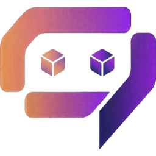

<p align="center">
  
</p>
<h1 align="center">BaaSForge frontend</h1>
<p align="center"><strong>The BaaSForge dashboard, public pages, and documentation.</strong></p>
<p align="center">
  <a href="#local-development">Get started</a> ·
  <a href="#documentation">Documentation</a> ·
  <a href="#contributing">Contribute</a>
</p>

[](LICENSE)
[](https://github.com/BaaSForge/baasforge-frontend-vite)
[](https://github.com/BaaSForge/baasforge-frontend-vite/issues)
[](CONTRIBUTING.md)
[](#community-and-support)

<p align="center">
  <a href="docs/assets/dashboard-conversation.png">
    
  </a>
</p>

The BaaSForge dashboard: project navigation, development conversations, and draft units in one workspace.

## Contents

- [Why BaaSForge?](#why-baasforge)
- [Ecosystem](#ecosystem)
- [Application areas](#application-areas)
- [How it works](#how-it-works)
- [Local development](#local-development)
- [Documentation](#documentation)
- [Production](#production)
- [CI/CD](#cicd)
- [Roadmap](#roadmap)
- [Contributing](#contributing)
- [Community and support](#community-and-support)
- [Code of Conduct](#code-of-conduct)
- [Security](#security)
- [License](#license)

## Why BaaSForge?

BaaSForge is for developers and small teams who want to describe a backend in plain language and ship APIs, workflows, and queue workers to production.

New to BaaSForge? Start with the [main backend repository](https://github.com/BaaSForge/baasforge-backend-actix) for the project introduction and ecosystem setup. This repository is the home of the [documentation site source](docs-site).

React/Vite application with a static Next.js/Nextra documentation site.

> **Naming:** BaaSForge was previously named BAAL. Old paths or configuration that use `BAAL` refer to the same application. Use `BaaSForge` in new code and documentation.

## Ecosystem

The [backend repository](https://github.com/BaaSForge/baasforge-backend-actix) is the main entry point. Use the runtime and frontend repositories for their respective parts of the system.

| Repository | Start here |
| --- | --- |
| [Backend](https://github.com/BaaSForge/baasforge-backend-actix) | Main entry point and control plane |
| [Runtime](https://github.com/BaaSForge/baasforge-runtime-actix) | Execution plane |
| [Frontend](https://github.com/BaaSForge/baasforge-frontend-vite) | Dashboard, public pages, and documentation |

## Application areas

- **Static pages:** `/`, `/careers`, `/pricing`, and legal pages. Source: `src/pages/home/`, `src/pages/careers/`, `src/pages/pricing/`, and `src/pages/legal/`.
- **Dashboard:** `/dashboard/**` after login. Source: `src/pages/dashboard/`. Login is in `src/pages/login/`.
- **Docs:** `/docs/**`. Source: `docs-site/app/`.

The React routes are defined in `src/pages/router.tsx`. Public-page browser entries are in `src/entries/`.

## How it works

- Vite builds the application into `dist/`.
- The build also renders the home, pricing, careers, legal, and 404 pages as static HTML.
- `docs-site` exports the documentation into `docs-site/out/`.
- The Docker image copies both outputs into Nginx.
- Nginx serves public HTML, `/docs`, cached assets, and `app.html` for application routes.
- The browser calls `VITE_API_HOST`. Nginx does not proxy `/api` in production.

`VITE_API_HOST` is compiled into browser code. It is public and cannot contain secrets.

## Local development

Requirements:

- Node.js 22.17.0 (`.nvmrc`)
- npm
- A backend on `http://localhost:1100`, or another reachable API

Install and run:

```bash
nvm use
npm install
cp .env.example .env.local
npm run dev
```

Open `http://localhost:1200`.

For local docs, run this in a second terminal:

```bash
npm install --prefix docs-site
npm run dev --prefix docs-site
```

The main Vite server sends `/docs` to `http://localhost:1220`.

### API proxy and CORS

The default `.env.local` uses `VITE_API_HOST="/api"`. In development, Vite proxies HTTP and WebSocket `/api` requests to `http://localhost:1100`. The browser sees one origin, so browser CORS checks do not apply.

To use a remote backend, set an absolute URL in `.env.local`, then restart Vite:

```env
VITE_API_HOST="https://api.example.com/api"
```

The API client sends cookies. The remote backend must allow the exact frontend origin, credentials, methods, and headers. Its cookies must also use suitable `SameSite`, `Secure`, and domain settings.

Useful commands:

```bash
npm test          # Type-check only
npm run lint      # ESLint; warnings fail
npm run format    # Format src/ and organize imports
npm run build     # Type-check, lint, and build the app
npm run preview
```

There is no automated test suite. See [CONTRIBUTING.md](./CONTRIBUTING.md) for the recommended checks.

## Documentation

Documentation pages are in `docs-site/app/**/page.mdx`. Navigation labels and order are in `docs-site/app/_meta.global.tsx`.

To edit a page, change its MDX file. To add a page, create its route folder and `page.mdx`, then register it in `_meta.global.tsx`.

- Development: start both development servers, then open `http://localhost:1200/docs`.
- Production: open `/docs` on the deployed frontend, such as `https://baasforge.com/docs`.
- Production-like preview: run `npm run build --prefix docs-site && npm run preview:ssr --prefix docs-site`, then open `http://localhost:1221/docs`.

## Production

### Configuration files

- `.env.local`: local override; Git ignores it.
- `.env.stage`: staging API URL used by Docker.
- `.env.prod`: production API URL used by Docker.
- `.env.example`: local environment template.
- `Dockerfile`: builds the Vite app and docs, then creates the Nginx image.
- `nginx.conf`: production domains, TLS, routes, cache, and 404 behavior.
- `nginx.local.conf`: HTTP-only Nginx config for a local container.
- `.github/workflows/deploy.yml`: builds, publishes, and deploys tagged images.

### Set up your server

Requirements:

- Docker
- DNS records for the frontend domain
- A TLS certificate on the host
- A reachable API with credentialed CORS configured
- Ports 80 and 443 available

Before you build:

1. Set your API URL in `.env.prod` or `.env.stage`.
2. Replace `baasforge.com` and the certificate paths in `nginx.conf`.
3. Update the certificate mounts in the run command.

Build and run:

```bash
docker build --build-arg APP_ENV=PROD -t baasforge-frontend .
docker run -d \
  --name baasforge-frontend \
  --restart unless-stopped \
  -p 80:80 \
  -p 443:443 \
  -v /path/to/fullchain.pem:/etc/nginx/tls/fullchain.pem:ro \
  -v /path/to/privkey.pem:/etc/nginx/tls/privkey.pem:ro \
  baasforge-frontend
```

Make the Nginx certificate paths match these mounts. Use `APP_ENV=STAGE` for `.env.stage`.

For an HTTP-only local image:

```bash
npm run docker:build
npm run docker:run
```

This starts the site at `http://localhost:1210`. It uses `.env.stage` by default. `nginx.local.conf` does not proxy the API.

## CI/CD

Deployment starts for these tags:

- `v1.2.3-prod.0` → GitHub `production` environment
- `v1.2.3-stage.0` → GitHub `staging` environment

It can also deploy an existing matching tag from **Run workflow**.

The workflow:

1. Checks out the tag.
2. Builds the Docker image with `APP_ENV=PROD` or `STAGE`.
3. Runs TypeScript, ESLint, the Vite client and SSR builds, static prerendering, and the docs build inside Docker.
4. Stops if any build check fails.
5. Pushes the tagged image to GHCR.
6. Connects to the target host by SSH.
7. Pulls the image and replaces the environment container.
8. Verifies that the container runs with `unless-stopped`.

There is no pull-request workflow, automated test suite, or Prettier check. CI/CD runs only for a deployment tag or a manual deployment. Run the checks in [CONTRIBUTING.md](./CONTRIBUTING.md) before you push.

Set these secrets in each GitHub environment:

- `SSH_HOST`
- `SSH_USER`
- `SSH_PRIVATE_KEY`

The SSH user needs Docker access and permission to start Docker. The host must already contain the certificate directories used in `deploy.yml`. Production and staging need separate hosts unless you change their ports or add an external reverse proxy.

Create and push a release tag:

```bash
git tag v1.2.3-stage.0
git push origin v1.2.3-stage.0
```

See [CONTRIBUTING.md](./CONTRIBUTING.md) before you submit changes.

## Roadmap

Where BaaSForge is heading:

- [ ] Performance & runtime durability
- [ ] Stream processing and WebSocket / realtime units
- [ ] Storage pattern units
- [ ] Monitoring, alerting, and collaboration

<details>
<summary><strong>Explore more planned capabilities</strong></summary>

- Event and schedule triggers
- SDK convenience helpers
- Files and search behaviors
- Unit marketplace
- Third-party integrations

</details>

> These plans are directional. Timing and order may change.

**[Explore the full roadmap →](https://baasforge.com/docs/about/future-plans)**

See [Units](https://baasforge.com/docs/platform/units) for what is available now.

Roadmap documentation lives in [`docs-site/app/about/future-plans/page.mdx`](docs-site/app/about/future-plans/page.mdx).

## Contributing

Read [CONTRIBUTING.md](CONTRIBUTING.md) before opening a pull request.
Documentation fixes, reproducible bug reports, and focused improvements are welcome.
Browse [open issues](https://github.com/BaaSForge/baasforge-frontend-vite/issues), or explain a proposed change before starting substantial work.

## Community and support

- [Report a bug or suggest an improvement](https://github.com/BaaSForge/baasforge-frontend-vite/issues).
- Include reproduction steps and the relevant repository when asking for help.
- If BaaSForge is useful to you, consider starring the repository or sharing what you built.

## Code of Conduct

Read our [Code of Conduct](CODE_OF_CONDUCT.md) for community standards and private reporting instructions.

## Security

Read our [Security Policy](SECURITY.md) to report a vulnerability privately and understand the scope of security maintenance.

## License

Licensed under the [Apache License 2.0](LICENSE).
