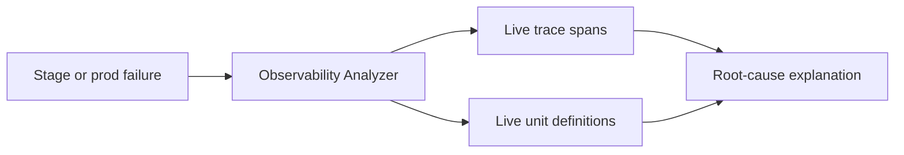

import { Callout, Cards, Details, Steps, Summary, Tabs } from 'nextra/components'

export const metadata = {
  title: 'Advantages',
}

# Advantages

Every platform makes trade-offs. BaaSForge's trade-off is deliberate: **eliminate everything that isn't your product's behavior** — infra, pipelines, boilerplate, and the cognitive overhead of assembling a multi-tool stack — and let AI manage what remains.

Below are the nine categories where that bet pays off.

<Cards>
  <Cards.Card title="Full backend coverage" href="#full-backend-coverage" />
  <Cards.Card title="Zero infrastructure" href="#zero-infrastructure-0" />
  <Cards.Card title="AI owns the code" href="#ai-owns-the-code-and-the-decisions" />
  <Cards.Card title="Costs as you go" href="#transparent-pay-as-you-go-costs" />
  <Cards.Card title="Built-in CI/CD" href="#built-in-cicd--seconds-to-ship" />
  <Cards.Card title="History & rollback" href="#git-like-history-and-rollback" />
  <Cards.Card title="Auto docs & HTTP client" href="#auto-docs--built-in-http-client" />
  <Cards.Card title="Observability" href="#observability--live-tracing" />
  <Cards.Card title="Maintainable architecture" href="#architecture-that-stays-maintainable" />
</Cards>

---

## Full backend coverage

Most platforms answer one question well. Covering multiple questions requires multiple tools — and that toolchain has real cost.

<Tabs items={['With multiple platforms', 'With BaaSForge']}>
  <Tabs.Tab>
    A typical process-heavy backend today assembles:

    | Need | Tool |
    | --- | --- |
    | HTTP APIs | Supabase Edge Functions / custom server |
    | Durable workflows | Temporal (you operate workers + DB) |
    | Background jobs | Separate queue (BullMQ, SQS…) |
    | Per-entity state | Custom locking on Postgres rows |
    | Observability | Third-party APM |
    | Deployment | CI/CD pipeline (GitHub Actions, etc.) |

    Each boundary is integration work, operational surface, and a new failure mode. Teams building multi-pattern backends — fulfillment, billing, reservations, provisioning — spend most of their time on **glue, not product**.
  </Tabs.Tab>
  <Tabs.Tab>
    BaaSForge ships all four compute patterns as first-class **units** in one platform:

    | Unit type | Role |
    | --- | --- |
    | `api` | HTTP entry points — request-scoped |
    | `workflow` | Durable orchestration — crash-resilient, days-long sleeps, human waits |
    | `queue_worker` | Background jobs — retry, DLQ, batch, rate limits |
    | `actor` | Per-entity state — sequential, race-free handlers |

    Units compose across types. An API triggers a workflow; the workflow spawns queue workers and reads actor state. No glue code. No cross-service contracts to maintain.
  </Tabs.Tab>
</Tabs>

<Callout type="important">
  Scenarios where you need more than one compute or state model — multi-step
  money flows, human-in-the-loop approvals, per-entity reservations — become
  expensive or complex when no single platform covers all patterns. BaaSForge
  does. See [What You Can Do With BaaSForge?](/about/what-you-can-do) for
  concrete examples of backends that are hard or costly to assemble elsewhere.
</Callout>

---

## Zero infrastructure (0%)

When your project is created, BaaSForge automatically provisions Stage and Production runtimes. You never configure, scale, or monitor any of the following:

| Engine | Used for | Your involvement |
| --- | --- | --- |
| Redis / NATS | Workflow state, actor mailboxes, queue dispatch | 0% |
| Postgres | Platform persistence, trace storage | 0% |
| Unit workers | API / workflow / queue / actor execution processes | 0% |
| Encryption keys | Per-project runtime secret encryption | 0% |

Engines live **under** the platform. You interact with unit types and SDK primitives — never with connection strings, cluster configs, or capacity plans.

<Callout type="info">
  "Zero infra" means zero infra **forever**, not just at project start. When
  your traffic grows, the platform scales — you don't touch a YAML file or open
  a cloud console.
</Callout>

---

## AI owns the code and the decisions

BaaSForge AI is not a copilot bolted onto an otherwise manual platform. It has full ownership of writing, validating, and debugging every unit in your project.

### Multi-agent pipeline

<Steps>
### Planner

Translates your description into an architecture plan. No raw code is shown to you — only intent and structure.

### Architecture & Solution Analyzers

Evaluate the plan against your existing bounded contexts, dependency graph, and unit contracts before any code is written.

### Developer agent

Writes or modifies units with full knowledge of platform SDK, context layout, and env key names. Discovers existing units and dependencies before mutating anything.

### Technical Reviewer (validation gate)

Every unit passes **compiler → lint → rules** before it is saved. The LLM output is never trusted blindly — no unit row is written until all checks pass.

### Observability Analyzer

When something fails in stage or production, this agent reads your live trace spans alongside your current unit definitions to explain what happened — not just what the code says.
</Steps>

### Chat = historical decision log

Every code change is **scoped to a chat session** and persisted against it. Opening a past conversation shows exactly what was requested, what the AI planned, and what units were written or changed as a result — a human-readable record of every architectural decision your project has ever made.

<Callout type="important">
  The AI has full control over your project's code. It knows your architecture,
  your dependency graph, your live traces, and your env key names. That context
  is what makes debugging and codegen accurate rather than generic.
</Callout>

### Why token usage stays low
LLM cost is proportional to tokens in context. Traditional AI coding assistants pay context tax on:
- Infrastructure configuration (Dockerfiles, k8s manifests, CI YAMLs)
- Framework boilerplate (middleware wiring, ORM setup, server config)
- Cross-service glue code with no business value

BaaSForge removes all of that from the picture. The AI only sees:
- Your bounded contexts and unit graph
- The SDK primitives that match each unit type
- Your business-specific env key names (never secret values)

**The result:** the LLM focuses exclusively on business logic. Context is smaller, prompts are more precise, and fewer tokens are spent on repeated infra boilerplate. That directly reduces your AI usage cost per feature shipped.

---

## Transparent, pay-as-you-go costs

Every cost is metered at the smallest possible unit of work — no flat-rate surprises.

| Cost type | Metered by |
| --- | --- |
| Compute | GB·ms per invocation (1 ms minimum, similar to Lambda pricing) |
| LLM tokens | Input + output tokens per agent call, charged at model rates |
| Storage | Hot and cold storage GB·ms |
| Platform entities | Runtime entity-seconds (projects, actors, workflows in flight) |

<Callout type="info">
  Because BaaSForge eliminates infrastructure complexity from the LLM's context,
  you use **cheaper models** without sacrificing quality. The AI focuses on
  business behavior, not infra boilerplate — so a smaller, faster model is
  sufficient. That keeps AI token costs significantly lower compared to
  general-purpose coding assistants that must reason about your entire stack.
</Callout>

Costs accumulate in real time and are visible in the dashboard at any point during your billing period — no end-of-month surprises.

---

## Built-in CI/CD — seconds to ship

BaaSForge replaces the entire CI/CD setup you would otherwise build and maintain. There are no pipelines to configure, no runners to provision, no minutes billed.

### Secrets and variables

```
/projects/{id}/runtime-env-vars
```

Secrets and environment variables are stored encrypted, scoped per runtime (stage vs production), and surfaced to units via `sdk.getSecureEnv()`. The AI only ever sees key **names** — never values.

### Stage → production in seconds

<Steps>
### Stage release

After the AI validates your units, you click to create a stage release. The platform deploys to your managed stage runtime — no pipeline wait, no Docker build queue. **Seconds, not minutes.**

### Production release

When stage looks good, promote to production with one action. The platform performs a live runtime swap — existing consumers pick up the new release immediately.

### Rollback

Every previous stage and production release is preserved. Reverting is the same click — promote an older revision to production.
</Steps>

| Approach | Time to production |
| --- | --- |
| Traditional CI/CD (build → test → push → deploy) | Minutes to tens of minutes |
| BaaSForge (validate → stage → promote) | Seconds |

---

## Git-like history and rollback

Every release in BaaSForge carries a revision number. Chat sessions snapshot the production baseline at the moment they open, so the AI always knows what is live versus what it is proposing to change.

| Concept | What it maps to |
| --- | --- |
| Commit | A validated set of unit changes tied to a chat session |
| Branch | A chat session working off the current production baseline |
| Tag / release | A stage or production release with a revision number |
| Rollback | Promoting any historical revision back to stage or production |

<Callout>
  If two chat sessions modify overlapping units, BaaSForge detects the conflict
  before deployment and warns you — similar to a merge conflict, without
  requiring you to understand Git internals.
</Callout>

---

## Auto docs & built-in HTTP client

API unit documentation is **generated automatically** from the unit's exported types and route definitions. You don't write or maintain an OpenAPI spec — the platform derives it.

### What you get

- **Per-project docs page** — always reflects the current live release
- **Shareable links** — time-limited, read-only links you can send to partners or teammates without giving them dashboard access
- **Built-in HTTP client** — a Postman-style try-it interface embedded in the docs, pointed at your stage or production endpoint; no separate tooling needed to call and test your API units

<Callout type="info">
  Documentation share links are scoped to API units only and expire on a
  configurable schedule — safe to hand to external consumers during integration
  work.
</Callout>

---

## Observability & live tracing

<Callout type="warning">
  A full **monitoring dashboard** (metrics, alerting, historical charts) is
  **coming soon**. What ships today is live trace querying and AI-powered
  debugging — described below.
</Callout>

### What ships today

| Capability | How it works |
| --- | --- |
| **Live trace query** | Query traces by release or trace ID; lookback up to 15 minutes when querying by release id, unlimited for specific trace id |
| **Secret masking** | Sensitive values are masked in all trace output before the AI or UI ever sees them |
| **Observability Analyzer** | The AI agent fetches your trace spans for a release, combines them with live unit definitions, and explains what happened — why a workflow step failed, what an actor received, where a queue worker retried |

<div style={{ marginTop: '1rem' }} />



The Observability Analyzer is connected to the same multi-agent pipeline. When debugging is needed, the Planner routes the request there automatically — you don't have to navigate a log UI yourself.

---

## Architecture that stays maintainable

Beyond the runtime advantages, BaaSForge enforces structure that keeps large backends understandable.

| Feature | Benefit |
| --- | --- |
| **Bounded contexts** | Units live in `context.module.type.name` paths; AI and humans navigate the same taxonomy |
| **Dependency graph** | Explicit `depends_on` edges let the AI assess impact before changing a unit; prevents silent breakage |
| **Typed cross-unit contracts** | `sdk.callWorkflow`, `sdk.callActor`, `@units/...` imports are typed — the compiler catches contract violations before deploy |
| **Allowlisted runtime libraries** | The reviewer enforces which packages/library are permitted inside units — no supply-chain surprises from AI-generated `import` statements |
| **Validation from unit zero** | The same compiler → lint → rules gate applies to the first unit in a new project and the ten-thousandth. Quality doesn't drift as projects grow |

<Callout type="info">
  All of the above is enforced by the platform, not by team discipline. The
  architecture stays sound whether the project has three units or three
  thousand.
</Callout>

---

## Continue reading

<Cards>
  <Cards.Card title="Who We Are" href="/about/who-we-are" />
  <Cards.Card title="What You Can Do With" href="/about/what-you-can-do" />
  <Cards.Card title="AI Role" href="/platform/ai-role" />
  <Cards.Card title="Releases" href="/platform/releases" />
  <Cards.Card title="Tracing" href="/platform/tracing" />
  <Cards.Card title="Costs & Billing" href="/security-billing/costs" />
  <Cards.Card title="Getting Started" href="/getting-started" />
</Cards>
