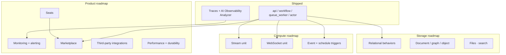

import {
  Callout,
  Cards,
  Details,
  Steps,
  Summary,
  Tabs,
} from 'nextra/components'

export const metadata = {
  title: 'Future Plans',
}

# Future Plans

BaaSForge's roadmap is guided by one goal: become the **only backend platform you need** — compute patterns, storage patterns, observability, collaboration, and distribution — without assembling vendor APIs.

What ships today covers process-heavy and entity-heavy backends. What comes next closes the remaining gaps: faster execution, richer unit types, first-class storage behaviors, production monitoring, team access, a unit marketplace, and third-party integrations.

<Callout type="info">
  Roadmap items below are **directional**. Timing and order can shift as we
  learn from production usage. Shipping status of compute units is always
  authoritative under [Unit Types](/platform/unit-types).
</Callout>

## Where we are today

Four compute unit types are available now. Storage-pattern units, stream/realtime compute, marketplace, seats, and a full monitoring dashboard are still ahead.

<Cards>
  <Cards.Card title="All unit types" href="/platform/unit-types" />
  <Cards.Card title="API Unit" href="/platform/unit-types/api-unit" />
  <Cards.Card title="Workflow Unit" href="/platform/unit-types/workflow-unit" />
  <Cards.Card title="Queue Worker Unit" href="/platform/unit-types/queue-worker-unit" />
  <Cards.Card title="Actor Unit" href="/platform/unit-types/actor-unit" />
  <Cards.Card title="Common Unit" href="/platform/unit-types/common-unit" />
</Cards>

| Available today | On the roadmap |
| --- | --- |
| `api`, `workflow`, `queue_worker`, `actor`, `common` | Stream, WebSocket / realtime |
| Actor state + workflow checkpoints via SDK | SQL, document, graph, object-storage **behavior** units |
| Live trace query + Observability Analyzer | Per-project monitoring dashboard + alerting |
| Owner-only project access | Seats for collaborators |
| AI chat → validated units → stage/prod | Unit marketplace + Zapier-style integrations |

<Callout type="important">
  Design rule for everything below: if a capability needs a new storage or
  compute model, we add a **unit type** or **SDK primitive** — not a leaked
  third-party connection string or vendor SDK surface.
</Callout>

---

## Roadmap at a glance

<Tabs items={['By category', 'By phase']}>
  <Tabs.Tab>
    | Category | Highlights |
    | --- | --- |
    | [Performance & durability](#performance--runtime-durability) | Faster units; lower delay across all unit types |
    | [New compute units](#new-compute-units) | Stream processing; WebSocket / realtime |
    | [Triggers & metadata](#triggers--cross-cutting-runtime) | Event triggers (`sdk.emit`); schedule / cron on any unit |
    | [SDK patterns](#sdk-patterns--helpers) | Convenience helpers (locks, circuit breakers, rate limiting, cache-aside) |
    | [Storage pattern units](#storage-pattern-units) | Relational, document, graph, object storage — as behaviors, engines hidden |
    | [Platform behaviors](#platform-behaviors-files-search) | Files, vector / search as platform primitives |
    | [Monitoring & alerting](#monitoring--alerting) | Per-project dashboards; threshold-based alerts |
    | [Collaboration](#collaboration--seats) | Seats for non-owner developers on a project |
    | [Marketplace](#unit-marketplace) | Publish and buy battle-tested units |
    | [Integrations](#third-party-integrations) | Zapier-style wiring to external APIs |
  </Tabs.Tab>
  <Tabs.Tab>
    <Steps>
    ### Foundation (shipped)

    API, workflow, queue worker, actor, common units; chat-tied releases;
    technical reviewer gate; live traces + AI debug.

    ### Stateful + realtime compute

    Stream processing and WebSocket / realtime units; event and schedule
    triggers that multiply every existing unit type.

    ### Storage as behaviors

    Relational, document, graph, and object-storage pattern units — engines
    managed under the platform, never sold as raw DB APIs.

    ### Operate & collaborate

    Monitoring dashboards, alerting, seats, marketplace, third-party
    integrations; ongoing latency and durability work.
    </Steps>
  </Tabs.Tab>
</Tabs>

---

## Performance & runtime durability

We have plans to increase the speed and reduce the delay of all units.

<Callout type="warning">
  Durability upgrades are internal. Your unit code and SDK stay the same; the
  platform strengthens the engines underneath.
</Callout>

---

## New compute units

New unit types earn a place only when they introduce a **distinct** computation, lifecycle, or connection model. Patterns that fit existing types become triggers or SDK helpers instead.

### Planned compute unit types

| Unit type | What it uniquely adds | Typical use |
| --- | --- | --- |
| **Stream processing** | Continuous, windowed aggregation over unbounded event flows | Fraud scores, analytics projections, CQRS read models |
| **WebSocket / realtime** | Persistent bidirectional client connections | Live dashboards, chat, collaborative cursors, push to devices |

See [Unit Types](/platform/unit-types) for everything available **now**.

  
Why cron is a trigger — not its own unit type

  Scheduled / cron uses the same computation as any other unit; only the wake
  source differs. It lands as a trigger mode, not a separate type.

<Callout type="info">
  WebSocket units build on actor-style durable room/session state. Stream units
  unlock projections that CQRS-style patterns need.
</Callout>

---

## Triggers & cross-cutting runtime

Triggers multiply every unit type without adding new types.

| Capability | How it works |
| --- | --- |
| **Event triggers** | Any unit declares `metadata.triggers` for `order.created` (or wildcards); shared consumer dispatches via on-the-fly release lookup |
| **Schedule / cron** | Cron expressions as a trigger mode on any unit — not a separate “cron unit” |
| **Cross-cutting metadata** | `timeout`, `rateLimit`, `concurrency`, `tags` enforced by shared middleware before code runs |
| **`sdk.emit`** | Platform event bus so units wake each other without custom brokers |

---

## SDK patterns & helpers

| Item | Role |
| --- | --- |
| Convenience helpers | Distributed locks, circuit breakers, rate limiting, cache-aside — optional sugar |

---

## Storage pattern units

Engines (SQL, NoSQL, graph, object stores, messaging) will run **under** the platform — provisioned and scaled by us — the same way workflow state already lives in Redis/NATS without you managing clusters.

What we will **not** ship: “here is your Postgres connection string; write queries.”

### Planned storage behaviors

| Pattern | Direction | Not this |
| --- | --- | --- |
| **Relational / SQL** | Record / aggregate-style units + SDK behaviors | Exposed `postgres.query()` API |
| **Document / NoSQL** | Document-shaped persistence as a unit/SDK model | Bring-your-own Mongo connection |
| **Graph** | Graph-shaped domain units for relationship-heavy domains | Raw Cypher in user code |
| **Object storage** | File / blob persistence as a first-class behavior | Hand-rolled S3 buckets + IAM |
| **Messaging** | Platform bus + future messaging behaviors | User-operated Kafka clusters as the product |

<Cards>
  <Cards.Card title="Current compute units" href="/platform/unit-types" />
</Cards>

<Callout type="important">
  Vision: BaaSForge alone is enough for a complete backend. External DB
  products are a transition option for some teams — not the target
  architecture.
</Callout>

---

## Platform behaviors (files, search)

Alongside storage units, capabilities that competitors expose as separate products land as **platform-native behaviors**:

| Behavior | Roadmap shape |
| --- | --- |
| **Files** | File persistence tied to object-storage behaviors |
| **Vector / search / RAG** | Search behavior units — not exposed pgvector SQL |

---

## Monitoring & alerting

Live trace query and the Observability Analyzer already ship. The next step is a **production monitoring surface** every project owner can use without an external APM.

### Per-project monitoring dashboard

For production (and stage) runtimes, a dashboard that shows **how each unit performs**:

- Response time (p50 / p95 / p99) per unit and route
- Uptime / availability for trigger endpoints
- Throughput, error rate, retry / DLQ activity (queue workers)
- Workflow suspend / complete / fail rates
- Actor mailbox depth and alarm activity

Tied to the same OpenTelemetry / W3C trace identity used by the debug agent — one correlation story from entry unit through downstream calls.

### Alerting

Threshold-based alerts on those metrics:

| Example | Threshold idea |
| --- | --- |
| Latency | Alert when API p95 exceeds *N* ms for *M* minutes |
| Errors | Alert when error rate exceeds *X%* |
| Uptime | Alert when availability drops below *Y%* |
| Queues | Alert when DLQ depth or age crosses a limit |

Channels (email, webhook, chat) and per-project ownership of alert rules come with this layer.

<Callout type="warning">
  Full metrics charts and alerting are **planned**. Today you can query live
  traces and ask the AI what failed — see
  [Tracing & Debugging](/platform/tracing) and
  [Advantages → Observability](/about/advantages#observability--live-tracing).
</Callout>

---

## Collaboration & seats

Projects are owner-scoped today. **Seats** let owners grant access to non-owner users so teammates can contribute without sharing credentials.

| Capability | Intent |
| --- | --- |
| **Invite by seat** | Add developers who are not the billing owner |
| **Project-scoped access** | Collaborate on one project without access to the owner’s other projects |
| **Role-appropriate actions** | Contribute to chat, units, and releases under clear permissions |

Built for agencies, co-founders, and hired developers who need to ship on a specific BaaSForge project.

---

## Unit marketplace

Publish battle-tested units; others install them into a project — often **faster and more reliable than generating the same logic from chat**.

<Steps>
### Author & harden

Build units on BaaSForge, validate through the technical reviewer, run them in production.

### Publish

List a unit (or a small pack of related units) on the marketplace with versioning, pricing, and docs.

### Install

Buyers add the unit to their project graph — typed contracts and `depends_on` edges included — and go live without re-deriving the architecture from an LLM prompt.
</Steps>

| Why it matters | |
| --- | --- |
| **Speed** | Skip chat → plan → generate for common patterns |
| **Reliability** | Install code already proven under real traffic |
| **Composition** | Marketplace units remain normal units in your dependency graph |

---

## Third-party integrations

Zapier-style integration support so projects connect to external SaaS and APIs without custom glue in every unit.

| Direction | Examples |
| --- | --- |
| **Outbound actions** | Create a Stripe charge, post to Slack, sync a CRM row |
| **Inbound triggers** | Wake a workflow or queue worker when an external system fires |
| **Managed credentials** | Store provider tokens as project secrets; units never hard-code keys |
| **Composable with units** | Integrations trigger or are called from api / workflow / worker / actor units |

This complements — not replaces — first-class unit types. External systems stay at the edge; your core backend stays in BaaSForge behaviors.

---

## How categories fit together

---

## Principles that won’t change

1. **Behaviors over engines** — users model units and SDK calls; the platform picks and runs engines.
2. **No redundant unit types** — only distinct computation / lifecycle / connection models become types.
3. **Shared infra at pod scale** — deploy updates release data; shared consumers look up metadata on the fly.
4. **AI stays grounded** — every new type gets prompts, lint rules, and reviewer checks so codegen stays valid.
5. **Enough alone** — the long-term product is a complete backend, not a glue layer beside another BaaS.

---

## Continue reading

<Cards>
  <Cards.Card title="Who We Are" href="/about/who-we-are" />
  <Cards.Card title="What You Can Do With" href="/about/what-you-can-do" />
  <Cards.Card title="Advantages" href="/about/advantages" />
  <Cards.Card title="Unit Types" href="/platform/unit-types" />
  <Cards.Card title="Tracing & Debugging" href="/platform/tracing" />
</Cards>
