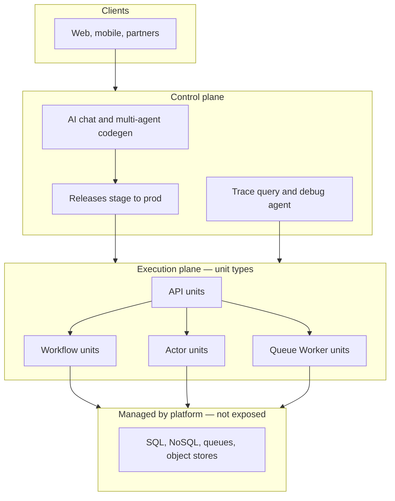
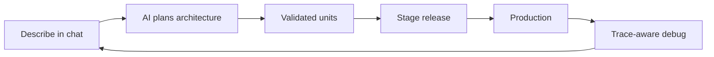
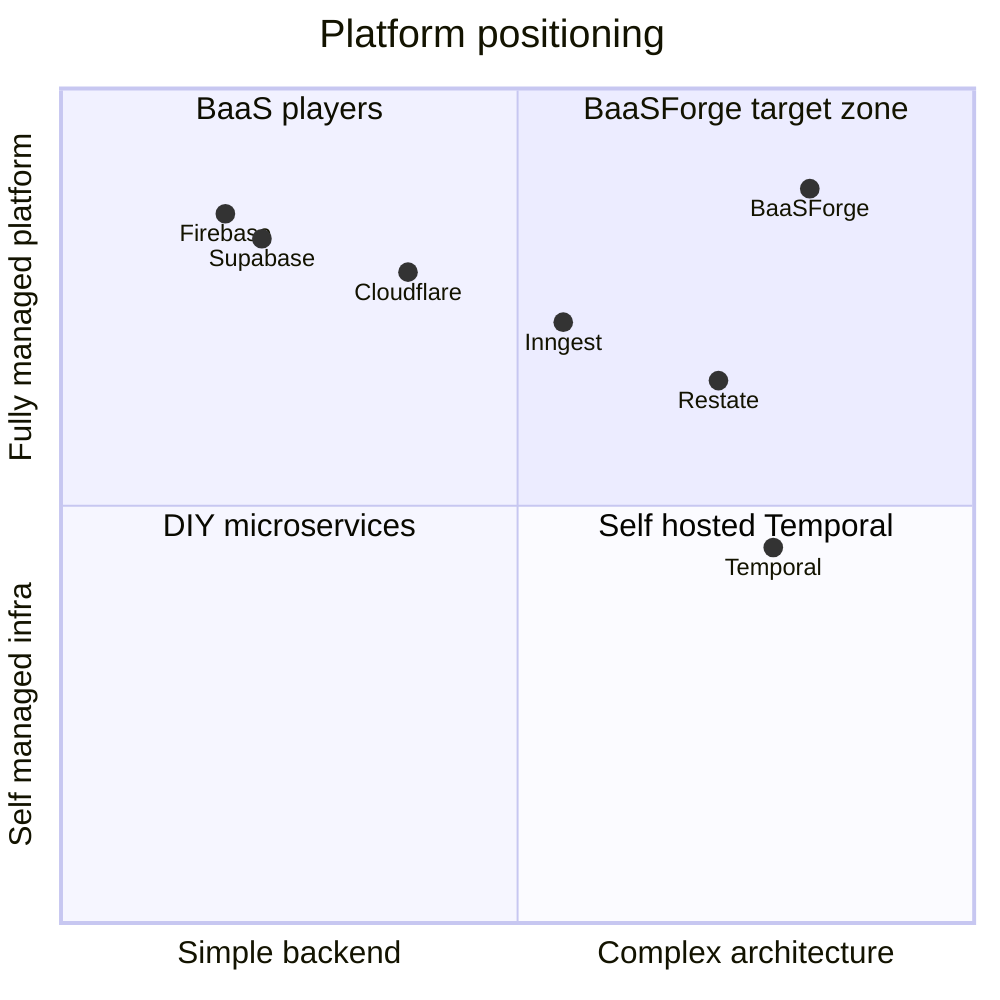

import {
  Callout,
  Cards,
  Details,
  FileTree,
  Steps,
  Summary,
  Tabs,
} from 'nextra/components'

export const metadata = {
  title: 'Who We Are',
}

# Who We Are

**BaaSForge is a backend architecture platform** — a managed application
runtime where distributed-system patterns (workflows, queue workers,
actors, APIs) are typed **units** in a bounded architecture, not
infrastructure projects you assemble yourself.

Supabase exposes Postgres. Temporal exposes a workflow engine. BaaSForge
exposes **backend behaviors** — through unit types that normalize storage
and compute, so you don't assemble a stack.

<Callout type="important">
  Actually BaaS is only part of what we do. We are a **behavior-first** platform —
  compute, storage, workflows, deploy, and debug as unit types and
  SDK primitives, not a stack you assemble or a single product category.
</Callout>

## What different platforms answer to

| Platform | Answers |
| --- | --- |
| Supabase / Firebase | *How do I expose and query my database?* |
| Temporal | *How do I run one durable workflow engine?* |
| **BaaSForge** | *How do I build any backend app from behaviors — compute, storage patterns, deploy, debug — without assembling a stack?* |

## Two systems, one product

BaaSForge is a **control plane** and an **execution plane** working as
one product. You interact with the dashboard; your code runs on managed
runtimes (stage + production per project).

| Layer | Role |
| --- | --- |
| **Control plane** | Dashboard API, auth, multi-agent chat, releases, billing, trace query |
| **Execution plane** | Unit runtime, workflow / queue / actor workers, traces export |

<div style={{ height: '1.5rem' }} />



<Callout type="info">
  BaaSForge is designed to be the **only backend platform** you need.
  Under the hood we may run Redis, NATS, SQL, or other engines — but you
  never get a “Postgres API.” You get unit types and SDK behaviors.
</Callout>

## Core primitive: the unit

Every capability — compute or storage — is a **unit**: a TypeScript /
JavaScript function with a four-segment path:

```
{context}.{module}.{unit_type}.{unit_name}
```

Example: `billing.payments.workflow.charge`

| Unit type | Role | Model |
| --- | --- | --- |
| `api` | HTTP entry points | Request-scoped, synchronous |
| `workflow` | Durable orchestration | Multi-step, crash-resilient |
| `queue_worker` | Background jobs | Pull-based, retry / DLQ / batch |
| `actor` | Stateful entities | Per-instance mailbox + state |

Units live in **bounded contexts** and form an explicit **dependency
graph** — so both humans and AI can reason about large backends without
scanning every file.

<div style={{ marginTop: '1.5rem' }}>
  <Cards.Card title="See all unit types" href="/platform/unit-types" arrow />
</div>

## How the product works

<Steps>
### Describe the backend in chat

Open a project conversation and describe the behavior you need —
fulfillment, dunning, approvals, entity state, and more.

### AI plans and writes validated units

A multi-agent pipeline (Planner → Architecture / Solution analyzers →
Developer) writes units grounded in our SDK. Nothing is saved until
typecheck, lint, and some technical rules pass.

### Stage, then production

Releases are born in chat sessions. Promote stage → production on
managed runtimes. Roll back from release history when needed.

### Debug from real traces

When something fails, the Observability Analyzer reads stage / production
traces with live unit definitions — not just static code review.
</Steps>



## AI-native by design

Most platforms give you primitives **or** a generic copilot. BaaSForge
connects both: the LLM is grounded in our unit types, SDK, and runtime —
not a bolt-on assistant.

| Capability | What it means |
| --- | --- |
| **Multi-agent chat** | Planner, Architecture Analyzer, Solution Analyzer, Developer, Observability Analyzer — each with its own tools and context |
| **Runtime-aware codegen** | Creates / modifies / removes units with gated discovery of contexts, units, and env keys |
| **Pre-deploy gate** | Compiler → lint → rule check before any unit row is written |
| **Chat-scoped releases** | Git-like history tied to conversations; stage before prod; rollback |
| **Trace debugging** | AI explains failures from real stage / production spans |

<Callout>
  The AI doesn't just write code — it writes **your** architecture,
  validates it against **your** rules, you ship it to **your** stage or
  production, and AI can explain failures from **your** traces.
</Callout>

## Where we sit



### Philosophy contrast

| | Exposed-database BaaS | BaaSForge |
| --- | --- | --- |
| Developer writes | SQL, RLS, REST consumers | Units + SDK (AI-authored) |
| Mental model | “My Postgres project” | “My contexts and unit graph” |
| Data access | Engine APIs | Behaviors — engines stay underneath |
| Long-running logic | DIY glue | Native workflow / worker / actor units |

### Execution peers

| | Temporal / Inngest / Restate | BaaSForge |
| --- | --- | --- |
| Scope | Workflow / steps / durable objects | Full application runtime |
| Primitives | One primary model | `api` + `workflow` + `queue_worker` + `actor` |
| Operations | You run workers / clusters | Platform runs the workers |
| Structure | Your repos | Bounded contexts + dependency graph |
| AI | None or external | Dashboard agents + traces |

<Details>
  <Summary>Messaging we use — and what we avoid</Summary>

  **Use:** “Backend architecture platform — behaviors as unit types, not
  a stack of vendor APIs.”

  **Avoid:**

  | Stop saying | Say instead |
  | --- | --- |
  | “Supabase-like” | Behavior-first backend — not exposed Postgres |
  | “Complements Supabase” | Complete backend platform via unit types |
  | “Bring your own Postgres” | Engines managed underneath; you write units |
  | “BaaS” | Backend architecture platform |
  | “Better than Temporal at workflows” | Temporal-class durability, plus workers, actors, and structure |
</Details>

## Who we're for

**Primary ICP:** Teams with process-heavy backends who outgrew Edge
Functions + cron + queue tables, but won't hire a platform team or
operate Temporal.

Signals that fit:

- Multi-step money flows (billing, fulfillment, payouts)
- Waits for humans or external systems (hours to days)
- Per-entity state (cart, room, tenant provisioning)
- Dozens to thousands of backend functions getting messy
- Evaluating Temporal + separate workers + a custom event bus

<Callout type="warning">
  **Anti-fit (today):** Teams that want raw SQL control and table-first
  modeling with no interest in unit architecture. New storage-pattern units
  are on the roadmap — until then, a table-centric BaaS may fit better
  for pure CRUD.
</Callout>

## Platform shape (under the hood)

What users see vs. what the platform runs:

<FileTree>
  <FileTree.Folder name="BaaSForge" defaultOpen>
    <FileTree.Folder name="control-plane (users see)" defaultOpen>
      <FileTree.File name="dashboard + auth" />
      <FileTree.File name="multi-agent chat" />
      <FileTree.File name="releases + technical reviewer" />
      <FileTree.File name="trace query + billing" />
    </FileTree.Folder>
    <FileTree.Folder name="execution-plane (hidden from users)" defaultOpen>
      <FileTree.File name="api / workflow / queue / actor workers" />
      <FileTree.File name="QuickJS unit runtime" />
      <FileTree.File name="@sdk primitives" />
      <FileTree.File name="traces export" />
    </FileTree.Folder>
    <FileTree.Folder name="managed-engines (hidden from users)" defaultOpen>
      <FileTree.File name="Redis · NATS · Postgres (platform-owned)" />
    </FileTree.Folder>
  </FileTree.Folder>
</FileTree>

## Bottom line

BaaSForge is not “Supabase for workflows” and not “Temporal with a UI.”

- **Category:** Backend architecture platform (behavior-first, not stack-first)
- **Wedge today:** AI-native codegen + durable unit types + trace-aware debugging
- **Vision:** The only backend tool needed — engines managed under unit types, not sold as separate products

## Continue reading

<Cards>
  <Cards.Card title="What You Can Do" href="/about/what-you-can-do" />
  <Cards.Card title="Advantages" href="/about/advantages" />
  <Cards.Card title="Glossary" href="/platform/glossary" />
  <Cards.Card title="AI Role" href="/development/ai-role" />
  <Cards.Card title="Unit Types" href="/platform/unit-types" />
  <Cards.Card title="Getting Started" href="/getting-started" />
</Cards>
