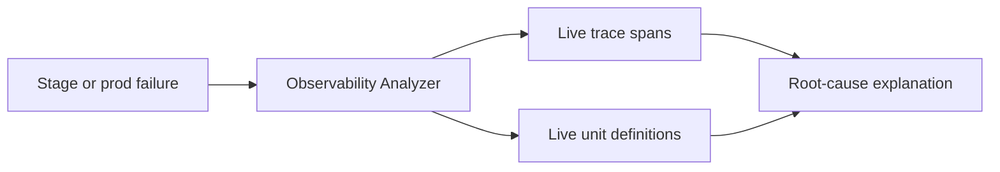

import { Callout, Cards, Collapse, Details, Steps, Summary, Tabs } from 'nextra/components'

export const metadata = {
  title: 'Why Still Needed',
}

# Why BaaSForge Still Is Needed Despite the Growth of LLMs?

LLMs can write backend code faster than any human team. So why doesn't "ChatGPT + a server" replace a platform like BaaSForge?

The answer isn't the code. It's everything around the code.

<Callout type="important">
  An LLM produces text. A running backend requires servers, databases, queues,
  secrets management, CI/CD, monitoring, and debugging tools — all wired
  together, all maintained over time. That gap doesn't shrink as models get
  smarter.
</Callout>

---

## The real cost of AI-written backends

Most people underestimate what "writing a backend with an LLM" actually means end-to-end.

<Tabs items={['What the LLM does', 'What you still need']}>
  <Tabs.Tab>
    The LLM writes code — functions, route handlers, business logic. With a good
    AI IDE and clear prompts, it can produce working TypeScript or Python in
    seconds.

    That part is genuinely fast and cheap. And it keeps improving.
  </Tabs.Tab>
  <Tabs.Tab>
    After the code exists, you still need:

    | Requirement | What it takes |
    | --- | --- |
    | A server to run the code | Provision, configure, scale, secure |
    | A database | Schema design, migrations, connection pooling, backups |
    | A message queue | Deploy, monitor, handle dead-letter queues |
    | CI/CD | Write pipelines, configure runners, manage secrets |
    | Observability | APM service, log aggregation, alert rules |
    | Git + code review | Repository hosting, branch strategy, deployment hooks |
    | An AI IDE | Separate subscription (Cursor, Copilot, etc.) |

    None of this is written by the LLM. All of it requires configuration, uptime,
    and ongoing maintenance from you.
  </Tabs.Tab>
</Tabs>

---

## Five reasons the stack problem isn't solved by smarter models

### 1. LLM costs stay high when the context is polluted

When you use a general-purpose AI IDE against a real backend project, the model
sees everything: Dockerfiles, Kubernetes manifests, CI YAML, ORM configuration,
middleware wiring, environment scaffolding, and the actual business logic buried
inside all of that.

Every token spent on boilerplate is a token that costs money and dilutes
accuracy. Models have to be large — and expensive — to reason about your entire
stack simultaneously.

BaaSForge eliminates infrastructure from the AI's context entirely. The LLM
only sees:

- Your bounded contexts and unit graph
- The SDK primitives matched to each unit type
- Your environment key names (never values)

That narrower context means cheaper models produce more accurate output.
[See exactly why token usage stays low →](/about/advantages#why-token-usage-stays-low)

<Callout type="info">
  BaaSForge uses cheaper models than a general AI IDE — not because accuracy is
  sacrificed, but because there is no infrastructure noise for the model to
  reason through. Business logic is all it sees.
</Callout>

---

### 2. Code is the smallest part of deploying a backend

Even perfect code doesn't run until you have somewhere to run it.

<Steps>
### Provision compute

A server, container cluster, or serverless platform. Each has its own IAM,
networking rules, and scaling configuration.

### Provision a database

Schema migrations, connection strings, pool sizing, backup schedules, read
replicas for production — every change in your data model requires coordinated
migration management.

### Add a message queue

Workflows that span multiple steps, background jobs, retry logic — all of this
requires a separate queue system (RabbitMQ, SQS, BullMQ, NATS) with its own
deployment and monitoring.

### Wire secrets

Every service needs credentials from every other service. Managing encrypted
secrets across environments, rotating them safely, and making sure the AI never
sees a live secret value requires dedicated tooling.

### Maintain all of it

Server patches, database version upgrades, queue broker restarts, certificate
renewals. None of this is a one-time task — it recurs indefinitely.
</Steps>

BaaSForge provisions all of this automatically when a project is created and
scales it transparently as traffic grows. You never touch a connection string or
a cluster config — not at launch, not at 10× traffic.

---

### 3. Multiple platforms add up faster than expected

Running a full backend with an AI IDE today means subscribing to and
maintaining several separate services simultaneously.

| Platform | Purpose | Monthly cost (typical) |
| --- | --- | --- |
| AI IDE (Cursor, Copilot) | Write code | $20–40 / seat |
| Cloud server (EC2, Fly.io) | Run the backend | $50–200+ depending on size |
| Database (RDS, Neon, PlanetScale) | Persist data | $25–100+ |
| Message queue (CloudAMQP, Upstash) | Async jobs and workflows | $20–80+ |
| CI/CD (GitHub Actions, GitLab) | Deploy pipelines | $0–50+ |
| Observability (Datadog, New Relic) | Monitor and debug | $50–300+ |
| **Total** | | **$165–770+ per month** |

These platforms are not integrated. Data flows between them only through
configuration you write and maintain. When something breaks, you debug across
all of them.

<Callout type="warning">
  Beyond the monthly cost, each platform boundary is an integration point that
  can fail independently. A CI/CD misconfiguration can prevent the AI-written
  code from ever reaching production. An observability gap means failures are
  invisible until a user reports them.
</Callout>

BaaSForge replaces the entire column above with one subscription. Code,
deployment, runtime, tracing, and AI are in the same system by design — not
stitched together by configuration.

---

### 4. Pay-per-use only when something uses it

Traditional infrastructure charges whether your backend is busy or idle.

<Tabs items={['Traditional model', 'BaaSForge model']}>
  <Tabs.Tab>
    A Postgres instance on RDS runs 24/7. An EC2 server runs 24/7. You pay for
    reserved capacity whether a single request arrives or ten thousand.

    For early-stage products or low-traffic periods, the baseline cost of
    provisioned infrastructure is the same as peak-load cost. You pay full price
    to be ready for traffic that may not come.
  </Tabs.Tab>
  <Tabs.Tab>
    BaaSForge meters at the smallest possible unit of work:

    | Cost type | Metered by |
    | --- | --- |
    | Compute | GB·ms per invocation — zero when idle |
    | LLM tokens | Input + output tokens per agent call |
    | Storage | Hot and cold GB·ms |
    | Platform entities | Runtime entity-seconds for active workflows and actors |

    Idle time costs nothing. You scale from zero without reconfiguring anything.
  </Tabs.Tab>
</Tabs>

<Callout type="info">
  The cost difference is largest when traffic is low. A server sitting at 1%
  utilization still charges full price. A BaaSForge project at 1% utilization
  charges 1% of active-load cost.
</Callout>

---

### 5. Monitoring and debugging require a connected system

When code the AI wrote breaks in production, you need to understand what
happened. That requires:

1. A running observability stack (traces, logs, metrics)
2. Access to that stack from within the AI IDE
3. Enough context for the AI to reason about the failure

  
What this looks like with a generic AI IDE

  You have Cursor (or Copilot) open in one window. Your application throws an
  error in production. You open Datadog (or whatever APM you've configured) in
  another window, find the relevant trace, copy the stack trace and span data,
  paste it into the IDE chat, and ask the AI to explain what happened.

  The AI has never seen your production trace data before this moment. It reasons
  from the pasted snippet in isolation.

  That workflow is slow, manual, and produces generic answers.

BaaSForge connects observability to the AI by default. The Observability Analyzer
agent fetches live trace spans directly from your stage or production runtime,
combines them with your current unit definitions, and explains what happened — in
the context of your actual architecture.

You don't navigate a log UI or paste anything. The agent routes there
automatically when the Planner detects a debugging request.

---

## Side-by-side summary

| Problem | Generic AI IDE + own stack | BaaSForge |
| --- | --- | --- |
| LLM context size | Full stack (expensive, noisy) | Business logic only (cheap, precise) |
| Server + DB + queue | You provision and maintain | Auto-provisioned, auto-scaled |
| Number of platforms | 5–7 separate subscriptions | One |
| Idle infrastructure cost | Full price 24/7 | Zero when idle |
| Debug from production traces | Manual copy-paste into chat | Observability Analyzer built-in |
| CI/CD pipeline | You write and maintain | Validate → stage → promote in seconds |
| Architecture coherence | Your responsibility | Enforced by unit types and dependency graph |

---

## What this means in practice

<Callout>
  LLMs are genuinely better at writing code than they were two years ago, and
  they will keep improving. BaaSForge benefits from that — the AI that writes
  your units gets more capable every model generation.

  What doesn't get solved by a smarter model is the cost of a six-platform stack,
  idle infrastructure billing, cross-service wiring, and the absence of
  production-trace context at debug time. Those are platform problems, not model
  problems.
</Callout>

BaaSForge exists because the value of AI-written backend code is only realized
when the code has somewhere to run, a way to deploy, a way to fail gracefully,
and a way to explain failures. That complete loop — write, validate, deploy,
monitor, debug — is what the platform provides.

---

## Continue reading

<Cards>
  <Cards.Card title="Advantages" href="/about/advantages" />
  <Cards.Card title="What You Can Do With BaaSForge" href="/about/what-you-can-do" />
  <Cards.Card title="AI Role" href="/platform/ai-role" />
  <Cards.Card title="Costs & Billing" href="/security-billing/costs" />
  <Cards.Card title="Observability" href="/platform/tracing" />
  <Cards.Card title="Getting Started" href="/getting-started" />
</Cards>
