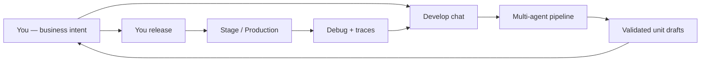
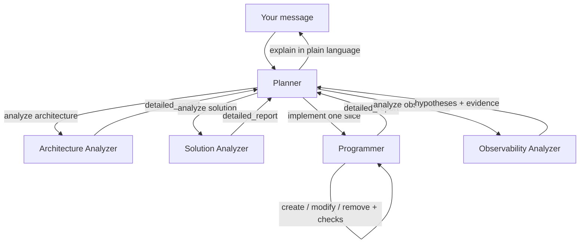
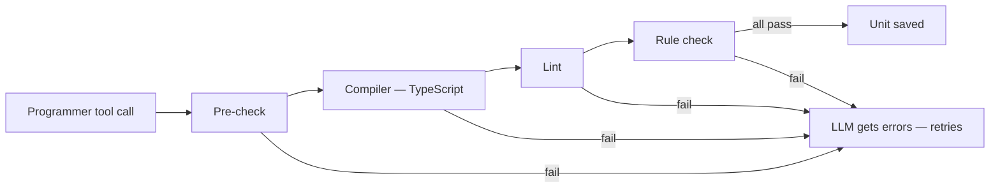

import {
  Callout,
  Cards,
  Details,
  Steps,
  Summary,
  Tabs,
} from 'nextra/components'

export const metadata = {
  title: 'AI Role',
}

# The Role of AI

BaaSForge AI is not a coding assistant bolted onto an IDE. It is the **development team** for your backend: it understands business intent, owns technical design, writes units, validates them against platform rules, and helps you debug live behavior — while **you** decide what ships.

<Callout type="important">
  There is **no IDE** and **no code editor** for units. You never write or edit unit TypeScript yourself. You describe product behavior in chat; the AI authors every unit. The AI is trained on platform rules, and the technical reviewer enforces them — you do not need to prompt technical coding rules.
</Callout>

---

## The goal: business language in, working backend out

Other platforms ask you to think like an engineer: pick frameworks, wire infrastructure, debug stack traces, and keep conventions consistent. BaaSForge flips that.

| You focus on | The AI + platform own |
| --- | --- |
| What the product should do | Which unit types to use and how they compose |
| Domain language (orders, payouts, tenants…) | [SDK](/platform/sdk) usage, typed paths, exports, imports |
| Outcomes and edge cases in product terms | Retries, durability, isolation, crash recovery |
| Approving what goes live | Compiler → lint → rule checks before anything is saved |
| Releasing and rolling back | Architecture placement (bounded contexts, modules, dependency graph) |

Think of the AI as a team that **understands business** and **owns technical concepts and concerns**. You should not need to refer to technical rules, infrastructure, or debugging rituals for the platform itself — only your product behavior.

<Callout type="info">
  **You do not need to ask the AI to follow technical rules.** The AI is trained on import shapes, unit contracts, sandbox limits, SDK patterns, and naming conventions — and the platform re-checks them automatically. Speak in product terms; training plus validation already cover the technical layer.
</Callout>

---

## What you never need to do

| Skip this | Why |
| --- | --- |
| Write or edit unit code | No editor exists — AI authors all units |
| Teach the AI DDD / SDK / unit contracts | Already trained and enforced |
| Paste infra configs, Dockerfiles, CI YAML | Platform removes that noise from context |
| Hardcode secrets in chat or code | AI never sees secret values; units use `sdk.getSecureEnv` |
| Ask AI to release, stage, or roll back | Shipping authority stays with you in the UI |
| Manually type-check or lint units | Technical reviewer runs before any unit row is saved |
| Debug platform infra | You debug **your** traces; AI explains them in plain language |

---

## How you interact with the AI

### Build and change units

<Steps>
### Open Develop

Select project → sidebar **Develop** → start a new conversation (or open one under **Previous conversations**).

### Describe business behavior

Example: *“When checkout succeeds, charge the card, reserve inventory, and email the receipt. If payment fails after inventory is reserved, undo the reservation.”*

No unit types, SDK method names, or export contracts required — say what should happen.

### Watch the agents work

Chat shows steps such as **Analyzing architecture**, **Analyzing solution**, **Implementing solution**, then unit create/modify rows with **Pre-check → Compiler → Lint → Rule check**. Expand a step for details; open a unit card for explanation and read-only diff.

### Review drafts

Use **View changes** on the release controller (or conversation sidebar) to compare before/after. Code is view-only (Split / Inline / Current) — you cannot edit it; ask the AI for further changes instead.

### You release

In the same Develop thread, use the release controller: **Release Stage** → pick a runtime → **Deploy**, then later **Release production**. The AI prepares drafts; it cannot publish.
</Steps>

### Ask about failures (Debug)

<Steps>
### Capture a trace

Call a live unit (Select project → **Runtimes** → runtime → **Open Units** → **Live interaction**, or **Units & Releases** for production). Copy **`X-Trace-Id`** from the response headers.

### Start Debug

Select project → sidebar **Debug** → **Start Debug** → **by trace id** (paste IDs) or **by release** (stage/production + revision) → **let's start**.

### Describe the symptom

The composer opens with debug context attached. Explain what went wrong in product terms; the Observability Analyzer reads traces and unit definitions and returns ranked hypotheses in plain language.
</Steps>

You can also attach debug context from the Develop composer: **+ Add to message** → **Debug context**. After HTTP tests in Live interaction, the dashboard can stream the run into assistant context without pasting (*“Your test run is already in the assistant's view”*).

### Variables the AI may need

Select project → **Variables**. Add plain or encrypted keys per runtime. The AI can discover **key names** (and whether a key is encrypted) — never values. If a plan needs a missing key, the Planner stops and asks you to add it before implementation continues.

---

## How the multi-agent team works

BaaSForge uses **five specialized agents**. Complex work is delegated to **separate LLM calls with separate conversation history**, so the main orchestrator stays focused while specialists dig deep.

| Agent | Role |
| --- | --- |
| **Planner (Orchestrator)** | Talks with you; coordinates the other agents; never dumps raw code |
| **Current Architecture Analyzer** | Maps **existing** units, how they communicate today, gaps and conflicts |
| **Solution Analyzer** | Chooses approaches and trade-offs before any code change |
| **Programmer** | Creates / modifies / removes units against the agreed plan |
| **Observability Analyzer** | Reads live traces and unit definitions to diagnose failures |

Sub-agents do **not** see your main chat thread or each other’s nested history. Each tool call starts a fresh nested run. When finished, a specialist returns one consolidated report; the Planner decides the next step and explains it to you in plain English.

### Build pipeline (gated)

<Steps>
### Architecture

Planner → **Analyzing architecture**. Fact-finding only: current units, communication, conflicts — not the implementation plan.

### Solution

Unlocked only after architecture finishes. Planner → **Analyzing solution**. Units to create/modify/delete, sequencing, risks.

### Implementation

Unlocked only after solution finishes. Planner may call the Programmer **several times**, one slice at a time, following the solution’s sequencing. Each slice runs create/modify/remove through the validation gate.

### Your summary

Planner reports what changed in product language. You review diffs and release when ready.
</Steps>

### Observability path (parallel)

When you report errors or attach a trace/release, the Planner calls the Observability Analyzer instead of (or in addition to) the build pipeline. That agent does not write units; it diagnoses. The Planner then explains findings and, if you ask, starts a fix through the normal architecture → solution → implement path.

---

## How the AI is trained on BaaSForge

Unlike general AI IDEs that must ingest your whole repo (infra, CI, frameworks, glue), BaaSForge AI is trained on a **closed, platform-owned surface**:

| Training surface | What it contains |
| --- | --- |
| Per–unit-type training | When to use each type, contracts, exact `sdk.*` signatures, code examples, runtime trigger docs |
| Full [SDK](/platform/sdk) | Typed unit paths, branded instance ids, sync helpers, env access |
| Platform rules | Imports, exports, naming, sandbox limits — the Programmer is trained on these |
| Your project graph | Bounded contexts, modules, units, `depends_on` from imports |
| Env key names | Names only — never secret values |
| Allowlisted packages / `node:*` | What the sandbox actually allows |

That focus has two user-facing effects:

1. **Higher outcome with cheaper, faster models** — context is business + SDK + your graph, not Kubernetes manifests and boilerplate.
2. **Less prompting from you** — the AI already knows how to write correct units; you describe the product.

<Callout>
  Deep reference for primitives the AI uses: [SDK](/platform/sdk). Unit behavior by type: [Units](/platform/units).
</Callout>

---

## Automatic quality gates (you do not ask for these)

No unit is saved until the **technical reviewer** finishes. The chat worker never writes a unit on its own.

### What is enforced (examples)

| Gate | Examples |
| --- | --- |
| **Compiler** | Full TypeScript check against `@sdk` and `@units/*` contracts |
| **Lint** | No explicit `any`; no `import * as …`; unsafe assertions blocked (branded id casts allowed) |
| **Rules — general** | No `console.*`; no `process` / `process.env`; only allowlisted modules; cross-unit import policy |
| **Rules — by unit type** | Required exports (`handleRequest` + body types for API; `export default workflow/actor/queueWorker`; `Input`/`Output` naming; common = named exports only) |
| **Graph & links** | `import type` from `@units/*` builds `depends_on`; broken refs / cycles / missing exports caught before production impact grows |
| **DDD placement** | `context` = bounded context, `module` = subdomain; unit path `{context}.{module}.{unit_type}.{unit_name}`; slug rules enforced |

The AI is also trained to use platform primitives correctly (sync `sdk.*`, object-argument calls, durable workflow step rules, actor-per-entity design, secrets via `sdk.getSecureEnv`, and so on). Failures are returned into the agent loop so it can fix itself — you stay in business language.

<Callout type="warning">
  Validation is automatic, but **shipping is not**. A unit draft is still a draft until **you** release to stage and production.
</Callout>

---

## Security boundaries the AI cannot cross

### Secrets

- Agents may call **list project env keys** → names + encrypted flag only.
- Secret **values** never appear in prompts, tool results, or (when masked) trace payloads the AI reads.
- Runtime code must use `sdk.getSecureEnv(key)`. Hardcoded secrets are rejected by platform rules.

### Release and rollback

- The Planner is instructed that it **cannot** create stage/production releases, open release dialogs, or deploy.
- Rollback and release history are **your** controls in the dashboard ([Release History & Rollback](/platform/release-history)).
- You keep full authority over what is published.

### Project isolation

SDK calls and unit graphs are scoped to the current project and runtime (stage vs production). The AI cannot reach another project’s units even if paths look the same.

---

## Debugging with the AI

| Mode | How | Lookback |
| --- | --- | --- |
| **By trace id** | Paste `X-Trace-Id` in **Start Debug** → **by trace id** | Entire that trace (no limited time window) |
| **By release** | **Start Debug** → **by release** (stage or production revision) | About the **last 15 minutes** of release-scoped activity |

Navigation: Select project → **Debug** → **Start Debug** → choose mode → **let's start** → describe the issue.

The Observability Analyzer loads spans (API, actor, queue worker, workflow services), pulls relevant live unit definitions, and returns ranked hypotheses with evidence and next checks — still without dumping raw source into the chat summary.

More detail: [Tracing & Debugging](/platform/tracing).

---

## Chat as your decision log

Every change is scoped to a conversation. Opening **Previous conversations** shows what you asked, what agents concluded, and which units were created or revised — a human-readable history of architectural decisions, not only a git-style code diff.

Drafts from an older chat can be **stale** relative to production advanced by other sessions. The platform warns when releasing would revert newer work; only you can confirm the release.

---

## How to prompt the AI

Open **Develop** and describe **what the product should do** — actors, workflows, SDK helpers, retries, and typed exports are chosen and validated for you. You do not need to name unit types or teach platform rules.

### What to include

| Include | Skip |
| --- | --- |
| Who / what the feature is for | “Create a workflow unit…” / “use an actor…” |
| Happy path in product language | SDK method names, export contracts, DDD lectures |
| Failure and undo rules (*if X fails, undo Y*) | Retry backoff numbers unless they are **business** policy |
| Waits that matter (*wait up to 48h for approval*) | Infra, queues, Redis, Temporal, Docker |
| External systems by name (*Stripe*, *SendGrid*) + which **Variables** keys exist | Asking the AI to release or roll back |
| Edge cases and who gets notified | “Don’t use `any`”, “keep modules clean” |

<Callout type="info">
  Prefer **behavior and constraints** over **implementation**. If a number is a product rule (e.g. “retry payment for 7 days”), say it. If it is a coding convention, leave it out — the platform already owns it.
</Callout>

### Prompt shape (simple template)

You can paste a short paragraph like this:

> **When** [trigger]…  
> **Do** [steps / outcomes]…  
> **If** [failure or timeout]… **then** [compensate / notify / stop]…  
> **Rules:** [business constraints]…

Example:

> When a customer completes checkout, charge the card, reserve stock, then send a receipt email. If charging fails after stock was reserved, release the stock. Carts expire after 30 minutes of inactivity and marketing should get a notification.

### Scenario examples

Each example is something you can say almost verbatim. The AI decides APIs, durable processes, per-entity state, background jobs, and how they wire together.

<Tabs items={['Commerce', 'Fintech & billing', 'SaaS & ops', 'Jobs & notifications', 'Entities & state', 'Change & debug']}>
  <Tabs.Tab>
    **Checkout and fulfillment**

    <Callout>
      I need checkout: validate the cart, charge the customer, reserve inventory, then mark the order as paid. If payment fails after inventory is reserved, undo the reservation. Send a receipt email after success. Expose an HTTP endpoint the storefront can call with cart id and payment method.
    </Callout>

    **Flash sale stock**

    <Callout>
      Each product SKU must never oversell under concurrent checkouts. Checkout should reserve stock atomically, then charge; if charge fails, put the stock back. When stock hits zero, reject new checkouts with a clear sold-out response.
    </Callout>

    **Returns**

    <Callout>
      Customers can request a return within 30 days. After warehouse confirms the item is received, refund the original payment and restock. If refund fails, keep the return open and alert support. Customer should get email updates at request, received, and refunded.
    </Callout>

    **Supplier wait**

    <Callout>
      After payment, wait up to 48 hours for the supplier to confirm they can ship. If they confirm, create a shipment and email tracking. If they do not respond in time, cancel the order, refund the customer, and notify support.
    </Callout>
  </Tabs.Tab>
  <Tabs.Tab>
    **Money transfer with undo**

    <Callout>
      Transfer money from account A to account B: debit A, credit B, write a ledger entry. If any step fails after debit, reverse what already happened so balances stay correct. Return the transfer id and final status on an API.
    </Callout>

    **Subscriptions and failed payments**

    <Callout>
      New subscriptions start with a 14-day trial, then charge monthly. If a charge fails, retry on day 3, 7, and 14 with reminder emails; after the last failure, downgrade the plan and notify the customer. Customer portal needs APIs to see status and cancel.
    </Callout>

    **Compliance approval**

    <Callout>
      KYC applications are submitted via API. Processing should wait until a compliance officer approves or rejects (or 5 business days pass). On approve, activate the account; on reject or timeout, mark failed and email the applicant. Officers need a way to approve or reject with a reason.
    </Callout>

    **Merchant payouts**

    <Callout>
      Once a day, pay out each merchant available balance: lock the wallet, create a bank payout, then mark paid. If the bank rejects permanently, unlock funds and alert finance. Temporary bank errors should retry with backoff without double-paying.
    </Callout>
  </Tabs.Tab>
  <Tabs.Tab>
    **Tenant provisioning**

    <Callout>
      When a company signs up, create their tenant, wait for their DNS to point at us (webhook or polling), finish integrations, then email ready. Provisioning can take days. Show progress on an API the onboarding UI can poll.
    </Callout>

    **Onboarding checklist**

    <Callout>
      New users must verify email, connect billing, and invite one teammate. Track which steps are done. Send a nudge email if stuck more than 24 hours. Do not unlock the main app until all required steps complete.
    </Callout>

    **Partner sync**

    <Callout>
      Each connected partner should sync catalog changes to us without exceeding their rate limits. Permanent failures should stop and alert ops; temporary failures should retry. Admins need an API to reconnect or pause a partner.
    </Callout>

    **License lifecycle**

    <Callout>
      Each customer has a license that can be active, suspended, or revoked. Renewing extends expiry; revoking immediately blocks access and should undo any pending renewal charges if they have not settled yet. Email on renew, suspend, and revoke.
    </Callout>
  </Tabs.Tab>
  <Tabs.Tab>
    **Reliable emails / webhooks**

    <Callout>
      After every successful order, send a receipt email and POST a webhook to the merchant URL. These must not get lost if our process crashes mid-send. If the webhook endpoint keeps failing, stop and notify the merchant ops email; do not block checkout.
    </Callout>

    **Bulk import**

    <Callout>
      Admins upload a CSV of products. Process rows in the background with a concurrency cap so we do not overwhelm our catalog store. Failed rows should be reportable; the API should return a job id and progress.
    </Callout>

    **Rate-limited third party**

    <Callout>
      Sync invoices to our accounting provider, max 100 requests per minute. Retries are fine for 429/5xx; if a row is invalid, skip it and continue, then summarize failures at the end.
    </Callout>
  </Tabs.Tab>
  <Tabs.Tab>
    **Shopping cart**

    <Callout>
      Each shopper has one active cart: add, remove, update quantity, checkout. After 30 minutes idle, clear the cart and tell marketing the cart was abandoned. Checkout should start order fulfillment and empty the cart only after payment succeeds.
    </Callout>

    **Support ticket**

    <Callout>
      Tickets move through open, in progress, waiting on customer, then resolved. Only allowed transitions; store a short history of status changes. If waiting on customer more than 3 days, escalate to a senior queue and email the assignee.
    </Callout>

    **Device / resource lock**

    <Callout>
      Only one operator can hold a given resource at a time. Lease lasts 2 minutes and can be renewed with a heartbeat. If the lease expires, free it automatically. APIs for acquire, renew, and release.
    </Callout>

    **Game / lobby session**

    <Callout>
      A lobby has join, leave, ready, and start. Start only when everyone is ready. Scores update one at a time with no lost updates. When the match ends, grant rewards once (never twice).
    </Callout>
  </Tabs.Tab>
  <Tabs.Tab>
    **Evolve an existing feature**

    <Callout>
      On the existing checkout flow: also create a loyalty points credit after payment succeeds. If crediting points fails, do not undo the order — queue a retry and alert loyalty ops.
    </Callout>

    **Tighten a business rule**

    <Callout>
      Cart abandon should be 15 minutes instead of 30, and we should SMS the user once (not email marketing). Keep everything else the same.
    </Callout>

    **Debug a live failure**

    <Callout>
      Trace a1b2c3d4 — customer paid but never got a receipt. What happened, and fix it so receipt send failures retry without blocking the paid order.
    </Callout>

    **Debug recent stage noise**

    <Callout>
      Something is failing on the latest stage release for payouts in the last few minutes — dig into recent traces and tell me the most likely cause before we change anything.
    </Callout>
  </Tabs.Tab>
</Tabs>

### Good vs unnecessary wording

<Tabs items={['Say this', 'Do not bother saying this']}>
  <Tabs.Tab>
    <ul>
      <li>If payment fails after stock was reserved, release the stock.</li>
      <li>Wait up to 48 hours for supplier confirmation.</li>
      <li>Retry failed charges on day 3, 7, and 14 — that is our dunning policy.</li>
      <li>Use the STRIPE_SECRET_KEY variable I already added under Variables.</li>
      <li>Trace … — paid order, no receipt email.</li>
    </ul>
  </Tabs.Tab>
  <Tabs.Tab>
    <ul>
      <li>Use DDD bounded contexts and keep modules clean.</li>
      <li>Create a workflow with ctx.run and compensation arrays.</li>
      <li>Remember sdk helpers are sync and take one object argument.</li>
      <li>Export RequestBody / ResponseBody and do not use any.</li>
      <li>Put this on a queue worker with exponential backoff metadata.</li>
      <li>Please release this to production when you are done.</li>
    </ul>

    Those are platform responsibilities. The AI is already trained and gated for them; asking adds noise and does not make the result safer.
  </Tabs.Tab>
</Tabs>

<Callout type="important">
  More product scenarios (what you can build, not how to phrase prompts): [What You Can Do With BaaSForge?](/about/what-you-can-do).
</Callout>

---

## Related docs

<Cards>
  <Cards.Card title="SDK" href="/platform/sdk" />
  <Cards.Card title="Units" href="/platform/units" />
  <Cards.Card title="Tracing & Debugging" href="/platform/tracing" />
  <Cards.Card title="Releases" href="/platform/releases" />
  <Cards.Card title="Variables" href="/platform/variables" />
  <Cards.Card title="Avoiding Conflicts" href="/platform/avoiding-conflicts" />
  <Cards.Card title="Getting Started" href="/getting-started" />
  <Cards.Card title="Advantages" href="/about/advantages" />
</Cards>

  
Quick navigation cheat sheet

  | Goal | Path |
  | --- | --- |
  | Talk to AI | Select project → **Develop** |
  | Past chats | Select project → **Previous conversations** |
  | Debug with traces | Select project → **Debug** → **Start Debug** |
  | Env keys | Select project → **Variables** |
  | Live units | Select project → **Runtimes** → runtime → **Open Units** → **Live interaction** |
  | Production units | Select project → **Units & Releases** |
  | Ship | Develop chat → **Release Stage** / **Release production** |
  | Roll back | [Release History & Rollback](/platform/release-history) |

