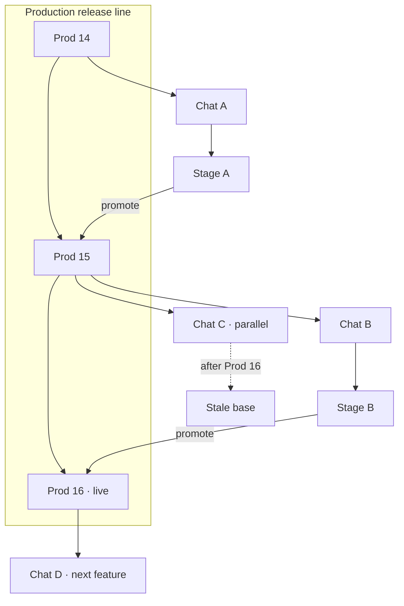

import {
  Callout,
  Cards,
  Details,
  Steps,
  Summary,
} from 'nextra/components'

export const metadata = {
  title: 'Avoiding Conflicts',
}

# Avoiding Conflicts

BaaSForge avoids merge conflicts by keeping **one live production line**. Each Develop chat snapshots that production release as its base; staging and production releases from the chat are built on that snapshot — not on whatever became live later.

That model matches **trunk-based development** — a common git strategy teams use on purpose: short-lived work off a single mainline, frequent integration to that trunk, and no long-lived diverging release trees. It keeps shipping simpler and easier to reason about. Here, Develop chats play the role of those short branches; production is the trunk.

It is ideal for **small teams** on one service. If you need several backends (classic microservices), create **multiple projects** — each with its own deployments, runtimes, and owners shipping features on that project’s trunk. That mirrors how larger companies split ownership without fighting one shared release line.

<Callout type="info">
  **Coming soon:** cross-project development so multiple projects can work together faster as a microservice set.
</Callout>

How to ship (stage → production → new chat): [Releases](/platform/releases).

| Shape | Meaning |
| --- | --- |
| **Production line** | One live production release at a time (trunk) |
| **Chat → stage → prod** | Work branches from a prod baseline; promote only after staging |
| **Parallel chat** | Same baseline as another chat — fine to explore; only one line should land on production |
| **New chat after prod** | Starts from the latest live production — safe next cycle |

## How a chat picks its base

When you open a chat:

Select project → **Develop** → start a conversation (or open an existing one).

That session locks to the **production release that was live at creation**. The AI drafts units on that baseline plus this chat’s accepted changes.

<Callout type="important">
  Parallel chats that share the same baseline can each reach staging. **Only one** should be promoted to production. The next feature belongs in a **new** chat after that promote — otherwise you are racing the same trunk.
</Callout>

## Recommended cycle

<Steps>
### One chat, one feature

Select project → **Develop** → new chat. Describe the feature; let the AI draft units.

### Staging, then test

Release controller → **Release Stage** → stage runtime. Validate via **Runtimes** → stage runtime → **Open Units** → **Live interaction**.

### Promote, then start fresh

Same chat → **Release production**. Then open a **new** Develop chat for the next change — its base is the production you just shipped.
</Steps>

That cycle is how the platform stays linear: no long-lived diverging “branches,” no manual merge of unit trees.

## Stale base

A chat shows **Stale base** when live production moved to a release that was **not** produced from this chat.

You will see it:

- In the chat title bar (**Stale base** → read more)
- Again in the production deploy confirmation
- As a toast when production changes while the chat is open

The AI Planner also warns in conversation. Shipping is still allowed — only you confirm.

<Callout type="warning">
  Releasing from a stale-base chat **will replace** current production with this chat’s line of work and **revert** production that came from other chats. Use that only when you mean to overwrite (for example an intentional rollback path). Prefer a new chat on current production for normal work.
</Callout>

| Situation | Stale base? |
| --- | --- |
| Live prod still equals this chat’s saved baseline | No |
| Live prod was promoted **from this chat** | No |
| Live prod advanced from **another** chat | Yes |
| You rolled production back to this chat’s baseline | Clears — warning disappears |

## Rollback clears stale base

If you put an older production revision live again (Units & Releases → deploy a previous revision), chats whose base matches that revision are no longer stale — their baseline is live again.

Deep dive: [Release History & Rollback](/platform/releases/release-history).

<Callout type="info">
  Stale base is a warning, not a lock. Staging deploy and further AI drafts in that chat stay available. The platform simplifies conflict handling by design: one trunk, chat-scoped snapshots, warn before overwrite.
</Callout>

## Related docs

<Cards>
  <Cards.Card title="Releases" href="/platform/releases" />
  <Cards.Card title="Release History & Rollback" href="/platform/releases/release-history" />
  <Cards.Card title="Runtimes" href="/platform/runtimes" />
  <Cards.Card title="AI Role" href="/platform/ai-role" />
  <Cards.Card title="Glossary" href="/platform/glossary" />
</Cards>

  
Quick reference

  | Question | Answer |
  | --- | --- |
  | Why no merge conflicts? | One live production line; each chat is a snapshot + deltas |
  | What does a new chat use? | Latest live production at creation time |
  | Parallel chats? | Explore freely; promote only one line to production |
  | Best habit? | Feature chat → staging → test → production → new chat |
  | What is Stale base? | Live prod moved via another chat; shipping here overwrites it |
  | Does stale block work? | No — warns in UI and before production deploy |
  | Rollback effect? | Chats based on the restored prod lose the stale warning |

