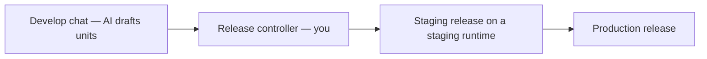

import {
  Callout,
  Cards,
  Details,
  Steps,
  Summary,
  Tabs,
} from 'nextra/components'

export const metadata = {
  title: 'Releases',
  asIndexPage: true,
}

# Releases

A **release** is a deployable snapshot of validated unit changes. Think of it as the platform’s CI/CD step — but you ship from the dashboard UI, not from git remotes or YAML pipelines. Releases are numbered with a **revision** (e.g. `15.4`), tied to the chat that produced them, and attached to a [runtime](/platform/runtimes) as that environment’s **live release**.

<Callout type="important">
  The AI prepares drafts. **Only you** create staging / production releases and deploy. There is no IDE — you describe business behavior in chat; the AI authors units. Technical rules are already trained and enforced; you do not prompt coding conventions.
</Callout>

## Mental model

| Concept | Like… | In BaaSForge |
| --- | --- | --- |
| Release | A deployable build / git tag | Snapshot of base production units + this chat’s accepted drafts |
| Revision | Version number | Dotted number for releases (e.g. `15.4`); say **revision**, not “version” |
| Line | Trunk-based mainline | One live production at a time; each chat starts from the production that was live when the chat opened |
| Staging → prod | Promote after QA | You must create a **staging** release first; production copies that proven snapshot |

A release is **not** a full rewrite of the project. It is:

1. **Base production units** — the production release that was live when the chat started
2. **Plus session deltas** — units created, modified, or removed in that chat

Same chat can offer several release-controller turns (e.g. after more AI changes). Each controller only covers **draft units up to that message**. Shipping from the **last** controller includes every accepted change from the start of the chat through that turn. The conversation sidebar **Release Stage** / **Release production** buttons do the same as that latest controller — they ship the full chat scope. If you do not want the newest changes, release from an **earlier** controller in the thread instead — that ships only up to that point.

<Callout type="info">
  Draft unit details and unit revisions (integers) live under [Units](/platform/units). This page covers shipping those drafts.
</Callout>

## Who ships

| Actor | Can draft units | Can release / deploy / roll back |
| --- | --- | --- |
| **You** | Describe intent in Develop | Yes — release controller and Units & Releases |
| **AI** | Writes and validates units | **No** — cannot open release dialogs or deploy |

## Staging, then production

<Steps>
### Draft in Develop

Select project → **Develop** → describe product behavior. When a turn changes units, a **release controller** appears under that message.

### Release to staging

On the controller → **Release Stage** → pick an idle stage runtime (**Deploy**) or a busy one (**swap live release**). That creates a staging release and attaches it to the runtime.

### Validate

Select project → **Runtimes** → that stage runtime → **Open Units** → unit → **Live interaction**. Prefer staging before promote.

### Release production

Same chat → **Release production** after staging looks correct. Production is created **from that staging release** (no recalculating the unit set) and goes live on the project’s single production runtime.

### Start a new chat

Select project → **Develop** → start a **new** conversation for the next feature.
</Steps>

<Callout type="important">
  **Prefer a new chat after you release to production.** Staging releases stay visible only in the chat that introduced them. A new chat sees the **latest production** release as its baseline — not staging drafts from other sessions. That clears long history (better AI accuracy) and keeps a separate chat trail per feature.
</Callout>

<Callout>
  You can redeploy an existing staging or production revision to a runtime later from the same controller (or from Units & Releases for production history).
</Callout>

<Callout type="info">
  Releasing a new snapshot onto a runtime **does not clear** that runtime’s unit data (actor state, workflow instances, queue jobs, and similar). Existing data stays — like upgrading a classic app in place. Only the unit code/revision changes; durable data for that runtime keeps running under the new live release.
</Callout>

## Browse releases and units

<Tabs items={['By runtime', 'Production history', 'New vs all units', 'Intro chat']}>
  <Tabs.Tab>
    Select project → **Runtimes**.

    Each card shows the **live release revision**. When a release is attached:

    - Stage → **Open Units**
    - Production → **Open Units** (or sidebar **Units & Releases**)

    Idle runtimes have no live release — nothing to open yet.
  </Tabs.Tab>
  <Tabs.Tab>
    Select project → **Units & Releases**.

    The secondary sidebar lists production releases (live lineage highlighted). Click a revision to open its units. The live one is marked **Live**.
  </Tabs.Tab>
  <Tabs.Tab>
    On any open release page:

    | Tab | Shows |
    | --- | --- |
    | **New units** | Units this release introduced vs its base |
    | **All units** | Full combined snapshot (base + this release’s changes) |

    Filter by context / module / type as needed.
  </Tabs.Tab>
  <Tabs.Tab>
    Every release is born in a chat session.

    - Runtime card → **Open chat** (release intro chat)
    - Units & Releases → release card **⋮** → **Open chat session**
  </Tabs.Tab>
</Tabs>

## Live interaction on a release

Test units that support Live interaction (API, actor, workflow, queue worker) from the unit card on a **live** release:

| Environment | Path |
| --- | --- |
| Staging | Select project → **Runtimes** → stage runtime → **Open Units** → All units tab → unit → **Live interaction** |
| Production | Select project → **Units & Releases** (or production runtime → **Open Units**) → All units tab → unit → **Live interaction** |

Live interaction is available only when that release is **currently live** on the runtime you opened. Historical / non-live revisions can be browsed, but Live interaction is disabled.

<Callout type="error">
  You **can** Live-interact with production units. That hits real production traffic and data — use staging for everyday validation.
</Callout>

More: [Live interaction](/platform/live-interaction).

## One line, not diverged trees

Releases follow a **linear** production line (trunk-based): there is one live production release at a time. A chat is pinned to the production baseline that was live when the chat was created so the AI always sees a coherent unit set for that session.

You do **not** maintain two independent long-lived release branches that both keep growing. New work should continue from current production (usually a **new chat**). If production moved ahead via another chat, this session will show a **stale base** warning — shipping from it can replace newer production work (useful for intentional rollback; risky if accidental).

<Callout type="warning">
  The platform warns on stale-base chats; it does not block you. Confirm only when you mean to overwrite live production. Details: [Avoiding Conflicts](/platform/releases/avoiding-conflicts).
</Callout>

## Rollback

Yes — you can put a previous production revision live again from release history (Units & Releases sidebar → deploy an older revision). That is a deliberate overwrite of whatever is live now.

Deep dive: [Release History & Rollback](/platform/releases/release-history).

## Related docs

<Cards>
  <Cards.Card title="Runtimes" href="/platform/runtimes" />
  <Cards.Card title="Avoiding Conflicts" href="/platform/releases/avoiding-conflicts" />
  <Cards.Card title="Release History & Rollback" href="/platform/releases/release-history" />
  <Cards.Card title="Live interaction" href="/platform/live-interaction" />
  <Cards.Card title="Units" href="/platform/units" />
  <Cards.Card title="AI Role" href="/platform/ai-role" />
  <Cards.Card title="Glossary" href="/platform/glossary" />
</Cards>

  
Quick reference

  | Question | Answer |
  | --- | --- |
  | What is a release? | Deployable snapshot of chat-scoped unit changes, attached to a runtime |
  | Who releases? | You — never the AI |
  | Staging required first? | Yes — production is promoted from a staging release |
  | After production? | Open a **new** Develop chat — baseline is latest prod; staging stays chat-scoped |
  | New release clears runtime data? | No — unit data on that runtime stays (classic in-place upgrade) |
  | See a runtime’s units? | Runtimes → Open Units |
  | New vs all units? | Tabs on the release units page |
  | Find the intro chat? | Runtime card **Open chat**, or release **⋮** → **Open chat session** |
  | Live-interact on prod? | Yes — affects production |
  | Diverged release trees? | No — one live production line; stale-base chats warn before overwrite |
  | Rollback? | Redeploy a previous production revision |

