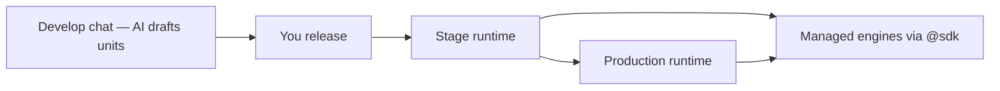

import {
  Callout,
  Cards,
  Details,
  Steps,
  Summary,
  Tabs,
} from 'nextra/components'

export const metadata = {
  title: 'Runtimes',
}

# Runtimes

A **runtime** is a managed execution environment for one project. Unit code drafted in chat is released onto a runtime; that runtime serves the live release, holds that environment’s variables, and scopes durable data and traces.

<Callout type="important">
  There is **no IDE** for unit code. You describe business behavior in chat; the AI writes TypeScript units. The platform trains and enforces technical rules — you do not prompt coding conventions, SDK shapes, or infra wiring.
</Callout>

## What runs on a runtime

| Layer | Detail |
| --- | --- |
| Language | TypeScript / JavaScript **unit blueprints** authored by the AI |
| Engine | Executed on the platform’s execution plane (QuickJS workers on Rust servers) |
| Infra | Rust, Redis, NATS, Postgres, and similar stay **platform-managed** |

Units never open Redis, NATS, RabbitMQ, or database connections themselves. Durable mailboxes, queues, workflow journals, secrets, and cross-unit calls go through the [SDK](/platform/sdk) (`@sdk`). Under the hood the platform may use those engines — you only get unit types and SDK behaviors.

<Callout type="info">
  Same unit path in two projects, or on stage vs production, are separate worlds. Isolation is enforced on every `sdk.*` call.
</Callout>

## Stage vs production

| | **Stage** | **Production** |
| --- | --- | --- |
| Purpose | Validate before promote | Live customer-facing traffic |
| Count per project | **2** today (`Stage 1`, `Stage 2`) | **Exactly 1** |
| Can I add more? | Not yet — coming soon | **No** |
| Trigger URL | Includes `/stage/{runtime_id}/…` | Production trigger path (single runtime) |

New projects are created with **Stage 1**, **Stage 2**, and **Production**.

<Callout>
  Extra stage runtimes will be purchasable later. Most projects do not need many stages — the platform’s goal is a fast develop → stage → production cycle so parallel stage environments stay optional.
</Callout>

<Callout type="error">
  Production is capped at **one runtime per project**. You cannot buy or request a second production runtime.
</Callout>

## What belongs to a runtime

Each runtime keeps its own copy of these — they do **not** bleed across stage runtimes or into production:

| Belongs to the runtime | Notes |
| --- | --- |
| **Live release** | The release currently attached (or none if idle) |
| **Units in that release** | Served only on that runtime — same revision on Stage 1 vs Stage 2 vs production are separate deployments and have different data storage |
| **Variables & secrets** | Plain and encrypted keys, per runtime |
| **Durable unit data** | Actor state, workflow instances, queue jobs scoped to that runtime |
| **Traces** | Invocations and spans for that runtime only |

<Callout type="warning">
  Changing a variable or secret on Stage 1 does not change Stage 2 or production.
</Callout>

Deep dives: [Variables](/platform/variables) · [Releases](/platform/releases) · [Tracing](/platform/tracing) · [SDK](/platform/sdk).

## Idle vs busy

| Status | Meaning | Dashboard section |
| --- | --- | --- |
| **Idle** | No live release attached | select project -> runtimes -> **Idle stage runtimes** |
| **Busy** | A live release is attached and being served | select project -> runtimes -> **Busy stage runtimes** |

Production is listed under **Production runtimes**.

When you deploy to a busy stage runtime, the UI offers **swap live release** — detach the current release and attach the new one.

## How to use runtimes

<Tabs items={['Find runtimes', 'Deploy to stage', 'Variables', 'Open units']}>
  <Tabs.Tab>
    Select project → sidebar **Runtimes**.

    Sections: **Production runtimes** → **Busy stage runtimes** → **Idle stage runtimes**.

    Each card shows name, environment, runtime id, live revision, the chat conventions introduced that release deployment on that runtime, and **Open Units** (when a release is live).
  </Tabs.Tab>
  <Tabs.Tab>
    <Steps>
    ### Open Develop

    Select project → **Develop** → work with the AI until drafts look right.

    ### Release Stage

    On the release controller → **Release Stage** → pick an idle runtime (**Deploy**) or a busy one (**swap**).

    ### Validate

    Select project → **Runtimes** → that runtime → **Open Units** → unit → **Live interaction**.

    ### Promote

    Same chat → **Release production** when stage looks correct. See [Releases](/platform/releases).
    </Steps>
  </Tabs.Tab>
  <Tabs.Tab>
    Select project → sidebar **Variables** → **Non-encrypted** / **Encrypted** → set keys for the target runtime.

    The AI sees **key names only** (never secret values) and uses `sdk.getSecureEnv` in unit code.
  </Tabs.Tab>
  <Tabs.Tab>
    | Environment | Path |
    | --- | --- |
    | Stage | Select project → **Runtimes** → stage runtime → **Open Units** |
    | Production | Select project → **Units & Releases** (or production runtime card → **Open Units**) |
  </Tabs.Tab>
</Tabs>

## Related docs

<Cards>
  <Cards.Card title="SDK" href="/platform/sdk" />
  <Cards.Card title="Releases" href="/platform/releases" />
  <Cards.Card title="Variables" href="/platform/variables" />
  <Cards.Card title="Live interaction" href="/platform/live-interaction" />
  <Cards.Card title="Tracing & Debugging" href="/platform/tracing" />
  <Cards.Card title="AI Role" href="/platform/ai-role" />
  <Cards.Card title="Glossary" href="/platform/glossary" />
</Cards>

  
Quick reference

  | Question | Answer |
  | --- | --- |
  | What is a runtime? | Managed place your released units run for stage or production |
  | Who writes the code? | The AI — you prompt business intent |
  | How do units use Redis / NATS / DB? | Only via [SDK](/platform/sdk); engines are not exposed |
  | How many stages? | 2 today; more purchasable soon |
  | How many production? | Always 1; cannot increase |
  | Idle vs busy? | No live release vs live release attached |

