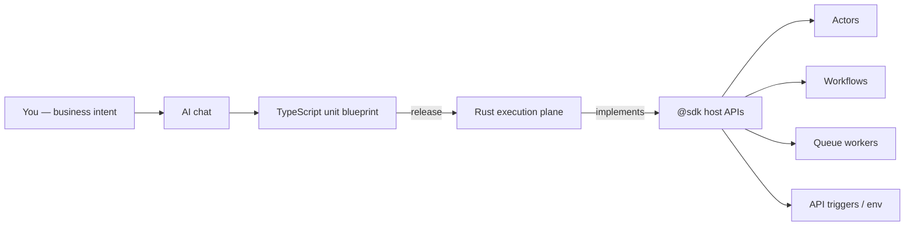

import {
  Callout,
  Cards,
  Details,
  Steps,
  Summary,
  Tabs,
} from 'nextra/components'

export const metadata = {
  title: 'SDK',
}

# SDK

The **SDK** (`@sdk`) is the only bridge between unit code and the BaaSForge execution plane. Unit TypeScript is a **blueprint**: the AI authors it; the Rust runtime loads, validates, and runs it (QuickJS workers). Durable mailboxes, queues, workflow journals, secrets, and cross-unit delivery are platform work — not libraries you install.

<Callout type="important">
There is **no IDE** for unit code. Describe business behavior in chat; the AI writes units that import `@sdk`. Platform rules (types, sync helpers, path shapes, isolation) are already taught to the AI and enforced by the technical reviewer — you do not need to prompt technical coding rules.
</Callout>



## What the SDK is for

| Concern | How it works |
| --- | --- |
| Define a unit | AI uses `actor` / `workflow` / `queueWorker` from `@sdk` |
| Call another unit in **this** project | AI uses `sdk.*` (actors, workflows, queue workers, API URLs) |
| Share types / helpers | `@units/…` type imports; value imports only from **common** units |
| Secrets | `sdk.getSecureEnv` — keys from dashboard **Variables** |
| Public HTTP between APIs | `fetch` + `sdk.getApiUnitTriggerUrl` |

Cross-unit orchestration is always `@sdk` (or HTTP for APIs). Executable units are **not** value-imported from each other.

## Project isolation

Every `sdk.*` call is scoped to the **current project** and the **runtime** the unit is running in (stage runtime id or production). There is **no** way to address another project's units, actors, workflows, or queues through the SDK.

Same unit path in two projects = two separate worlds. Same path in stage vs production = separate instances and queues.

<Callout type="warning">
Isolation is platform-enforced. The AI cannot “reach across” projects or stage/prod boundaries via `@sdk`, even if paths look identical.
</Callout>

## Modules

| Module | Role |
| --- | --- |
| `@sdk` | Unit definitions + `sdk` host object + shared types (`TerminalError`, branded ids, options) |
| `@units/<context>.<module>.<unit_type>.<unit_name>` | Cross-unit imports — named bindings only |

```typescript copy
import { sdk, actor, workflow, queueWorker, type ActorInstanceId } from "@sdk";
import type { IncrementInput } from "@units/shop.cart.actor.counter";
import { normalizeSlug } from "@units/shared.utils.common.helpers";
```

| Import style | Allowed |
| --- | --- |
| `import type { … } from "@units/…"` | Any unit type (erased at compile time) |
| `import { … } from "@units/…"` (runtime value) | **Only** `common` units |
| Bare / default / `import *` from `@units/…` | Never |

## Unit definition helpers

These are how the AI declares executable units. API units use `handleRequest` (Node HTTP types) and still call `sdk` for outbound work; they are not created with a helper from `@sdk`.

<Tabs items={['Actor', 'Workflow', 'Queue worker']}>
  <Tabs.Tab>
```typescript copy filename="counter.actor.ts"
import { actor } from "@sdk";

export type State = { count: number };

export default actor<State>({
  state: { count: 0 },
  handlers: {
    increment(ctx, { by }: { by: number }) {
      ctx.state.count += by;
      return { count: ctx.state.count };
    },
  },
});
```
  </Tabs.Tab>
  <Tabs.Tab>
```typescript copy filename="fulfill.workflow.ts"
import { workflow } from "@sdk";

export type Input = { orderId: string };
export type Output = { ok: boolean };

export default workflow<Input, Output>({
  run: async (ctx, input) => {
    await ctx.run("charge", () => {
      /* durable step */
    });
    return { ok: true };
  },
  handlers: {
    async status(ctx) {
      return { phase: ctx.get<string>("phase") };
    },
  },
});
```
  </Tabs.Tab>
  <Tabs.Tab>
```typescript copy filename="notify.queue_worker.ts"
import { queueWorker } from "@sdk";

export type Input = { email: string };
export type Output = { sent: true };

export default queueWorker<Input, Output>(async (ctx, data) => {
  // process job; ctx.attempt, ctx.id (runId), ctx.TerminalError
  return { sent: true };
});
```
  </Tabs.Tab>
</Tabs>

Deep behavior (mailbox, replay, batch, DLQ): [Actor](/platform/units/actor-unit) · [Workflow](/platform/units/workflow-unit) · [Queue Worker](/platform/units/queue-worker-unit).

## `sdk` host API

All cross-unit host calls live on `sdk`. Names ending in `Sync` return **plain values** — unit code must not `await sdk.xxxSync(…)`.

### Reference

| Method | Returns | Behavior |
| --- | --- | --- |
| `getApiUnitTriggerUrl({ unitPathOrId })` | `string` | Full trigger URL for an **api** unit (stage-aware) |
| `getSecureEnv(key)` | `string` | Runtime variable; encrypted values decrypted |
| `callActorAndWaitForResultSync({ unitPath, actorId, handler, payload?, opts? })` | `TResult` | Block until actor handler finishes (default timeout **30s**) |
| `sendActorMessageSync({ unitPath, actorId, handler, payload? })` | `{ delivered: true }` | Fire-and-forget into actor mailbox |
| `enqueueWorkerSync({ unitPath, data, opts? })` | `{ runId }` | Persist job; never waits for completion |
| `startWorkflowSync({ unitPath, input })` | `{ instanceId }` | Start workflow; return immediately |
| `callWorkflowAndWaitForOutputSync({ unitPath, input, opts? })` | `TOutput` | Start and block until terminal (default **300s**) |
| `callWorkflowHandlerAndWaitForResultSync({ unitPath, instanceId, handler, input?, opts? })` | `TResult` | Signal / query a **running** instance (default **30s**) |

Path types are branded by unit type: `ActorUnitPathOrId`, `WorkflowUnitPathOrId`, `QueueWorkerUnitPathOrId`, `ApiUnitPathOrId` — four segments `{context}.{module}.{type}.{name}`.

Ids are branded strings: `ActorInstanceId`, `WorkflowInstanceId`, `QueueWorkerRunId`.

### Options

| Options type | Fields |
| --- | --- |
| `CallActorSyncOptions` | `timeoutMs?` |
| `CallWorkflowSyncOptions` | `timeoutMs?` |
| `CallWorkflowHandlerSyncOptions` | `timeoutMs?` |
| `EnqueueWorkerOptions` | `delay?: Duration`, `deduplicationKey?: string` |

`Duration`: `{ milliseconds?, seconds?, minutes?, hours?, days? }`.

### Choosing wait vs fire-and-forget

| Need | Prefer |
| --- | --- |
| Handler / workflow **result** in this call | `callActorAndWaitForResultSync` / `callWorkflowAndWaitForOutputSync` |
| Kick off long / signal-driven work | `startWorkflowSync` → keep `instanceId` → later `callWorkflowHandlerAndWaitForResultSync` |
| Background job | `enqueueWorkerSync` (always fire-and-forget) |
| Don’t stall an actor mailbox | `sendActorMessageSync` / `enqueueWorkerSync` / `startWorkflowSync` |

<Callout type="warning">
Do **not** use `callWorkflowAndWaitForOutputSync` for workflows that wait on human/external signals — the caller blocks forever waiting for a signal that cannot arrive on that path. Use `startWorkflowSync` instead.
</Callout>

### Inside a workflow `run`

| Call | How the AI must wrap it |
| --- | --- |
| `callWorkflowAndWaitForOutputSync` | Bare (durable child wait) |
| `startWorkflowSync`, actor calls, enqueue, handler calls | Inside `await ctx.run("step-name", () => …)` for replay safety |
| `callActorAndWaitForResultSync` | Inside `ctx.run` |

## Shared types and errors

| Export | Purpose |
| --- | --- |
| `TerminalError` | Non-retriable failure — skips retries / can feed dead-letter paths |
| `RetryPolicy` | `maxAttempts`, `initialInterval`, `maxInterval`, `backoffFactor` |
| `Duration` | Human-readable time fields for delays / timeouts |

Contexts expose `ctx.TerminalError` (same class) on actors, workflows, and queue workers.

## Contexts (what unit code can do locally)

Not every capability is on `sdk` — some are on the unit context:

| Unit | Context highlights |
| --- | --- |
| **Actor** | `ctx.id`, `ctx.state`, `setAlarm` / `cancelAlarm`, `attempt` |
| **Workflow `run`** | `ctx.run`, `sleep`, `promise`, `set` / `get`, deterministic `rand` / `date` |
| **Workflow handlers** | `get`, `promise(…).resolve/reject` — no `run` / `sleep` |
| **Queue worker** | `id` (`runId`), `attempt`, `enqueuedAt` |

## Platform-enforced rules (you don’t prompt these)

The technical reviewer and runtime already enforce, among others:

- Sync `sdk.*` helpers are not `await`ed
- Result generics required where the host needs an explicit `TResult` / `TOutput`
- `@units/*` import shapes (named only; runtime values only from `common`)
- Unit path / type segment shapes (`queue_worker`, not `queue-worker`)
- Workflow replay safety (side effects in `ctx.run`; deterministic helpers instead of `Math.random`)
- Project + runtime isolation on every host call

You describe **what the product should do**; the AI + platform own **how** the SDK is used correctly.

## Examples (patterns the AI writes)

Adapted from platform test units — same call shapes the runtime validates.

<Tabs items={['API → actor', 'API → workflow handlers', 'API → API', 'Actor → worker', 'Workflow fan-out']}>
  <Tabs.Tab>
Call actor and wait for the handler result (typical HTTP gateway):

```typescript copy filename="call-actor-sync.ts"
import { sdk, type ActorInstanceId } from "@sdk";

const result = sdk.callActorAndWaitForResultSync<
  { by: number },
  { count: number }
>({
  unitPath: "shop.cart.actor.counter",
  actorId: "user-42" as ActorInstanceId,
  handler: "increment",
  payload: { by: 1 },
  opts: { timeoutMs: 30_000 },
});
```
  </Tabs.Tab>
  <Tabs.Tab>
Start fire-and-forget, then signal the same instance:

```typescript copy filename="call-workflow-handler.ts"
import { sdk, type WorkflowInstanceId } from "@sdk";

const { instanceId } = sdk.startWorkflowSync<Record<string, never>>({
  unitPath: "shop.orders.workflow.gate",
  input: {},
});

const echoed = sdk.callWorkflowHandlerAndWaitForResultSync<
  { msg?: string },
  { echoed: string }
>({
  unitPath: "shop.orders.workflow.gate",
  instanceId: instanceId as WorkflowInstanceId,
  handler: "echo",
  input: { msg: "approve-me" },
});
```
  </Tabs.Tab>
  <Tabs.Tab>
Resolve a stage-aware trigger URL, then `fetch`:

```typescript copy filename="api-to-api-via-sdk.ts"
import { sdk } from "@sdk";

const url = sdk.getApiUnitTriggerUrl({
  unitPathOrId: "shop.orders.api.echo",
});

const echoResp = await fetch(url, {
  method: "POST",
  headers: { "Content-Type": "application/json" },
  body: JSON.stringify({ via: "sdk-url" }),
});
```
  </Tabs.Tab>
  <Tabs.Tab>
Enqueue is always fire-and-forget; keep `runId` if you need to poll later:

```typescript copy filename="actor-enqueues-worker.ts"
import { actor, sdk } from "@sdk";

export default actor<{ enqueuedRunId: string | null }>({
  state: { enqueuedRunId: null },
  handlers: {
    triggerWorker(ctx, { value }: { value: number }) {
      const { runId } = sdk.enqueueWorkerSync<{ value: number }>({
        unitPath: "ops.jobs.queue_worker.echo",
        data: { value },
      });
      ctx.state.enqueuedRunId = runId;
      return { runId };
    },
  },
});
```
  </Tabs.Tab>
  <Tabs.Tab>
Actor + child workflow + enqueue from one workflow (step-wrapped where required):

```typescript copy filename="workflow-fan-out.ts"
import { workflow, sdk, type ActorInstanceId } from "@sdk";

export default workflow(async (ctx, input: { actorId: string; marker: string }) => {
  const ar = await ctx.run("actor", () =>
    sdk.callActorAndWaitForResultSync({
      unitPath: "shop.cart.actor.session",
      actorId: input.actorId as ActorInstanceId,
      handler: "probe",
      payload: {},
    }),
  );
  const child = sdk.callWorkflowAndWaitForOutputSync({
    unitPath: "shop.orders.workflow.child",
    input: { marker: input.marker },
  });
  const enq = await ctx.run("qw", () =>
    sdk.enqueueWorkerSync({
      unitPath: "ops.jobs.queue_worker.echo",
      data: { marker: input.marker },
    }),
  );
  return { ar, child, runId: enq.runId };
});
```
  </Tabs.Tab>
</Tabs>

## Secrets and variables

Configure keys in the dashboard; the AI discovers **key names** (not secret values) and uses `sdk.getSecureEnv("KEY")` in unit code.

Select project → **Variables** → add plain or encrypted keys for the target runtime.

## Related docs

<Cards>
  <Cards.Card title="Units" href="/platform/units" />
  <Cards.Card title="API Unit" href="/platform/units/api-unit" />
  <Cards.Card title="Actor Unit" href="/platform/units/actor-unit" />
  <Cards.Card title="Workflow Unit" href="/platform/units/workflow-unit" />
  <Cards.Card title="Queue Worker Unit" href="/platform/units/queue-worker-unit" />
  <Cards.Card title="Common Unit" href="/platform/units/common-unit" />
  <Cards.Card title="Variables" href="/platform/variables" />
  <Cards.Card title="Glossary" href="/platform/glossary" />
</Cards>

<Details>
  <Summary>Quick cheat sheet</Summary>

| Goal | SDK surface |
| --- | --- |
| Define actor / workflow / worker | `actor` / `workflow` / `queueWorker` |
| Actor result | `callActorAndWaitForResultSync` |
| Actor enqueue only | `sendActorMessageSync` |
| Start workflow | `startWorkflowSync` |
| Wait for workflow output | `callWorkflowAndWaitForOutputSync` |
| Signal running workflow | `callWorkflowHandlerAndWaitForResultSync` |
| Background job | `enqueueWorkerSync` → `{ runId }` |
| Call another API | `getApiUnitTriggerUrl` + `fetch` |
| Secret | `getSecureEnv` |
| Fail without retry | `TerminalError` / `ctx.TerminalError` |
</Details>
