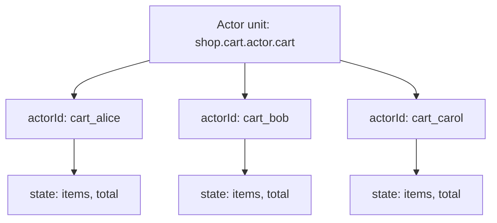
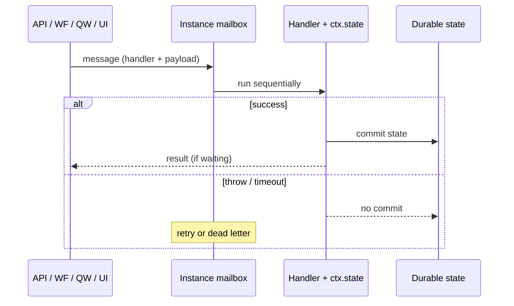

import {
  Callout,
  Cards,
  Details,
  Steps,
  Summary,
  Tabs,
} from 'nextra/components'

export const metadata = {
  title: 'Actor Unit',
}

# Actor Unit

An **actor unit** is a stateful, entity-scoped compute primitive: one durable instance per `actorId`, sequential message processing, and state that survives crashes and deployments. Use it for things with identity and evolving state — carts, profiles, devices, sessions, balances.

The AI authors the unit (path, state shape, handlers, alarms, retry). You address instances and invoke handlers through the dashboard **Live interaction** client (or from other units via `@sdk`) after the actor is released.

The **unit path** of an actor unit is:

```
{context}.{module}.actor.{unit_name}
```

Example: `shop.cart.actor.cart`

The AI uses this path when wiring SDK calls and `@units/…` type imports. You work with the unit through the dashboard — you do not construct the path yourself.

<Callout type="important">
Think of an **actor unit** as a table and each **actor instance** (`actorId`) as a row. One domain entity per `actorId`. Do not stuff a growing registry of ids into one shared instance.
</Callout>

## What they are for

| Use case | Why an actor unit |
| --- | --- |
| Shopping cart / session | One cart id → one instance; sequential adds/removes without locks |
| User / account profile | Durable fields for that user only; isolated from other users |
| Device / IoT twin | Per-device state + alarms for heartbeats or reconnect windows |
| Game / match session | Entity-scoped score and phase; messages never interleave |
| Wallet / balance | Atomic mutate-or-fail; retries see pre-handler state |
| Rate / quota per key | One instance per customer or API key; mailbox serializes updates |

Actors are **not** request-scoped. Short HTTP work belongs in an **API** unit; multi-step orchestration in a **workflow**; fire-and-forget jobs in a **queue worker**; shared helpers in a **common** unit.

### Example scenarios

- **E-commerce cart** — `shop.cart.actor.cart` with `actorId = cart_abc`. API `add-item` calls `sdk.callActorAndWaitForResultSync`; checkout workflow reads the same instance.
- **Per-user notification prefs** — `notify.prefs.actor.preferences` keyed by user id; queue workers update prefs without racing each other.
- **Device twin** — `iot.devices.actor.twin` keyed by device id; `onAlarm` marks offline if no heartbeat arrives.
- **Match lobby** — `game.lobby.actor.session` keyed by match id; players join via fire-and-forget `sendActorMessageSync` while the lobby stays sequential.

## Unit vs instance

| Concept | Meaning |
| --- | --- |
| **Actor unit** | The definition (state schema + handlers) — like a table |
| **Actor instance** | One live entity addressed by `actorId` — like a row |
| **`actorId`** | Unique **within that actor unit path**, not globally across units |



Same unit path + same `actorId` always reaches the same durable state. Different `actorId`s are fully isolated.

<Callout type="warning">
Wrong design: one `"global"` / `"registry"` instance whose state is a growing `Map` / `Set` / list of every entity id. Right design: each entity gets its own `actorId`; existence is “does this instance have state?”, not a central registry.
</Callout>

## How execution works

Messages for one instance are processed **one at a time** (mailbox). State commits only when the handler finishes successfully.

<Steps>
### Message arrives

SDK call, dashboard Live interaction, or HTTP private trigger targets `(unit path, actorId, handler)`.

### Activate if needed

Cold instances load durable state, then run the handler. Only one handler runs per instance at a time.

### Commit or roll back

Success → state persisted. Throw / timeout → state rolls back to the pre-handler snapshot; retries see that snapshot.

### Idle passivation

After idle time (configurable), the instance can leave memory; state remains durable and reloads on the next message.
</Steps>



## Guarantees (platform-enforced)

| Guarantee | Detail |
| --- | --- |
| Sequential delivery | No interleaved handlers for the same `actorId` |
| Atomic state | Mutations commit only on success |
| Isolation | Different projects, units, instances, and staging runtimes do not share state |
| Durable alarms | Named alarms survive crash / passivation / restart |
| Retry + DLQ | Transient errors retry; `TerminalError` skips retries and can hit `onDeadLetter` |

## Create and change actors (Develop)

There is no code editor for units. Describe the product behavior; the AI chooses unit types (including actors when per-entity state fits), writes the code, and wires callers.

<Steps>
### Open Develop

Select your project → sidebar **Develop** → open or start a conversation.

### Describe the behavior

Example: *“Each shopper has one active cart: add and remove items, change quantities, and read the cart. Different shoppers must not share carts. Checkout should use that cart, then clear it only after payment succeeds.”*

### Review the draft

The AI produces the units and updates dependents. Drafts are not live until you release.

### Release to staging

In the release controller: **Release Stage** → pick a staging runtime → **Deploy**.

### Promote when ready

**Release production** → confirm → **Deploy to production**.
</Steps>

<Callout type="info">
You do not need to name unit types (actor, workflow, API, …), exports, or SDK helpers. Speak in product terms — what the entity stores, which operations it supports, and who calls it. The AI is trained on platform rules and the technical reviewer enforces them.
</Callout>

## Live interaction (dashboard)

Actor triggers are **private** (dashboard / SDK), not a public internet surface like API units. Prefer an **API unit** as the external gateway; use Live interaction to test and operate instances.

### Staging

<Steps>
### Open a runtime

Select your project → sidebar **Runtimes** → pick the staging runtime you deployed to.

### Open units

On the runtime card → **Open Units**.

### Find the actor

Tab **All units** → actor unit card → toggle **Live interaction**.

### Set Actor instance id

Enter the entity id (e.g. `cart_alice`). Default placeholder is `default`. Max **512** characters.

### Invoke

Pick a **handler** tab → fill body → **Test Request** → **Send**.  
Or use **Read state** / **Passivate** / **Delete instance**.
</Steps>

### Production

<Steps>
### Open Units & Releases

Select your project → sidebar **Units & Releases**.

### Find and test

Tab **All units** → actor card → **Live interaction** → set **Actor instance id** → handler / ops → **Send**.
</Steps>

| Live interaction tab | What it does |
| --- | --- |
| Handler name (from metadata) | `POST` invoke that handler (body = input type) |
| **Read state** | `GET` durable state (does not run a handler) |
| **Passivate** | Flush / evict the hot instance; state remains durable |
| **Delete instance** | Delete that `actorId`’s state |

Query flag on handler invoke: **`await=true`** (default) waits for the handler result; **`await=false`** returns `{ delivered: true }` without waiting.

<Callout type="important">
Every response includes **`X-Trace-Id`**. Copy it → sidebar **Debug** → **Start Debug** → **by trace id** when something fails.
</Callout>

## Required contract (what the AI exports)

These exports power Live interaction schemas, docs, and cross-unit type imports. The technical reviewer enforces them automatically.

| Export | Rule |
| --- | --- |
| `export type State` | Actor state shape — **required** |
| `export type {Handler}Input` | Payload type when the handler takes input |
| `export type {Handler}Output` | Return type when the handler returns a value |
| `export default actor<State>({ … })` | Definition — **required** |

Naming: PascalCase handler name + `Input` / `Output` (e.g. handler `addItem` → `AddItemInput`).

Forbidden: value exports, `export { … }` / `export *`, `OnAlarm*` / `OnDeadLetter*` type exports, missing `State`.

```typescript copy filename="skeleton.ts"
import { actor } from "@sdk";

export type State = { count: number };
export type IncrementInput = { by?: number };
export type IncrementOutput = { count: number };

export default actor<State>({
  state: { count: 0 },
  handlers: {
    increment(ctx, payload?: IncrementInput): IncrementOutput {
      ctx.state.count += payload?.by ?? 1;
      return { count: ctx.state.count };
    },
  },
});
```

Other units can import types only:

```typescript copy
import type { State, IncrementInput } from "@units/shop.cart.actor.cart";
```

Runtime value imports from actors are **not** allowed — use `@sdk` to call them, or put shared helpers in a **common** unit.

## Patterns the AI writes

### Multi-handler cart

```typescript copy filename="shop.cart.actor.cart.ts"
import { actor } from "@sdk";

export type Item = { id: string; price: number };
export type State = { items: Item[]; total: number };
export type AddItemInput = Item;
export type RemoveItemInput = { itemId: string };
export type GetStateOutput = State;

export default actor<State>({
  state: { items: [], total: 0 },
  handlers: {
    addItem(ctx, item: AddItemInput) {
      ctx.state.items.push(item);
      ctx.state.total += item.price;
    },
    removeItem(ctx, { itemId }: RemoveItemInput) {
      const index = ctx.state.items.findIndex((i) => i.id === itemId);
      const item = index !== -1 ? ctx.state.items[index] : undefined;
      if (index !== -1 && item !== undefined) {
        ctx.state.total -= item.price;
        ctx.state.items.splice(index, 1);
      }
    },
    getState(ctx): GetStateOutput {
      return ctx.state;
    },
  },
});
```

State can be mutated in place **or** replaced:

```typescript copy
ctx.state = { count: 7, tag: "reassigned" };
```

### Call actor and wait (from API / actor / queue worker)

```typescript copy filename="call-actor-sync.ts"
import { sdk, type ActorInstanceId } from "@sdk";

const result = sdk.callActorAndWaitForResultSync<
  { by: number },
  { count: number }
>({
  unitPath: "shop.cart.actor.counter",
  actorId: "user-42" as ActorInstanceId,
  handler: "increment",
  payload: { by: 1 },
  opts: { timeoutMs: 30_000 },
});
```

### Fire-and-forget

```typescript copy filename="send-actor-message.ts"
import { sdk, type ActorInstanceId } from "@sdk";

const ack = sdk.sendActorMessageSync<{ value: number }>({
  unitPath: "shop.cart.actor.counter",
  actorId: "user-42" as ActorInstanceId,
  handler: "receive",
  payload: { value: 1 },
});
// ack === { delivered: true }
```

No result is returned on this path — use `callActorAndWaitForResultSync` when the caller needs the handler’s return value.

### From a workflow (step-wrapped)

Inside workflow `run`, blocking actor calls go inside `await ctx.run(…)`:

```typescript copy filename="workflow-calls-actor.ts"
import { workflow, sdk, type ActorInstanceId } from "@sdk";

export type Input = { actorId: string; value: number };
export type Output = { ok: boolean };

export default workflow<Input, Output>({
  run: async (ctx, input) => {
    const result = await ctx.run("call-actor", () =>
      sdk.callActorAndWaitForResultSync<{ value: number }, { ok: boolean }>({
        unitPath: "shop.cart.actor.session",
        actorId: input.actorId as ActorInstanceId,
        handler: "set",
        payload: { value: input.value },
      }),
    );
    return result;
  },
});
```

### Actor → actor / workflow / queue worker

```typescript copy filename="actor-calls-out.ts"
import { actor, sdk, type ActorInstanceId } from "@sdk";

export type State = { called: boolean };
export type FanOutInput = { childId: string; n: number };

export default actor<State>({
  state: { called: false },
  handlers: {
    fanOut(ctx, { childId, n }: FanOutInput) {
      sdk.callActorAndWaitForResultSync({
        unitPath: "shop.cart.actor.child",
        actorId: childId as ActorInstanceId,
        handler: "receive",
        payload: { value: n },
      });

      sdk.callWorkflowAndWaitForOutputSync({
        unitPath: "billing.payments.workflow.charge",
        input: { n },
      });

      sdk.enqueueWorkerSync({
        unitPath: "ops.jobs.queue_worker.echo",
        data: { value: n },
      });

      ctx.state.called = true;
    },
  },
});
```

<Callout type="warning">
Every sync-wait SDK call **blocks that instance’s mailbox** until it returns. For work that should not stall the entity, prefer `sendActorMessageSync` / `enqueueWorkerSync` / `startWorkflowSync`.
</Callout>

<Callout type="info">
Sync SDK helpers return plain values — unit code must not `await sdk.xxxSync(…)`.
</Callout>

### Alarms

Prefer `{ fireAfterMs }` so the host applies the delay at commit time. Duplicate names **replace** the previous schedule. Alarms survive passivation; cancel with `ctx.cancelAlarm(name)`.

```typescript copy filename="device.twin.actor.heartbeat.ts"
import { actor } from "@sdk";

export type State = { alarmFired: boolean; scheduledAt: number | null };
export type ScheduleAlarmInput = { delayMs: number };

export default actor<State>({
  state: { alarmFired: false, scheduledAt: null },
  handlers: {
    scheduleAlarm(ctx, { delayMs }: ScheduleAlarmInput) {
      ctx.state.scheduledAt = Date.now();
      ctx.setAlarm("test", { fireAfterMs: delayMs });
    },
    cancelAlarm(ctx) {
      ctx.cancelAlarm("test");
    },
  },
  onAlarm(ctx, name) {
    if (name === "test") ctx.state.alarmFired = true;
  },
});
```

### Retry, TerminalError, dead letter

- Throw a normal `Error` → retries (see `metadata.retry`); state changes for that attempt are rolled back.
- Throw `new ctx.TerminalError(…)` → skips remaining retries and can invoke `onDeadLetter`.
- After retries are exhausted, `onDeadLetter(ctx, handler, payload, error)` may run and mutate state.

```typescript copy filename="retry-and-dlq.ts"
import { actor } from "@sdk";

export type State = { dlqPayloadReceived: boolean; attempt: number };
export type FailAndDlqInput = unknown;

export default actor<State>({
  state: { dlqPayloadReceived: false, attempt: 0 },
  metadata: { retry: { maxAttempts: 3 } },
  handlers: {
    failAndDlq(ctx, _payload: FailAndDlqInput) {
      throw new Error("trigger dlq");
    },
    throwTerminal(ctx) {
      ctx.state.attempt = ctx.attempt;
      throw new ctx.TerminalError("stop immediately");
    },
  },
  onDeadLetter(ctx, _name, payload?) {
    ctx.state.dlqPayloadReceived = payload !== undefined && payload !== null;
  },
});
```

### Durability: failed handler does not commit

```typescript copy
mutateAndThrow(ctx) {
  ctx.state.value = 9999;
  throw new Error("intentional failure");
  // prior committed state is preserved; retries see the pre-handler snapshot
}
```

Timeouts hard-kill the handler with the same no-commit rule.

## Metadata the AI may set

| Field | Role |
| --- | --- |
| `handlers` | Optional allowlist of handler names |
| `maxIdleTime` | Idle duration before passivation (string or number) |
| `alarms` | Declared alarm names |
| `stateLimit` | Max serialized state size |
| `retry` | `RetryPolicy` for transient handler failures |
| `timeout` | Handler wall-clock limit |
| `mailboxBacklog` | Cap on pending messages for an instance |

Readonly peeks (**Read state**) can extend idle — passivation is not only “no traffic forever.”

## Calling other units from an actor

| Goal | SDK helper | Blocks this instance’s mailbox? |
| --- | --- | --- |
| Call another actor and wait | `sdk.callActorAndWaitForResultSync` | **Yes** |
| Actor fire-and-forget | `sdk.sendActorMessageSync` | Until enqueue ack |
| Wait for workflow output | `sdk.callWorkflowAndWaitForOutputSync` | **Yes** |
| Start workflow, return | `sdk.startWorkflowSync` | Until start ack |
| Signal a running workflow | `sdk.callWorkflowHandlerAndWaitForResultSync` | **Yes** |
| Enqueue job | `sdk.enqueueWorkerSync` | Until enqueue ack |
| Secrets / env | `sdk.getSecureEnv` | No |

Secrets belong in dashboard **Variables** (Select project → **Variables**). The AI discovers configured keys automatically.

## Persistence isolation

| Concern | Behavior |
| --- | --- |
| Same unit path on stage A vs stage B vs production | Separate state — never shared |
| Same unit path, different revisions, same runtime | Same state and data — revisions share persistence on that runtime |
| Same `actorId` across those environments | Still separate instances |
| Homonymous paths via SDK chains | Runtime scope stays with the caller’s staging / production |

Test actors on staging before promoting. Deleting or mutating a staging instance does not affect production.

## Limits and operational notes

| Topic | Detail |
| --- | --- |
| Auth | Private trigger — not the public API surface |
| Default sync call timeout | **30s** (`opts.timeoutMs`) |
| Actor instance id | Up to **512** characters |
| State size | Enforced via `metadata.stateLimit` (oversized → terminal failure) |
| Commit boundary | Successful handler end only |
| GET `/state` | Reads durable copy; does not run handlers |
| Project isolation | SDK calls stay inside the same `project_id` |
| Observability | Response **`X-Trace-Id`** → **Debug** → **by trace id** |

## Common mistakes

<Details>
  <Summary>One "global" actor holding every entity id</Summary>
  Ask for one instance per entity. A growing registry map in a single `actorId` will not scale and defeats isolation.
</Details>

<Details>
  <Summary>Expecting actors to be a public REST API</Summary>
  External clients should hit an **API** unit; that unit calls the actor via `@sdk`. Actor Live interaction is for testing and ops.
</Details>

<Details>
  <Summary>Blocking the mailbox with a long workflow wait</Summary>
  Prefer `startWorkflowSync` / `enqueueWorkerSync` / `sendActorMessageSync` when the entity must keep processing other messages.
</Details>

<Details>
  <Summary>Assuming a failed handler kept its mutations</Summary>
  Throw and timeout roll back to the pre-handler snapshot. Design handlers so retries are safe.
</Details>

<Details>
  <Summary>Reusing the same actorId across unrelated entities</Summary>
  `actorId` uniqueness is per unit path. Pick domain ids (user id, cart id, device id) so each instance maps to one entity.
</Details>

<Details>
  <Summary>Value-importing an actor unit</Summary>
  Only **common** units are value-importable. Call actors with `@sdk`; import types with `import type` from `@units/…`.
</Details>

<Details>
  <Summary>Confusing staging and production instances</Summary>
  Same path + same `actorId` on staging vs production are different rows. Always test on the staging runtime you released to.
</Details>

## Quick reference

| Item | Value |
| --- | --- |
| Role | Per-entity durable state + sequential mailbox |
| Unit path | `{context}.{module}.actor.{unit_name}` (chosen by AI) |
| Entry point | `export default actor<State>({ state, handlers, … })` |
| Address | `actorId` (`ActorInstanceId`) — one entity per id |
| Call and wait | `sdk.callActorAndWaitForResultSync` |
| Fire-and-forget | `sdk.sendActorMessageSync` → `{ delivered: true }` |
| Alarms | `ctx.setAlarm` / `ctx.cancelAlarm` / `onAlarm` |
| Non-retriable | `throw new ctx.TerminalError(…)` |
| Production URL | `/api/v1/trigger/actor/{project_id}/{context}/{module}/{unit}/{actorId}/…` |
| Staging URL | `/api/v1/trigger/actor/{project_id}/stage/{runtime_id}/…` |
| Auth | Private |
| Dashboard try-it | **Runtimes** → **Open Units** → actor → **Live interaction** → set **Actor instance id** |
| Ops tabs | Handler · **Read state** · **Passivate** · **Delete instance** |
| Release | **Develop** chat → **Release Stage** / **Release production** |
| Debug | Response **X-Trace-Id** → **Debug** → **Start Debug** → **by trace id** |

<Cards>
  <Cards.Card title="Units" href="/platform/units" />
  <Cards.Card title="API Unit" href="/platform/units/api-unit" />
  <Cards.Card title="Common Unit" href="/platform/units/common-unit" />
  <Cards.Card title="Workflow Unit" href="/platform/units/workflow-unit" />
  <Cards.Card title="Queue Worker Unit" href="/platform/units/queue-worker-unit" />
  <Cards.Card title="SDK" href="/platform/sdk" />
  <Cards.Card title="Variables" href="/platform/variables" />
  <Cards.Card title="Glossary" href="/platform/glossary" />
</Cards>
