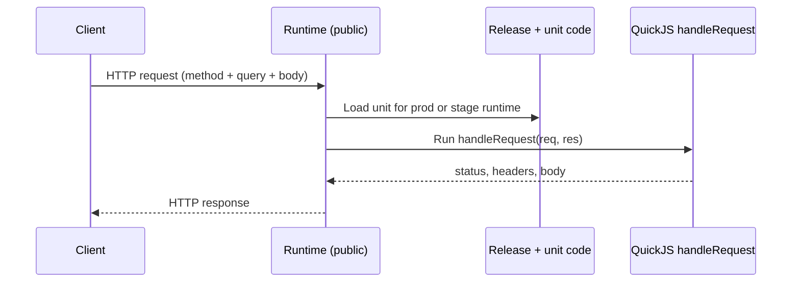

import {
  Callout,
  Cards,
  Details,
  Steps,
  Summary,
  Tabs,
} from 'nextra/components'

export const metadata = {
  title: 'API Unit',
}

# API Unit

An **API unit** is a single public HTTP endpoint: one path, one HTTP method, one request-response handler. Use it for REST-style APIs, webhooks, file downloads, and any short-lived request/response work.

The AI authors the unit (path, method, types, and handler). You trigger it through the dashboard **Live interaction** client (or any external HTTP client) after it is released.

The **unit path** of an API unit is:

```
{context}.{module}.api.{unit_name}
```

Example: `shop.orders.api.list-orders`

The AI uses this path when it writes unit code (SDK calls, `@units/…` imports, and related wiring). You work with the unit through the dashboard and its public trigger URL — you do not construct the path yourself.

<Callout type="important">
One API unit = one endpoint = one HTTP method. The AI does not switch on `req.method` or handle multiple verbs in one unit — it creates a separate unit per method (e.g. `create-order` for POST, `list-orders` for GET).
</Callout>

## What they are for

| Use case | Why an API unit |
| --- | --- |
| Public HTTP APIs | Stable trigger URL your app, mobile client, or partner can call |
| Webhooks | Receive Stripe, GitHub, or other provider callbacks |
| Thin gateway | Start a workflow, call an actor, or enqueue a worker, then return immediately |
| Downloads / non-JSON | Return attachments, plain text, or custom headers |
| Cross-unit HTTP | Call another API unit with `fetch` + `sdk.getApiUnitTriggerUrl` |

API units are **not** durable. Long-running orchestration belongs in a **workflow**; background jobs belong in a **queue worker**; entity-scoped state belongs in an **actor**.

## Unit path and URL shape

**Unit path:** `{context}.{module}.api.{unit_name}`

The platform owns the HTTP trigger URL. The AI chooses the slugs (`context`, `module`, `unit_name`) when it creates the unit. The unit type (`api`) is part of the unit path but **not** in the trigger URL — the runtime route is dedicated to API units.

| Segment | In unit path | In trigger URL |
| --- | --- | --- |
| `context` | yes | yes |
| `module` | yes | yes |
| `api` (unit type) | yes | **no** |
| `unit_name` | yes | yes |
| revision | only in full unit id | **no** |

Unit path: `shop.orders.api.list-orders`  
Full unit id (with revision): `shop.orders.api.list-orders.3`  
Trigger URL tail: `shop/orders/list-orders`

## Trigger URLs (stage and production)

Base host (current platform):

```
https://runtime.baasforge.com
```

### Production

```
https://runtime.baasforge.com/api/v1/trigger/{project_id}/{context}/{module}/{unit_name}
```

Example:

```bash copy
curl -X GET \
  "https://runtime.baasforge.com/api/v1/trigger/PROJECT_ID/shop/orders/list-orders?status=pending"
```

### Stage

Stage includes the **runtime id** so each chat/stage environment stays isolated:

```
https://runtime.baasforge.com/api/v1/trigger/{project_id}/stage/{runtime_id}/{context}/{module}/{unit_name}
```

Example:

```bash copy
curl -X POST \
  "https://runtime.baasforge.com/api/v1/trigger/PROJECT_ID/stage/RUNTIME_ID/shop/orders/create-order" \
  -H "Content-Type: application/json" \
  -d '{"sku":"sku_1","qty":2}'
```

<Tabs items={['Production', 'Stage']}>
  <Tabs.Tab>
    ```text copy
    /api/v1/trigger/{project_id}/{context}/{module}/{unit_name}
    ```
    Loads the project's **live production** release for that unit path.
  </Tabs.Tab>
  <Tabs.Tab>
    ```text copy
    /api/v1/trigger/{project_id}/stage/{runtime_id}/{context}/{module}/{unit_name}
    ```
    Loads the **stage** release bound to that `runtime_id`. Wrong or unknown runtime → unit not found.
  </Tabs.Tab>
</Tabs>

<Callout type="info">
Stage vs production is a **path** difference (`/stage/{runtime_id}/…`), not a different hostname. The same runtime host serves both.
</Callout>

## Public vs private triggers

API unit triggers are **public**. Anyone who knows the URL can call them — webhooks, browsers, `curl`, other services. No private API key is required.

| Trigger surface | Auth |
| --- | --- |
| API units (`/api/v1/trigger/{project_id}/…`) | **Public** |
| Workflows (`/api/v1/trigger/wf/…`) | Private |
| Actors (`/api/v1/trigger/actor/…`) | Private |
| Queue workers (`/api/v1/trigger/workerQueue/…`) | Private |

<Callout type="warning">
Treat API URLs as internet-facing. When an endpoint needs auth, signature checks, or secrets validation, ask the AI to implement that **inside** the unit. Do not rely on URL obscurity alone.
</Callout>

## How to trigger an API unit

Draft units from a chat are not callable until released. After a stage or production release is live, trigger via the dashboard **Live interaction** client, or any external HTTP client (`curl`, Postman, …). Cross-unit calls from other units use `fetch` (written by the AI).

The AI chooses `api_method` when creating or modifying the unit (`GET`, `POST`, `PUT`, `PATCH`, `DELETE`, `OPTIONS`, `HEAD`). That value is stored in unit metadata and drives the dashboard client — call the endpoint with that method.

### Release from the dashboard (Develop)

Releases are created from the AI chat, not a separate Deploy page.

<Steps>
### Open Develop

Select your project → sidebar **Develop** → open (or start) a conversation where the AI created the units.

### Release to stage

In the release controller (thread bottom / secondary sidebar): **Release Stage** → pick a stage runtime → **Deploy**.  
For a later revision: **Deploy revision … to stage** → choose runtime → **Deploy**.

### (Optional) Release to production

After testing on stage: **Release production** → confirm → **Deploy to production**  
(or **Deploy revision … to production**).
</Steps>

You can also open the units page from a chat release badge (**Stage release …** / **Production release …**).

### Built-in dashboard HTTP client (Live interaction)

The dashboard embeds a Postman-style client for each API unit under **Live interaction**. It is generated automatically from metadata `method` and the exported `RequestBody` / `QueryParams` / `ResponseBody`. That surface is not hand-editable — if it looks wrong, ask the AI to fix the unit.

<Callout type="important">
Exported types power documentation **and** the Live interaction client. The AI must keep `RequestBody` / `QueryParams` / `ResponseBody` aligned with what the handler actually reads and writes.
</Callout>

**Stage (typical):**

<Steps>
### Open a runtime

Select your project → sidebar **Runtimes** → pick a runtime under **Busy stage runtimes** (or the stage runtime you deployed to).

### Open units

On the runtime card → **Open Units**.

### Find the API unit

Tab **All units** → locate the unit card.

### Open Live interaction

On the unit card → toggle **Live interaction**.

### Send a test request

In the embed → **Test Request** → fill query/body as needed → **Send**.
</Steps>

**Production:**

<Steps>
### Open Units & Releases

Select your project → sidebar **Units & Releases** (opens the live production release).

### Find and test

Tab **All units** → unit card → **Live interaction** → **Test Request** → **Send**.
</Steps>

<Callout type="info">
**Live interaction** is only available when the release is the runtime’s (or production’s) **live** release.
</Callout>

### Trace id (`X-Trace-Id`)

<Callout type="important">
Every API trigger response includes an **`X-Trace-Id`** header. That id ties together the spans for this HTTP call **and** nested SDK work it started (workflows, actors, queue jobs, further HTTP, and so on). The AI uses it to load traces, debug failures, and reason about what happened.
</Callout>

**From the dashboard after a test:**

1. After **Send** in Live interaction → open **Response Headers**
2. Copy the **`X-Trace-Id`** value
3. Give it to the AI:

<Steps>
### Open Debug

Select your project → sidebar **Debug** → modal **Start Debug**.

### Attach the trace

Field **by trace id** → paste the id (Enter to add more) → **let's start**.

### Describe the issue

The debug chat opens with the trace attached — explain what went wrong so the AI can investigate.
</Steps>

You can also paste the id into a normal **Develop** chat message. From `curl` / Postman / browser Network tab, look for the same response header.

```bash copy filename="curl-show-trace-id.sh"
curl -sS -D - -o /dev/null \
  "https://runtime.baasforge.com/api/v1/trigger/$PROJECT_ID/shop/orders/list-orders" \
  | grep -i '^x-trace-id:'
```

See also [Tracing & Debugging](/platform/tracing).

### External clients

```bash copy filename="curl-get.sh"
curl -sS -X GET \
  "https://runtime.baasforge.com/api/v1/trigger/$PROJECT_ID/shop/orders/list-orders?status=pending" \
  -H "Accept: application/json"
```

```bash copy filename="curl-post.sh"
curl -sS -X POST \
  "https://runtime.baasforge.com/api/v1/trigger/$PROJECT_ID/shop/orders/create-order" \
  -H "Content-Type: application/json" \
  -d '{"sku":"sku_1","qty":2}'
```

### From another unit (`fetch` + SDK URL)

There is **no** `sdk.callApiUnit`. When one unit must call another API unit, the AI writes `fetch` against a URL from `sdk.getApiUnitTriggerUrl`:

```typescript copy filename="call-sibling-api.ts"
import { sdk } from "@sdk";

const url = sdk.getApiUnitTriggerUrl({
  unitPathOrId: "shop.orders.api.create-order",
});

const resp = await fetch(url, {
  method: "POST",
  headers: { "Content-Type": "application/json" },
  body: JSON.stringify({ sku: "sku_1", qty: 2 }),
});
```

`getApiUnitTriggerUrl` is runtime-aware: inside a stage trigger it emits a `/stage/{runtime_id}/…` URL; in production it emits the production URL.

## Path, query, and body

<Callout type="error">
**Path parameters are not supported.** URLs like `…/orders/{id}` or `…/users/:userId` are forbidden. The trigger path is fixed and immutable. Variable input goes in the **query string** or **request body**.
</Callout>

| Input channel | Supported | How unit code reads it |
| --- | --- | --- |
| Extra path segments / `:params` | **No** | — |
| Query string | **Yes** | `new URL(req.url ?? "/", "http://localhost").searchParams` |
| Body (POST/PUT/PATCH/…) | **Yes** | `text(req)` / `buffer(req)` from `node:stream/consumers` |
| Headers | **Yes** | `req.headers` |

Body size limit forwarded into the handler: **512 KiB**. Larger bodies are rejected before JS runs.

## HTTP method (chosen by the AI)

When the AI creates or modifies an API unit it sets `api_method` (tool argument). Allowed values:

`GET` · `POST` · `PUT` · `PATCH` · `DELETE` · `OPTIONS` · `HEAD`

That value is persisted in unit metadata as `method` and used by the dashboard HTTP client. Convention: **one unit, one method** — the AI does not implement multi-method routing inside `handleRequest`.

Optional metadata: `timeout_seconds` (handler wall-clock limit), also set by the AI when needed. Default **30s** if omitted, `0`, or invalid; max **3600s**. On timeout the runtime returns **504** with `api unit execution timed out`.

## Required contract (exports)

Every API unit the AI writes must export exactly these:

| Export | Rule |
| --- | --- |
| `export type RequestBody` | Body shape, or `never` if no body |
| `export type QueryParams` | Query shape, or `never` if none |
| `export type ResponseBody` | Concrete object type — **`never` is forbidden** |
| `export async function handleRequest` | `(req, res) => Promise<void>` |

```typescript copy filename="skeleton.ts"
import type { IncomingMessage, ServerResponse } from "node:http";

export type RequestBody = never;
export type QueryParams = { status?: string };
export type ResponseBody = { orders: { id: string }[] };

export async function handleRequest(
  req: IncomingMessage,
  res: ServerResponse,
): Promise<void> {
  // …
}
```

Forbidden exports: `export default`, extra type aliases, `export const` / `export class`, re-exports (`export { … }`, `export *`).

<Callout type="warning">
`handleRequest` must be `async` with top-level `await`. The AI must not use `void (async () => { … })()` — the runtime will not await that pattern and the HTTP response can finish early.
</Callout>

### Cross-unit type imports

Other units can import types for compile-time safety (stripped at runtime). The AI adds these imports when wiring units together:

```typescript copy
import type { RequestBody, ResponseBody, QueryParams } from "@units/shop.orders.api.create-order";
```

## Handler shape (what the AI writes)

Handlers receive Node-style `IncomingMessage` / `ServerResponse` (from `node:http`). The handler fully controls status, headers, and body via `res.writeHead` / `res.end`.

Allowed imports (same as other units):

1. `node:*` (platform-supported builtins)
2. `@sdk`
3. `@units/*` — **type-only** unless the target unit is a `common` unit type

### GET + query params

```typescript copy filename="query-params.ts"
import type { IncomingMessage, ServerResponse } from "node:http";

export type RequestBody = never;
export type ResponseBody = { params: Record<string, string> };
export type QueryParams = { [key: string]: string };

export async function handleRequest(req: IncomingMessage, res: ServerResponse): Promise<void> {
  const url = new URL(req.url ?? "/", "http://localhost");
  const params: Record<string, string> = {};
  url.searchParams.forEach((value, key) => {
    params[key] = value;
  });
  res.writeHead(200, { "Content-Type": "application/json" });
  res.end(JSON.stringify({ params } satisfies ResponseBody));
}
```

### POST + JSON body

```typescript copy filename="echo.ts"
import type { IncomingMessage, ServerResponse } from "node:http";
import { text } from "node:stream/consumers";

export type RequestBody = Record<string, unknown>;
export type ResponseBody = { echoed: Record<string, unknown>; method: string };
export type QueryParams = never;

export async function handleRequest(req: IncomingMessage, res: ServerResponse): Promise<void> {
  const raw = await text(req);
  let body: Record<string, unknown> = {};
  if (raw) {
    try {
      body = JSON.parse(raw) as Record<string, unknown>;
    } catch {
      body = { raw };
    }
  }
  const responseBody: ResponseBody = {
    echoed: body,
    method: req.method ?? "UNKNOWN",
  };
  res.writeHead(200, { "Content-Type": "application/json" });
  res.end(JSON.stringify(responseBody));
}
```

### Reading headers

```typescript copy filename="headers.ts"
import type { IncomingMessage, ServerResponse } from "node:http";

export type RequestBody = never;
export type ResponseBody = { received: Record<string, string> };
export type QueryParams = never;

export async function handleRequest(req: IncomingMessage, res: ServerResponse): Promise<void> {
  const probeKeys = ["content-type", "x-test-header", "x-custom-value", "accept"];
  const received: Record<string, string> = {};
  for (const key of probeKeys) {
    const val = req.headers[key];
    if (typeof val === "string") {
      received[key] = val;
    }
  }
  res.writeHead(200, { "Content-Type": "application/json" });
  res.end(JSON.stringify({ received } satisfies ResponseBody));
}
```

### Non-JSON response (download)

```typescript copy filename="attachment-download.ts"
import type { IncomingMessage, ServerResponse } from "node:http";

export type RequestBody = never;
export type ResponseBody = { kind: "attachment"; name: string; lines: number };
export type QueryParams = never;

export async function handleRequest(_req: IncomingMessage, res: ServerResponse): Promise<void> {
  const payload = "alpha\nbeta\ngamma\n";
  const snapshot: ResponseBody = { kind: "attachment", name: "sample-lines.txt", lines: 3 };
  res.writeHead(200, {
    "Content-Type": "text/plain; charset=utf-8",
    "Content-Disposition": 'attachment; filename="sample-lines.txt"',
    "X-Test-Download-Meta": JSON.stringify(snapshot),
  });
  res.end(payload);
}
```

### Multipart form upload

The AI uses `@mjackson/multipart-parser` on the **root** import with `buffer(req)` — not Fetch `Request` helpers:

```typescript copy filename="multipart-form.ts"
import type { IncomingMessage, ServerResponse } from "node:http";
import { Buffer } from "node:buffer";
import { buffer } from "node:stream/consumers";
import { getMultipartBoundary, parseMultipart } from "@mjackson/multipart-parser";

export type RequestBody = never;
export type ResponseBody = {
  fields: Record<string, string>;
  files: Record<string, { filename: string; mediaType: string | null; byteLength: number; base64: string }[]>;
};
export type QueryParams = never;

export async function handleRequest(req: IncomingMessage, res: ServerResponse): Promise<void> {
  const ct = req.headers["content-type"];
  const contentType = Array.isArray(ct) ? (ct[0] ?? "") : (ct ?? "");
  const boundary = getMultipartBoundary(contentType);
  if (!boundary) {
    res.writeHead(400, { "Content-Type": "application/json" });
    res.end(JSON.stringify({ error: "multipart boundary not found" }));
    return;
  }

  const bodyBytes = await buffer(req);
  const fields: Record<string, string> = {};
  const files: ResponseBody["files"] = {};
  for (const part of parseMultipart(bodyBytes, { boundary })) {
    if (!part.name) continue;
    if (part.isText) {
      fields[part.name] = part.text;
    } else if (part.isFile) {
      (files[part.name] ??= []).push({
        filename: part.filename ?? "unknown",
        mediaType: part.mediaType ?? null,
        byteLength: part.bytes.length,
        base64: Buffer.from(part.bytes).toString("base64"),
      });
    }
  }

  res.writeHead(200, { "Content-Type": "application/json" });
  res.end(JSON.stringify({ fields, files } satisfies ResponseBody));
}
```

## Calling other unit types from an API unit

API units often act as HTTP gateways into the rest of the platform. The AI wires these SDK calls inside the handler.

| Goal | SDK helper | Blocks HTTP response? |
| --- | --- | --- |
| Start workflow, return immediately | `sdk.startWorkflowSync` | No (only blocks until sdk call is sent) |
| Wait for workflow output | `sdk.callWorkflowAndWaitForOutputSync` | **Yes** |
| Signal a running workflow | `sdk.callWorkflowHandlerAndWaitForResultSync` | **Yes** |
| Call actor and wait | `sdk.callActorAndWaitForResultSync` | **Yes** |
| Actor fire-and-forget | `sdk.sendActorMessageSync` | No (only blocks until sdk call is sent) |
| Enqueue job | `sdk.enqueueWorkerSync` | No (only blocks until sdk call is sent) |
| Call another API unit | `fetch` + `sdk.getApiUnitTriggerUrl` | Until `fetch` completes |

<Callout type="warning">
`…AndWaitFor…Sync` helpers block until remote work finishes. For workflows that wait on signals, the AI should use `startWorkflowSync`, return an `instanceId`, and signal later — not hold the HTTP response open.
</Callout>

```typescript copy filename="start-workflow-ff.ts"
import type { IncomingMessage, ServerResponse } from "node:http";
import { text } from "node:stream/consumers";
import { sdk } from "@sdk";

export type RequestBody = { value?: unknown };
export type ResponseBody = { instanceId: string };
export type QueryParams = never;

export async function handleRequest(req: IncomingMessage, res: ServerResponse): Promise<void> {
  const raw = await text(req);
  let body: RequestBody = {};
  try {
    body = JSON.parse(raw) as RequestBody;
  } catch {
    // defaults
  }

  const { instanceId } = sdk.startWorkflowSync<{ value: unknown }>({
    unitPath: "billing.payments.workflow.charge",
    input: { value: body.value ?? null },
  });

  res.writeHead(200, { "Content-Type": "application/json" });
  res.end(JSON.stringify({ instanceId: String(instanceId) } satisfies ResponseBody));
}
```

```typescript copy filename="api-to-api-via-sdk.ts"
import type { IncomingMessage, ServerResponse } from "node:http";
import { sdk } from "@sdk";

export type RequestBody = never;
export type ResponseBody = { url: string; echoed: Record<string, unknown> };
export type QueryParams = never;

export async function handleRequest(_req: IncomingMessage, res: ServerResponse): Promise<void> {
  const url = sdk.getApiUnitTriggerUrl({ unitPathOrId: "shop.orders.api.echo" });

  const echoResp = await fetch(url, {
    method: "POST",
    headers: { "Content-Type": "application/json" },
    body: JSON.stringify({ via: "sdk-url" }),
  });

  const echoBody = (await echoResp.json()) as Record<string, unknown>;
  const echoed = (echoBody["echoed"] as Record<string, unknown> | undefined) ?? {};

  res.writeHead(200, { "Content-Type": "application/json" });
  res.end(JSON.stringify({ url, echoed } satisfies ResponseBody));
}
```

<Callout type="info">
Sync SDK helpers return plain values — unit code must not `await sdk.xxxSync(…)`. `await` on a non-Promise is a no-op and confuses readers.
</Callout>

## How execution works

<Steps>
### Request hits the runtime

`GET|POST|PUT|PATCH|DELETE|HEAD|OPTIONS` on the public trigger path.

### Unit loaded from live release

Production or stage release (by `runtime_id`) must contain the unit. Code is loaded from Postgres (Redis-cached), scoped by chat session in the release metadata.

### QuickJS handler run

The platform prepares `req`/`res`, injects `@sdk`, runs `handleRequest`, and maps status/headers/body back to the HTTP response.

### Timeout enforced in Rust

Wall clock from `metadata.timeout_seconds` (default 30s). Timeout → HTTP 504.
</Steps>



## Limits and operational notes

| Topic | Detail |
| --- | --- |
| Public access | No private API key; CORS allows credentials from any origin at the runtime edge |
| Body size | Max **512 KiB** into the unit |
| Default timeout | **30 seconds** |
| Max timeout | **3600 seconds** (via `api_timeout_seconds` / metadata) |
| Project isolation | SDK calls stay inside the same `project_id` |
| Stage isolation | Stage URLs include `runtime_id`; production and stage state do not mix |
| Observability | Response header `X-Trace-Id` (full call + nested SDK spans); copy → **Debug** → **Start Debug** → **by trace id** |

## Common mistakes

<Details>
  <Summary>Path parameters in the URL design</Summary>
  The platform URL cannot include `/{id}`. The AI must pass `id` as `?id=` or in the JSON body.
</Details>

<Details>
  <Summary>One unit handling GET and POST</Summary>
  The AI should split into two units with different slugs and `api_method` values.
</Details>

<Details>
  <Summary>`void (async () => …)()` inside `handleRequest`</Summary>
  The AI must make `handleRequest` itself `async` and `await` work so the response waits for completion.
</Details>

<Details>
  <Summary>Blocking forever on a signal-waiting workflow</Summary>
  Prefer `startWorkflowSync` + later `callWorkflowHandlerAndWaitForResultSync`, not `callWorkflowAndWaitForOutputSync` on a workflow that never finishes without a signal.
</Details>

<Details>
  <Summary>Wrong or stale exported types</Summary>
  The dashboard docs/client only follow exports. These exports are enforced by the Technical reviewer pipelines automatically to ensure all required exports are included in the unit's code.
</Details>

## Quick reference

| Item | Value |
| --- | --- |
| Entry point | `export async function handleRequest(req, res): Promise<void>` |
| Unit path | `{context}.{module}.api.{unit_name}` (chosen by AI) |
| Production URL | `https://runtime.baasforge.com/api/v1/trigger/{project_id}/{context}/{module}/{unit_name}` |
| Stage URL | `https://runtime.baasforge.com/api/v1/trigger/{project_id}/stage/{runtime_id}/{context}/{module}/{unit_name}` |
| Auth | Public |
| Path params | Not supported |
| Query / body | Supported |
| Method | Chosen by AI (`api_method`), one per unit |
| Dashboard try-it | **Runtimes** → **Open Units** → **All units** → **Live interaction** → **Test Request** → **Send** |
| Release | **Develop** chat → **Release Stage** / **Release production** |
| Call from units | `fetch` + `sdk.getApiUnitTriggerUrl` (written by AI) |
| Debug a call | Response **X-Trace-Id** → **Debug** → **Start Debug** → **by trace id** |

<Cards>
  <Cards.Card title="Units" href="/platform/units" />
  <Cards.Card title="Workflow Unit" href="/platform/units/workflow-unit" />
  <Cards.Card title="Actor Unit" href="/platform/units/actor-unit" />
  <Cards.Card title="Queue Worker Unit" href="/platform/units/queue-worker-unit" />
  <Cards.Card title="Glossary" href="/platform/glossary" />
</Cards>
