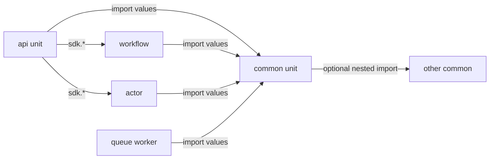

import {
  Callout,
  Cards,
  Details,
  Steps,
  Summary,
  Tabs,
} from 'nextra/components'

export const metadata = {
  title: 'Common Unit',
}

# Common Unit

A **common unit** is a shared TypeScript library: named exports (functions, constants, types) that other units import at runtime. Use it to deduplicate logic across all other units in the same project.

The AI authors the unit (path, exports, and helpers). You never call a common unit directly — there is **no trigger URL** and **no Live interaction**. It only runs when another released unit imports it.

The **unit path** of a common unit is:

```
{context}.{module}.common.{unit_name}
```

Example: `billing.shared.common.money`

The AI uses this path in `@units/…` imports. You work with the unit through the dashboard (browse, release, ask the AI to change it) — you do not construct the path yourself.

<Callout type="important">
Common units are **importable**, not **callable**. Describe shared logic in product terms (e.g. “format money the same way everywhere we show prices”); the AI places it in a common unit and imports it from the units that need it. Do not expect a public URL or try-it client for a common unit.
</Callout>

## What they are for

| Use case | Why a common unit |
| --- | --- |
| Shared helpers | Format money, normalize slugs, validate payloads once — reuse from many units |
| Shared constants | Limits, statuses, pure config **values that are not secrets** |
| Shared types | Domain types exported and imported where needed |
| Nested libraries | One common imports another (composer / leaf helpers) |
| Thin SDK wrappers | Shared functions that call `sdk.*` so several APIs use the same bridge |

Common units are **not** entrypoints. Long-running work stays in workflows; HTTP stays in API units; entity state stays in actors; background jobs stay in queue workers.

### Example scenarios

- **Billing** — `billing.shared.common.money` exports `formatMoney` / `centsToMajor`; API list-orders and a charge workflow both import it.
- **Auth helpers** — `auth.shared.common.tokens` exports pure JWT claim parsers used by several API units (secrets still come from dashboard's **Environment Variables**, not from the common unit).
- **Domain math** — `shop.catalog.common.pricing` exports `withTax` / `applyDiscount`; actors and queue workers import the same functions.
- **SDK bridge** — `ops.shared.common.bridges` exports `incrementCounterViaCommon(…)` wrapping `sdk.callActorAndWaitForResultSync` so multiple API units share one call shape.

## Unit path

**Unit path:** `{context}.{module}.common.{unit_name}`

| Segment | Example | Role |
| --- | --- | --- |
| `context` | `billing` | Domain boundary (AI-chosen) |
| `module` | `shared` | Sub-area (AI-chosen) |
| `common` | `common` | Unit type — fixed for this kind |
| `unit_name` | `money` | Library name (AI-chosen) |

Full unit id (with revision): `billing.shared.common.money.3`

Import path the AI writes:

```typescript copy
import { formatMoney } from "@units/billing.shared.common.money";
```

Path shape after `@units/`: four segments — `context.module.common.unit_name`.

## Not callable — import only

| Surface | Common unit |
| --- | --- |
| Public / private trigger URL | **None** |
| Dashboard **Live interaction** | **Not available** |
| How code reaches it | Other units **value-import** named exports |
| How executables talk to each other | Still `@sdk` (workflows, actors, queue workers, API URLs) |

<div style={{ height: "1.5rem" }} />



<Callout type="info">
Orchestration between executable units always uses `@sdk`. Common units only share **library code** (and can wrap `sdk` inside exported functions — see [SDK bridges](#sdk-bridges-inside-common-units)).
</Callout>

## Import rules

These rules are enforced by the platform reviewer and runtime.

| Import | Allowed? |
| --- | --- |
| `import { fn } from "@units/….common.…"` | **Yes** — runtime value import |
| `import type { T } from "@units/….any_type.…"` | **Yes** — any unit type (erased at compile time) |
| `import { handler } from "@units/….api.…"` (or actor / workflow / queue_worker) | **No** — use `@sdk` instead |
| Default import from `@units/…` | **No** |
| Bare `import "@units/…"` or `import * as ns from "@units/…"` | **No** — named bindings only |

```typescript copy filename="allowed-imports.ts"
import type { ChargeInput } from "@units/billing.payments.workflow.charge";
import { formatMoney } from "@units/billing.shared.common.money";
```

```typescript copy filename="forbidden-imports.ts"
// Wrong — value import from a non-common unit
import { handleRequest } from "@units/shop.orders.api.list-orders";

// Wrong — default / namespace / bare
import money from "@units/billing.shared.common.money";
import * as money from "@units/billing.shared.common.money";
import "@units/billing.shared.common.money";
```

Typical runtime errors when rules are broken:

- `"wrong import"` — value import from a non-common unit, or default import from `@units/…`
- `"unnamed imports from common units are not allowed"` — bare or star-from forms

<Callout type="info">
The platform already instructs and reviews the AI for these import rules. You only describe the shared behavior you need — you do not need to remind the AI about named bindings or other technical forms.
</Callout>

## What the AI puts in a common unit

Common units have **no** `handleRequest`, `workflow(…)`, `actor(…)`, or queue-worker entrypoint.

### Allowed exports

| Form | OK |
| --- | --- |
| `export function …` | Yes |
| `export const …` (pure initializer) | Yes |
| `export type …` | Yes |
| `export { … }` / re-export aliases | Yes |
| `export default` | **Forbidden** |

### Module body constraints

- Body is for **`import` + `export` only** — no bare top-level `const`/`let` that is not exported
- No top-level `sdk` calls at import time — `import { sdk }` is fine if used **inside** exported functions
- Same sandbox as other units: no `console`, no `process`, only allowlisted `node:*` / npm
- Circular common → common imports fail at load (`circular common import: …`)

```typescript copy filename="billing.shared.common.money.ts"
export const CURRENCY = "USD";

export function formatMoney(cents: number): string {
  return `${(cents / 100).toFixed(2)} ${CURRENCY}`;
}

export type Money = { cents: number; currency: string };
```

<Callout type="warning">
**Secrets and environment config do not belong in common units.** Put API keys, tokens, passwords, and environment-specific values in dashboard **Variables**. The AI automatically scans the project’s environment keys and wires them where needed — you do not need to name a specific key or tell the AI how to read it. Common units are for **shared code**, not a config or secrets store.
</Callout>

## Secrets and Variables (critical)

| Put here | Do not put here |
| --- | --- |
| Pure helpers, formatters, validators, shared types | API keys, tokens, passwords, connection strings |
| Non-secret constants (e.g. default page size `20`) | Staging/production-specific secrets |

**Dashboard path for variables:**

Select your project → sidebar **Variables** → **Non-encrypted** or **Encrypted** → add the key.

The AI automatically discovers configured keys for that project (key **names** only for encrypted values — never the secret values themselves) and uses them in units when your feature needs them. You do not need to tell the AI which key to call.

## Code examples (patterns the AI writes)

Examples below mirror platform test patterns, with product-style paths.

### API unit importing shared helpers

Common unit (`billing.shared.common.math`):

```typescript copy filename="billing.shared.common.math.ts"
export const FACTOR = 10;

export function sharedSum(a: number, b: number): number {
  return a + b + FACTOR;
}
```

API unit importing it:

```typescript copy filename="billing.reports.api.summary.ts"
import type { IncomingMessage, ServerResponse } from "node:http";
import { FACTOR, sharedSum } from "@units/billing.shared.common.math";

export type RequestBody = never;
export type QueryParams = never;
export type ResponseBody = { factor: number; sum: number };

export async function handleRequest(_req: IncomingMessage, res: ServerResponse): Promise<void> {
  const body: ResponseBody = {
    factor: FACTOR,
    sum: sharedSum(1, 2),
  };
  res.writeHead(200, { "Content-Type": "application/json" });
  res.end(JSON.stringify(body));
}
```

### Same export names from two commons (alias)

```typescript copy filename="alias-collision.ts"
import { TOKEN as ALPHA_TOKEN } from "@units/pkg.alpha.common.tokens";
import { TOKEN as BETA_TOKEN } from "@units/pkg.beta.common.tokens";
```

When two commons export the same name, the AI aliases the imports so both can be used.

### Nested common → common

```typescript copy filename="billing.shared.common.composer.ts"
import { bump as bumpA } from "@units/billing.shared.common.leaf-a";
import { bump as bumpB } from "@units/billing.shared.common.leaf-b";

export function compose(n: number): number {
  return bumpA(n) + bumpB(n);
}
```

### Actor / workflow / queue worker using a common helper

```typescript copy filename="shop.cart.actor.counter.ts"
import { actor } from "@sdk";
import { withOffset } from "@units/shop.shared.common.offset";

export type State = { count: number };
export type IncrementInput = { by?: number };
export type CountOutput = { count: number };

export default actor<State>({
  state: { count: 0 },
  handlers: {
    increment(ctx, payload?: IncrementInput): CountOutput {
      const by = payload?.by ?? 1;
      ctx.state.count = withOffset(ctx.state.count + by);
      return { count: ctx.state.count };
    },
  },
});
```

```typescript copy filename="shop.shared.workflow.apply-offset.ts"
import { workflow } from "@sdk";
import { withOffset } from "@units/shop.shared.common.offset";

export type Input = { n: number };
export type Output = { result: number };

export default workflow<Input, Output>({
  run: async (ctx, input) => {
    return await ctx.run("offset-step", () => ({ result: withOffset(input.n) }));
  },
});
```

### Type from a non-common + value from a common

```typescript copy filename="mixed-imports.ts"
import type { State } from "@units/shop.cart.actor.counter";
import { FACTOR } from "@units/billing.shared.common.math";
```

### Type and value from the same common

```typescript copy filename="type-and-value.ts"
import type { SizeTag } from "@units/ui.shared.common.sizes";
import { SIZE } from "@units/ui.shared.common.sizes";
```

### SDK bridges inside common units

A common unit may import `@sdk` and wrap calls **inside exported functions** (not at module top level). Other units then import that wrapper:

```typescript copy filename="ops.shared.common.bridges.ts"
import { sdk, type ActorInstanceId } from "@sdk";

export function incrementViaCommon(
  actorId: ActorInstanceId,
  by = 1,
): { count: number } {
  return sdk.callActorAndWaitForResultSync<{ by: number }, { count: number }>({
    unitPath: "shop.cart.actor.counter",
    actorId,
    handler: "increment",
    payload: { by },
    opts: { timeoutMs: 30_000 },
  });
}
```

```typescript copy filename="shop.cart.api.bump.ts"
import type { IncomingMessage, ServerResponse } from "node:http";
import { text } from "node:stream/consumers";
import { incrementViaCommon } from "@units/ops.shared.common.bridges";
import type { ActorInstanceId } from "@sdk";

export type RequestBody = { actorId?: string; by?: number };
export type ResponseBody = { count: number };
export type QueryParams = never;

export async function handleRequest(req: IncomingMessage, res: ServerResponse): Promise<void> {
  const raw = await text(req);
  const body = (JSON.parse(raw || "{}") as RequestBody) ?? {};
  const result = incrementViaCommon(
    (body.actorId ?? "default") as ActorInstanceId,
    body.by ?? 1,
  );
  res.writeHead(200, { "Content-Type": "application/json" });
  res.end(JSON.stringify(result satisfies ResponseBody));
}
```

The same pattern works for workflow and queue-worker SDK helpers inside a common unit.

## Create and change common units (Develop)

There is no code editor for units. Describe the shared product logic; the AI creates or modifies the common unit and wires imports in callers.

<Steps>
### Open Develop

Select your project → sidebar **Develop** → open or start a conversation.

### Describe the shared behavior

Example: *“Format money the same way on list-orders and create-order — currency, decimals, and rounding must match everywhere we show a price.”*

### Review the draft

The AI creates or updates the shared helpers and the units that use them. Drafts are not live until you release.

### Release to staging

In the release controller: **Release Stage** → pick a staging runtime → **Deploy**.

### Promote when ready

**Release production** → confirm → **Deploy to production**.
</Steps>

### Find common units in the dashboard

<Tabs items={['Staging', 'Production']}>
  <Tabs.Tab>
    <Steps>
### Open a runtime

Select your project → sidebar **Runtimes** → pick a staging runtime.

### Open units

On the runtime card → **Open Units**.

### Find the common unit

Tab **All units** → filter **common** unit type → open the unit card for explanation and dependencies.
    </Steps>
  </Tabs.Tab>
  <Tabs.Tab>
    <Steps>
### Open Units & Releases

Select your project → sidebar **Units & Releases**.

### Find the common unit

Tab **All units** → filter **common** unit type → unit card.
    </Steps>
  </Tabs.Tab>
</Tabs>

<Callout type="info">
Common unit cards have **no Live interaction** toggle. To verify shared code, trigger an **API** (or other executable) unit that imports it — staging or production — and inspect the response / trace.
</Callout>

**How to test shared helpers end-to-end:**

<Steps>
### Release both units

Release the common unit **and** the API (or actor / workflow / queue worker) that imports it to the same staging or production release.

### Trigger the executable

Select your project → **Runtimes** → **Open Units** → API unit card → **Live interaction** → **Test Request** → **Send**  
(or **Units & Releases** for production).

### Debug if needed

Copy **`X-Trace-Id`** from the response → sidebar **Debug** → **Start Debug** → **by trace id**.
</Steps>

## Staging vs production

Common units are released like every other unit. The same unit path can resolve to **different compiled code** per staging runtime vs production — staging isolation applies to commons too.

Ask the AI for staging-specific behavior when needed; do not assume a common unit in staging automatically matches production until you promote.

## Dependencies (`depends_on`)

When a unit is saved, the platform records `@units/*` imports (type and value) on `depends_on`. That graph helps the AI and release checks understand which commons a unit needs.

When a common unit’s exports change, the AI automatically scans dependents and tries to update them too — you do not need to list every caller yourself.

## Limits and operational notes

| Topic | Detail |
| --- | --- |
| Trigger / Live interaction | None — import only |
| Value imports | Only from `…common…` paths |
| Named bindings | Required for all `@units/*` imports |
| Default export | Forbidden on common units |
| Nested commons | Supported; cycles rejected at load |
| Packages / `node:*` | Same allowlist as other units |
| Secrets | Dashboard **Variables** (AI discovers keys automatically) — never in common source |
| Project isolation | Imports stay inside the same project |
| Staging isolation | Each staging runtime loads its own common revision |

## Common mistakes

<Details>
  <Summary>Trying to “call” a common unit like an API</Summary>
  Commons have no URL. Ask the AI to use the shared logic from the HTTP endpoint (or other entrypoint) you actually call, then trigger that entrypoint.
</Details>

<Details>
  <Summary>Putting secrets or env config in a common unit</Summary>
  Use **Variables** (Select project → **Variables**). The AI scans those keys automatically. Commons stay shared **code**.
</Details>

<Details>
  <Summary>Value-importing an API / actor / workflow / queue worker</Summary>
  Only commons are value-importable. For other kinds, AI will use `@sdk` (or `fetch` + `sdk.getApiUnitTriggerUrl` for APIs).
</Details>

<Details>
  <Summary>`export default` on a common unit</Summary>
  The platform rejects default exports automatically. Common units use named exports only.
</Details>

<Details>
  <Summary>Namespace or bare `@units/` imports</Summary>
  The platform rejects these automatically. Supported form is named bindings only (`import { name } from "@units/…"`).
</Details>

<Details>
  <Summary>Top-level `sdk` work when the common module loads</Summary>
  SDK usage belongs inside exported functions so work runs when callers invoke them — not at import time.
</Details>

<Details>
  <Summary>Releasing a caller without the common it imports</Summary>
  Both the common and the importing unit must be in the live staging/production release, or the runtime cannot load the module.
</Details>

## Quick reference

| Item | Value |
| --- | --- |
| Role | Shared library (functions, constants, types) |
| Unit path | `{context}.{module}.common.{unit_name}` (chosen by AI) |
| Entry point | None — named exports only |
| Trigger URL | None |
| Dashboard try-it | Not available — test via an importing executable unit |
| Import | `import { … } from "@units/context.module.common.name"` |
| Type-only from others | `import type { … } from "@units/…"` |
| Release | **Develop** chat → **Release Stage** / **Release production** |
| Find in UI | **Runtimes** → **Open Units** → **All units** → filter **common** (or **Units & Releases** for production) |
| Secrets / config | **Variables** (AI discovers keys) — not inside the common unit |
| Cross-unit orchestration | Still `@sdk` between executable units |

<Cards>
  <Cards.Card title="Units" href="/platform/units" />
  <Cards.Card title="API Unit" href="/platform/units/api-unit" />
  <Cards.Card title="Actor Unit" href="/platform/units/actor-unit" />
  <Cards.Card title="Workflow Unit" href="/platform/units/workflow-unit" />
  <Cards.Card title="Queue Worker Unit" href="/platform/units/queue-worker-unit" />
  <Cards.Card title="Variables" href="/platform/variables" />
  <Cards.Card title="Glossary" href="/platform/glossary" />
</Cards>
