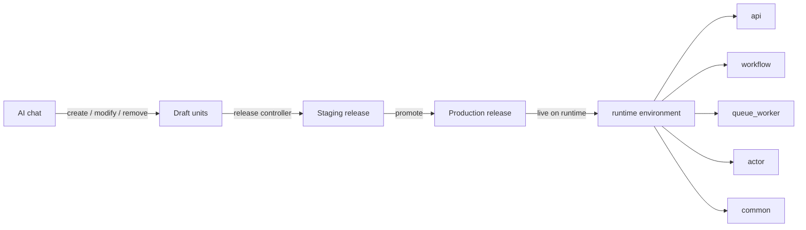
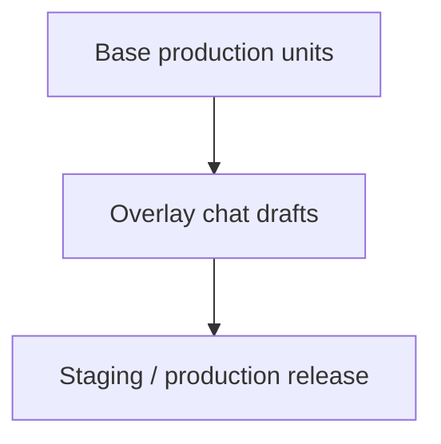
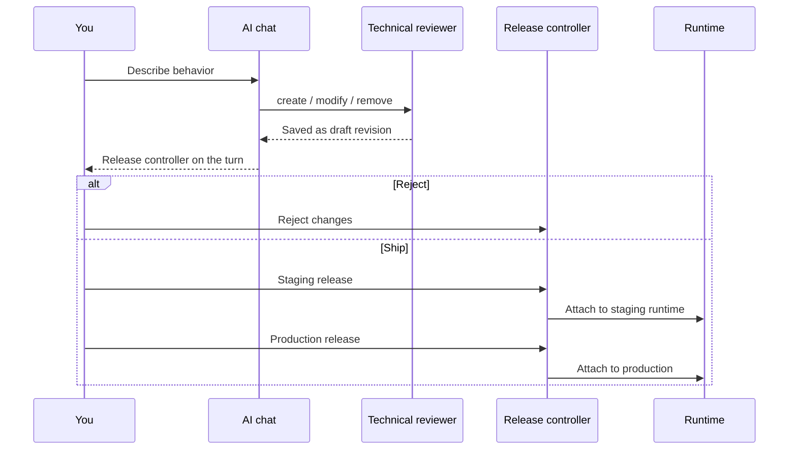

import {
  Callout,
  Cards,
  Details,
  FileTree,
  Steps,
  Summary,
  Tabs,
} from 'nextra/components'

export const metadata = {
  title: 'Units',
  asIndexPage: true,
}

# Units

A **unit** is the core primitive of BaaSForge. Every backend capability — HTTP
entry point, durable workflow, background job, stateful actor, or shared
library — is a unit: typed TypeScript that the platform stores, validates,
versions, and runs.

Units are not files in your repo. They are **platform-owned behaviors** with a
stable identity, a revision history, and a runtime model chosen by unit type.

<Callout type="important">
  Think **behaviors in a bounded architecture**, not source files in a folder
  tree. The AI authors them; the platform executes them.
</Callout>

## Philosophy

Traditional backends organize work as files, packages, and services you wire
together. BaaSForge organizes work as **units**:

| Traditional model | Units model |
| --- | --- |
| Files / folders you edit | Platform rows with path + revision |
| Framework choice (Express, Temporal SDK, …) | Unit type selects the runtime model |
| You deploy a repo | You release a chat-scoped set of unit changes |
| Cross-service HTTP / shared packages | `@sdk` + `@units/*` contracts |
| You invent folder layout | AI defines `context` / `module` domain boundaries |

Units exist so both **humans and AI** can reason about a large backend without
scanning a filesystem. Each unit has one job, one type, one path, and an
explicit dependency graph.



## Units vs filesystem files

| | Filesystem files | Units |
| --- | --- | --- |
| **Identity** | Path on disk | Four-segment unit path (+ integer revision) |
| **Ownership** | Your git repo | Project + chat session on the platform |
| **Editing** | IDE / PR | AI chat (manual edit is not possible) |
| **Deploy** | Build pipeline you operate | Staging → production release from chat |
| **Runtime** | Whatever you host | Managed QuickJS workers on BaaSForge runtimes |
| **Coupling** | Imports / shared packages / HTTP | Type imports, `common` value imports, `@sdk` calls |

There is no checkout of unit source into a local tree for day-to-day product
work. The dashboard and AI chat are the surface; the runtime environment loads
compiled code from the live release.

<Callout type="info">
  Under the hood the platform still stores TypeScript source and compiled JS —
  but that storage is **not** a developer-facing filesystem. You work with unit
  paths, revisions, and releases.
</Callout>

## Language

Units are written in **TypeScript** (Node-compatible APIs available through the
runtime allowlist).

- Source is TypeScript — plain JavaScript is rejected by the compiler gate.
- At runtime, compiled JS runs inside an embedded **QuickJS** engine on the
  execution plane.
- Only allowlisted imports are permitted: `@sdk`, `@units/*`, selected
  `node:*` modules, and selected npm packages.

<Callout type="warning">
  No `console`, no `process`, no arbitrary npm installs. Secrets and shared
  config come from **`sdk.getSecureEnv(key)`**, never hardcoding.
</Callout>

## Unit path and identity

Every unit has a canonical four-segment path:

```
{context}.{module}.{unit_type}.{unit_name}
```

Example: `billing.payments.workflow.charge`

| Segment | Meaning | Rules |
| --- | --- | --- |
| `context` | DDD **bounded context** / domain | `^[a-z]+(-[a-z]+)*$` — letters and hyphens only |
| `module` | **Subdomain** inside that context | Same slug rules |
| `unit_type` | Runtime model | `api` · `workflow` · `queue_worker` · `actor` · `common` |
| `unit_name` | Unit’s own name | Same slug rules — no digits in slugs |

Full unit id (row identity) appends the revision:

```
{context}.{module}.{unit_type}.{unit_name}.{revision}
```

Example: `billing.payments.workflow.charge.3`

<FileTree>
  <FileTree.Folder name="billing" defaultOpen>
    <FileTree.Folder name="payments" defaultOpen>
      <FileTree.File name="api.create-charge" />
      <FileTree.File name="workflow.charge" />
      <FileTree.File name="actor.payment-session" />
      <FileTree.File name="common.money" />
    </FileTree.Folder>
    <FileTree.Folder name="invoices">
      <FileTree.File name="queue_worker.send-invoice" />
    </FileTree.Folder>
  </FileTree.Folder>
</FileTree>

<Callout>
  Slugs never encode version numbers (`v2`, `step-1`, `api2` are invalid).
  Versioning is the platform’s **revision** integer — not part of the name.
</Callout>

### Can I edit a unit’s code myself?

**Only through AI chat.** There is no general-purpose code editor for
units. The product direction is to delegate code generation and edits entirely
to the multi-agent chat (Planner → analyzers → Developer), gated by the
technical reviewer before anything is saved.

You review, reject, stage, and promote — you don’t hand-edit TypeScript in a
repo for day-to-day work.

## Domain boundaries: context and module

Unit paths encode **domain-driven design** layers:

| Path segment | DDD meaning |
| --- | --- |
| `context` | Bounded context / domain (e.g. `billing`, `fulfillment`) |
| `module` | Subdomain inside that context (e.g. `payments`, `shipping`) |

These boundaries keep large projects navigable: list contexts, then modules,
then units — instead of a flat bag of functions.

<Callout type="important">
  **The AI defines context and module** when creating units. It is instructed
  to reuse existing domains when they fit, and to invent new ones only when
  the concept is genuinely different. You steer with product language in chat;
  the agents choose the path structure.
</Callout>

Why this helps:

- AI tools load related units by context / module instead of scanning everything
- Dependency and impact analysis stay scoped to a domain
- Releases and docs stay organized by business area, not by accidental folders

## Unit types at a glance

| Type | Role | Triggered how |
| --- | --- | --- |
| `api` | HTTP request–response | **Public** trigger URL |
| `workflow` | Durable multi-step orchestration | SDK (not public internet) |
| `queue_worker` | Background jobs with retry / DLQ | SDK (not public internet) |
| `actor` | Per-entity durable state + mailbox | SDK (not public internet) |
| `common` | Shared library (functions, types) | Imported by other units — **no trigger** |

Details for each type live on their own pages (cards at the bottom).

## How units communicate

Units do **not** import each other’s executable code like a normal monorepo.
Communication is intentional and typed.

### 1. Type imports from any unit

```typescript copy filename="caller.ts"
import type { Input, Output } from "@units/billing.payments.workflow.charge";
```

- Path shape: `@units/{context}.{module}.{unit_type}.{unit_name}`
- **`import type` only** from non-`common` units
- Compile-time contracts for SDK calls and auto docs
- Stripped before runtime — no runtime dependency on the other unit’s JS

### 2. Shared runtime code from `common` units

```typescript copy filename="api-unit.ts"
import { formatMoney } from "@units/billing.payments.common.money";
```

- Runtime **value** imports are allowed **only** when the type segment is `common`
- Use commons for shared helpers, constants, and types reused across units
- Executable kinds (`api`, `workflow`, `actor`, `queue_worker`) must not be
  value-imported

### 3. Runtime coupling via `@sdk`

Non-common units call each other through explicit SDK methods — never by
importing handlers:

```typescript copy filename="orchestrator.ts"
import { sdk } from "@sdk";
import type { ChargeInput, ChargeOutput } from "@units/billing.payments.workflow.charge";

const result = sdk.callWorkflowAndWaitForOutputSync<ChargeInput, ChargeOutput>({
  unitPath: "billing.payments.workflow.charge",
  input: { orderId, amount },
});
```

| Need | SDK surface (examples) |
| --- | --- |
| Start / await a workflow | `sdk.startWorkflowSync`, `sdk.callWorkflowAndWaitForOutputSync` |
| Signal a running workflow | `sdk.callWorkflowHandlerAndWaitForResultSync` |
| Call an actor | `sdk.callActorAndWaitForResultSync`, `sdk.sendActorMessageSync` |
| Enqueue a job | `sdk.enqueueWorkerSync` |
| Resolve another API’s URL | `sdk.getApiUnitTriggerUrl` (+ `fetch` if needed) |
| Secrets / env | `sdk.getSecureEnv` |

<Callout type="info">
  There is **no** generic `sdk.call`. Each unit type has its own semantics
  (blocking vs durable suspension vs fire-and-forget), so the SDK keeps
  per-type methods explicit.
</Callout>

Read more: [SDK](/platform/sdk).

### Dependency graph (`depends_on`)

When a unit is saved, the platform scans `@units/*` imports and stores an
explicit `depends_on` list. That graph powers AI context, impact analysis, and
pre-release checks — without inferring edges at runtime.

## How units use the BaaSForge SDK (`@sdk`)

Every executable unit imports platform capabilities from `@sdk`:

```typescript copy
import { sdk, workflow /* or actor, worker, … */ } from "@sdk";
```

At runtime, imports are resolved by the platform loader: `@sdk` is injected,
allowlisted `node:*` as modules, and `common` units load by
path. Host functions in the Rust runtime perform the real work (Redis, NATS,
unit lookup) — unit JS stays a thin, sandboxed surface.

What `@sdk` gives you:

- **Cross-unit invocation** with project isolation (no cross-project calls)
- **Unit-type constructors** (`workflow`, `actor`, queue worker entry shapes, …)
- **Secure env** via `getSecureEnv`
- **Trigger URL helpers** for API units

See [SDK](/platform/sdk) for the full surface.

## Drafts, revisions, and releases

### Revision

A **unit revision** is an **integer**. Each successful create / modify / remove
in a chat produces a new revision for that logical path. More updates → higher
revision.

- Product language is **revision**, not “version”
- Revisions are scoped per **chat session** (the same path can have revision
  `3` in two different chats)
- Full id includes the revision: `…charge.3`

### Draft units

Changes from AI chat are **draft units** until you release them:

- Created, modified, or soft-deleted in the current chat session
- Visible to later AI turns in that same session (effective unit set)
- **Not** live on production until you promote a release

### Creating, modifying, deleting

<Steps>
### Chat with the AI

Describe product behavior — not unit types or SDK terms. The multi-agent
pipeline plans and the Developer agent calls create / modify / remove tools.

### Technical gate

Nothing is saved until TypeScript compile, lint, and unit rules pass.

### Review the turn

A **release controller** appears under the assistant message when that turn
changed units — view diffs, reject, or release.

### Staging, then production

Build a staging release from the controller, validate on a staging runtime, then
promote to production.
</Steps>

<Callout type="important">
  **You can only create, modify, or delete units by chatting with the
  AI.** Manual unit editors are not the workflow; drafts exist until you
  release them to production.
</Callout>

### Can I reject an AI change?

Yes. When the AI creates or changes units, the **release controller** at the
end of that chat turn lets you review the offered changes. Use it (and the
linked reject control) to **reject** unit changes you do not want — rejected
drafts do not ship.

### What a release contains

A release is **not** a full rewrite of the project. It is composed of:

1. **Base units** — the production release that was live when the chat session
   started
2. **Plus session deltas** — units **created**, **modified**, or **deleted**
   in that chat



Same chat can produce multiple release controller turns; each eligible
promotion builds on that session’s baseline plus accepted drafts. Details:
[Releases](/platform/releases).

## Triggering units

### API units — public HTTP URLs

API units are the **public** internet surface. Each has a platform-owned URL
derived from project + path (no custom path segments, no path params):

**Production**

```
https://runtime.baasforge.com/api/v1/trigger/{project_id}/{context}/{module}/{unit_name}
```

**Staging**

```
https://runtime.baasforge.com/api/v1/trigger/{project_id}/stage/{runtime_id}/{context}/{module}/{unit_name}
```

Notes:

- `unit_type` and `revision` are **not** in the URL — the live release decides
  which revision runs
- Method and other constraints come from unit metadata; one API unit ≈ one
  method
- Variable input goes in **query** or **body**, never path params
- These API trigger routes are **public** (callable from the internet). Protect them in your own logic (auth headers,
  signatures, etc.) as needed for your product

Inside other units URL can be resolved with:

```typescript copy
const url = sdk.getApiUnitTriggerUrl({
  unitPathOrId: "billing.payments.api.create-charge",
});
```

### Workflow, actor, queue worker

These have management / trigger routes used by the dashboard and SDK, but they
are **not** the public integration surface the way API units are. External
clients should typically hit an **API unit**, which then calls workflows /
actors / workers via `@sdk`.

### Common units

No trigger URL. They only exist to be imported.

<Tabs items={['From the internet', 'From another unit', 'From the dashboard']}>
  <Tabs.Tab>
    Call the **API** trigger URL for a released API unit (staging or production
    host). Use the built-in HTTP client or any external client.
  </Tabs.Tab>
  <Tabs.Tab>
    Use `@sdk` methods (`callWorkflow…`, `callActor…`, `enqueueWorker…`, or
    `getApiUnitTriggerUrl` + `fetch`). Import types from `@units/…` and values
    only from `common` units.
  </Tabs.Tab>
  <Tabs.Tab>
    Use live interaction / HTTP client and management UIs for workflows,
    actors, and queue workers. See [Live interaction](/platform/live-interaction).
  </Tabs.Tab>
</Tabs>

## Lifecycle summary



<Details>
  <Summary>Quick FAQ</Summary>

  | Question | Answer |
  | --- | --- |
  | Are units files? | No — platform behaviors with path + revision |
  | Language? | TypeScript |
  | Edit by hand? | No — AI chat only |
  | Share code? | `common` units (value import) + `import type` elsewhere |
  | Call other units? | `@sdk` per unit type |
  | Who picks `domain` and `module` key for unit's path? | The AI, as domain boundaries |
  | What’s a revision? | Integer; increments on each update |
  | What’s a draft? | Chat change not yet in a live production release |
  | Public URL? | API units yes; others via SDK / dashboard |
</Details>

## Related

<Cards>
  <Cards.Card title="API Unit" href="/platform/units/api-unit" />
  <Cards.Card title="Common Unit" href="/platform/units/common-unit" />
  <Cards.Card title="Actor Unit" href="/platform/units/actor-unit" />
  <Cards.Card title="Workflow Unit" href="/platform/units/workflow-unit" />
  <Cards.Card title="Queue Worker Unit" href="/platform/units/queue-worker-unit" />
  <Cards.Card title="SDK" href="/platform/sdk" />
  <Cards.Card title="Releases" href="/platform/releases" />
  <Cards.Card title="AI Role" href="/platform/ai-role" />
  <Cards.Card title="Live interaction" href="/platform/live-interaction" />
  <Cards.Card title="Glossary" href="/platform/glossary" />
</Cards>
