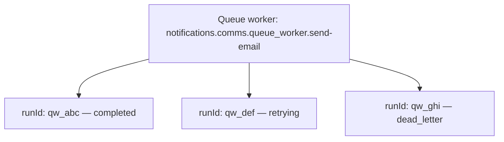
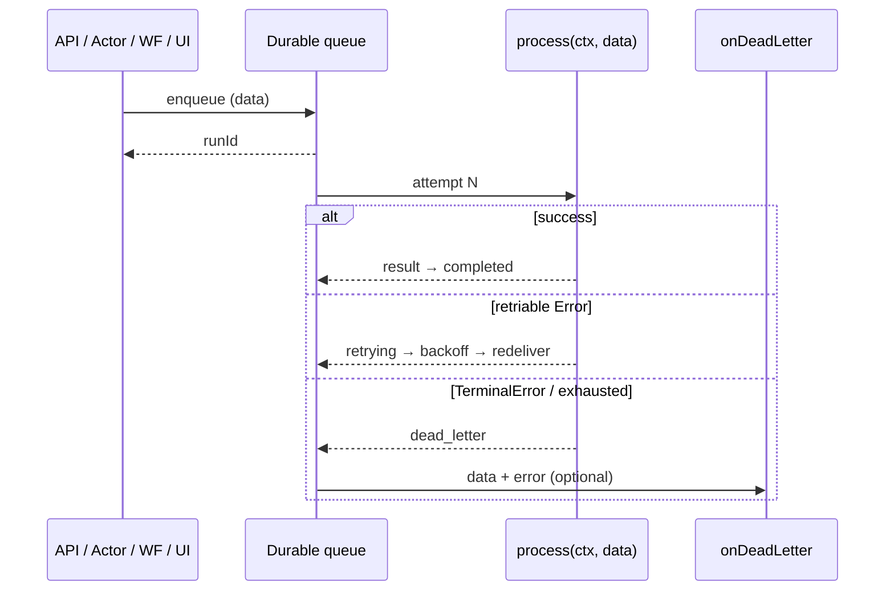

import {
  Callout,
  Cards,
  Details,
  Steps,
  Summary,
  Tabs,
} from 'nextra/components'

export const metadata = {
  title: 'Queue Worker Unit',
}

# Queue Worker Unit

A **queue worker unit** is a stateless, durable background-job processor: each run executes start-to-finish (no suspend / replay), jobs are persisted until handled, and failures retry with backoff until success or dead letter. Use it for fire-and-forget work that must leave the request path — emails, webhooks, media processing, imports, fan-out side effects.

The AI authors the unit (path, `Input` / `Output`, process handler, retries, batch, dead letter). You enqueue runs and operate them through the dashboard **Live interaction** client (or from other units via `@sdk`) after the worker is released.

The **unit path** of a queue worker unit is:

```
{context}.{module}.queue_worker.{unit_name}
```

Example: `notifications.comms.queue_worker.send-email`

The AI uses this path when wiring SDK calls and `@units/…` type imports. You work with the unit through the dashboard — you do not construct the path yourself.

<Callout type="important">
A queue worker is a **single background job**, not a long-lived entity and not a multi-step saga. For carts / balances keyed by id, use an **actor**. For multi-step orchestration with sleeps and approvals, use a **workflow**. For a public HTTP entry point, use an **API**.
</Callout>

## What they are for

| Use case | Why a queue worker unit |
| --- | --- |
| Email / SMS / push | Leave the HTTP path; retry transient provider failures |
| Webhook delivery | Fan-out with backoff; park poison messages in DLQ |
| Image / video / PDF jobs | CPU or I/O heavy work without blocking APIs |
| Import / export / sync | Burst jobs that must not stampede third-party APIs |
| Post-checkout side effects | Receipts, analytics, warehouse notify after order success |
| Compensation / alerts | `onDeadLetter` notifies ops when a job is permanently stuck |

Queue workers are **not** request-scoped. Short HTTP work belongs in an **API** unit; multi-step orchestration in a **workflow**; entity state in an **actor**; shared helpers in a **common** unit.

### Example scenarios

- **Welcome email** — Checkout API enqueues `notifications.comms.queue_worker.send-welcome`. Retries on provider blips; `onDeadLetter` alerts ops if the address is permanently invalid.
- **Webhook fan-out** — After payment, a worker delivers partner webhooks. Transient HTTP errors retry; `TerminalError` for 4xx “never retry” responses goes straight to DLQ.
- **Bulk receipt batch** — Nightly worker with `batch: { size, timeout }` aggregates many small enqueue calls into one provider API call.
- **Order side effects** — Fulfillment workflow steps enqueue independent jobs (email, PDF, warehouse) so the saga does not wait on each delivery.
- **Entity update from a job** — Worker calls an actor (`callActorAndWaitForResultSync`) to bump a counter or mark a notification as sent — still fire-and-forget from the original API’s point of view.

## Unit vs run

| Concept | Meaning |
| --- | --- |
| **Queue worker unit** | The definition (`process` + optional `onDeadLetter` + metadata) |
| **Run** | One job execution addressed by `runId` (`QueueWorkerRunId`) |
| **`runId`** | Returned on enqueue; required for status, result, and cancel |



Same unit path can have many concurrent runs. Each run has its own payload, attempt counter, status, and result.

<Callout type="info">
Enqueue is always **fire-and-forget**. `sdk.enqueueWorkerSync` returns `{ runId }` as soon as the job is persisted — it does **not** wait for the worker to finish. If a caller needs the outcome in-band, use a **workflow**, or have the worker write back into an **actor** / workflow you own.
</Callout>

## How execution works

Jobs are durable. The runtime picks up a run, executes `process` once end-to-end, then either stores the result or schedules a retry / dead letter.

<Steps>
### Enqueue

Dashboard Live interaction, SDK `enqueueWorkerSync`, or private HTTP trigger persists the job and returns `{ runId, status: "queued" }`.

### Process

A worker consumer loads the unit, sets status to `processing`, and runs `process(ctx, data)`.

### Success or retry

Return a value → `completed` (result stored). Throw a normal `Error` → `retrying` with exponential backoff until `maxAttempts`. Throw `TerminalError` → skip remaining retries.

### Dead letter

When retries are exhausted or `TerminalError` is thrown, status becomes `dead_letter`. If the AI defined `onDeadLetter`, it runs once with the original data and error.
</Steps>



## Guarantees (platform-enforced)

| Guarantee | Detail |
| --- | --- |
| Durable enqueue | Job survives until completed, cancelled, or dead-lettered |
| At-least-once delivery | Design side effects to be **idempotent** under retries |
| Retry + backoff | Transient `Error` retries per `metadata.retry` |
| Terminal failures | `TerminalError` skips remaining retries → dead letter |
| Dead letter | Exhausted / terminal runs can invoke `onDeadLetter` once |
| Timeout | `metadata.timeout` kills a stuck run (counts as retriable failure) |
| Batching | `metadata.batch` flushes by size or batch timeout |
| Isolation | Different projects, stage runtimes, and production never share runs |
| Private triggers | Queue worker HTTP surface is private (dashboard / SDK), not a public internet API |

## Create and change queue workers (Develop)

There is no code editor for units. Describe the background work and failure policy; the AI chooses unit types (including queue workers when fire-and-forget jobs fit), writes the code, and wires callers.

<Steps>
### Open Develop

Select your project → sidebar **Develop** → open or start a conversation.

### Describe the behavior

Example: *“After signup, send a welcome email without slowing down the signup response. Retry if the email provider is temporarily down (up to a few tries). If it permanently fails, alert ops. When many people sign up at once, batch sends so we do not overwhelm the provider.”*

### Review the draft

The AI produces the units and updates dependents. Drafts are not live until you release.

### Release to stage

In the release controller: **Release Stage** → pick a stage runtime → **Deploy**.

### Promote when ready

**Release production** → confirm → **Deploy to production**.
</Steps>

<Callout type="info">
You do not need to name unit types (queue worker, API, …), exports, SDK helpers, or retry metadata shapes. Speak in product terms — what the job does, when it should retry, what happens on permanent failure, and what triggers it. The AI is trained on platform rules and the technical reviewer enforces them.
</Callout>

## Live interaction (dashboard)

Queue worker triggers are **private** (dashboard / SDK), not a public internet surface like API units. Prefer an **API** unit as the external gateway; use Live interaction to enqueue and operate runs.

### Stage

<Steps>
### Open a runtime

Select your project → sidebar **Runtimes** → pick the stage runtime you deployed to.

### Open units

On the runtime card → **Open Units**.

### Find the worker

Tab **All units** → queue worker unit card → toggle **Live interaction**.

### Enqueue

Tab **Enqueue run** → fill the job body → **Send**. Copy `runId` from the response (`{ runId, status: "queued" }`).

### Operate the run

Paste **Run id** (required for the other tabs). Then use:

- **Run status** — `queued` / `processing` / `retrying` / `completed` / `dead_letter` / `cancelled` / …
- **Run result** — result payload when completed (or null while pending / on DLQ without a stored result)
- **Cancel run** — cancel a queued, processing, or retrying run
</Steps>

### Production

<Steps>
### Open Units & Releases

Select your project → sidebar **Units & Releases**.

### Find and test

Tab **All units** → queue worker card → **Live interaction** → **Enqueue run** → copy `runId` → status / result / cancel as needed.
</Steps>

| Live interaction tab | What it does |
| --- | --- |
| **Enqueue run** | `POST` enqueue — returns `{ runId, status: "queued" }` |
| **Run status** | `GET` status (+ attempt / enqueuedAt) |
| **Run result** | `GET` `{ status, result }` when available |
| **Cancel run** | `POST` cancel → `{ status: "cancelled" }` |

**Run id** max **512** characters.

<Callout type="important">
Every response includes **`X-Trace-Id`**. Copy it → sidebar **Debug** → **Start Debug** → **by trace id** when something fails.
</Callout>

## Required contract (what the AI exports)

These exports power Live interaction schemas, docs, and cross-unit type imports. The technical reviewer enforces them automatically.

| Export | Rule |
| --- | --- |
| `export type Input` | Per-message payload — **required** (for batch workers: element type) |
| `export type Output` **or** `BatchOutput` | Exactly one — use `never` if the worker always throws |
| `export default queueWorker(…)` | Definition — **required** |

Forbidden: other value exports, `export { … }` / `export *`, unrelated type names.

```typescript copy filename="skeleton.ts"
import { queueWorker } from "@sdk";

export type Input = { userId: string; email: string };
export type Output = { sent: true };

export default queueWorker<Input, Output>(async (_ctx, data) => {
  // send email using data.email …
  return { sent: true };
});
```

Other units can import types only:

```typescript copy
import type { Input, Output } from "@units/notifications.comms.queue_worker.send-email";
```

Runtime value imports from queue workers are **not** allowed — use `@sdk` to enqueue them, or put shared helpers in a **common** unit.

## Patterns the AI writes

### Simple handler form

```typescript copy filename="notifications.comms.queue_worker.double.ts"
import { queueWorker } from "@sdk";

export type Input = { x: number };
export type Output = { doubled: number; form: "simple" };

export default queueWorker<Input, Output>(async (_ctx, data) => {
  return { doubled: data.x * 2, form: "simple" };
});
```

### Full form (`process` + `onDeadLetter`)

```typescript copy filename="notifications.comms.queue_worker.send-email.ts"
import { queueWorker } from "@sdk";

export type Input = { x: number };
export type Output = { doubled: number; form: "full" };

export default queueWorker<Input, Output>({
  async process(_ctx, data) {
    return { doubled: data.x * 2, form: "full" };
  },
  async onDeadLetter(_ctx, _data, _error) {
    // alert ops, compensate, park poison payload…
  },
});
```

### Context fields

Every run sees:

| Field | Meaning |
| --- | --- |
| `ctx.id` | This run’s `QueueWorkerRunId` (UUID) |
| `ctx.attempt` | **1-based** attempt counter (increments on retry) |
| `ctx.enqueuedAt` | Enqueue time as Unix ms |
| `ctx.TerminalError` | Throw to skip remaining retries → dead letter |

```typescript copy filename="ops.jobs.queue_worker.ctx-probe.ts"
import { queueWorker } from "@sdk";

export type Input = Record<string, never>;
export type Output = {
  id: string;
  attempt: number;
  enqueuedAt: number;
};

export default queueWorker<Input, Output>(async (ctx) => {
  return {
    id: ctx.id,
    attempt: ctx.attempt,
    enqueuedAt: ctx.enqueuedAt,
  };
});
```

### Retry until success

```typescript copy filename="billing.jobs.queue_worker.retry-until-ok.ts"
import { queueWorker } from "@sdk";

export type Input = Record<string, never>;
export type Output = { finalAttempt: number; ok: true };

export default queueWorker<Input, Output>({
  metadata: {
    retry: {
      maxAttempts: 5,
      initialInterval: { seconds: 1 },
      maxInterval: { minutes: 1 },
      backoffFactor: 2,
    },
  },
  async process(ctx) {
    if (ctx.attempt < 5) {
      throw new Error(`failing on attempt ${ctx.attempt}`);
    }
    return { finalAttempt: ctx.attempt, ok: true };
  },
});
```

Defaults when retry metadata is omitted: **3** attempts, **1s** initial interval, backoff factor **2**, max interval **5 minutes**.

Payload is preserved across retries. Only the **successful** attempt’s return value is stored as the result.

### TerminalError (skip retries)

```typescript copy filename="billing.jobs.queue_worker.non-retriable.ts"
import { queueWorker } from "@sdk";

export type Input = Record<string, never>;
export type Output = never;

export default queueWorker<Input, never>({
  metadata: { retry: { maxAttempts: 10 }, deadLetter: { enabled: true } },
  async process(ctx) {
    throw new ctx.TerminalError("non-retriable: skip retries immediately");
  },
  async onDeadLetter() {},
});
```

Use `TerminalError` for permanent failures (invalid address, 4xx “do not retry”, business rejection). Use a normal `Error` for transient failures (timeouts, 5xx, network blips).

### Dead letter after exhausted retries

```typescript copy filename="ops.jobs.queue_worker.always-fail.ts"
import { queueWorker } from "@sdk";

export type Input = Record<string, never>;
export type Output = never;

export default queueWorker<Input, never>({
  metadata: {
    retry: { maxAttempts: 2 },
    deadLetter: { enabled: true },
  },
  async process(ctx) {
    throw new Error(`always fails (attempt ${ctx.attempt})`);
  },
  async onDeadLetter(_ctx, _data, _error) {
    // receives original data + error message
  },
});
```

<Tabs items={['DLQ behavior', 'Notes']}>
  <Tabs.Tab>
    Exhausted retries or `TerminalError` → status `dead_letter` → optional `onDeadLetter(ctx, data, error)`.
  </Tabs.Tab>
  <Tabs.Tab>
    - Without `onDeadLetter`, the run still ends as `dead_letter` (result may be null).
    - If `onDeadLetter` itself throws, the run **stays** `dead_letter` — no infinite loop.
    - DLQ handler receives the **original** enqueue payload and the failure error.
  </Tabs.Tab>
</Tabs>

### Timeout (retriable)

```typescript copy filename="ops.jobs.queue_worker.timeout-retry.ts"
import { queueWorker } from "@sdk";

export type Input = Record<string, never>;
export type Output = { attempt: number; ok: true };

export default queueWorker<Input, Output>({
  metadata: {
    timeout: 500,
    retry: { maxAttempts: 3 },
  },
  async process(ctx) {
    if (ctx.attempt < 2) {
      await new Promise((resolve) => setTimeout(resolve, 5000));
    }
    return { attempt: ctx.attempt, ok: true };
  },
});
```

Timeouts hard-kill the run and count as a **retriable** failure (then DLQ if attempts are exhausted).

### Batch processing

When `metadata.batch` is set, the AI exports `BatchOutput` and `process` receives an **array** of items. Flush happens when `size` is reached or the batch `timeout` elapses (partial batches included).

```typescript copy filename="analytics.jobs.queue_worker.batch-ingest.ts"
import { queueWorker } from "@sdk";

export type Input = { item: string };
export type BatchOutput = { count: number; items: string[] };

export default queueWorker<Input[], BatchOutput>({
  metadata: { batch: { size: 3, timeout: "10s" } },
  async process(_ctx, items) {
    return { count: items.length, items: items.map((i) => i.item) };
  },
});
```

<Callout type="warning">
A failure inside a batch retries the **whole batch**, not a single item. Keep batch side effects idempotent.
</Callout>

### Enqueue from another unit (API / actor / worker)

```typescript copy filename="enqueue-from-anywhere.ts"
import { sdk } from "@sdk";

const { runId } = sdk.enqueueWorkerSync<{ value: number }>({
  unitPath: "ops.jobs.queue_worker.echo",
  data: { value: 42 },
});
// runId is a QueueWorkerRunId — poll status/result via Live interaction or HTTP
```

Worker → worker fan-out:

```typescript copy filename="ops.jobs.queue_worker.fan-out-a.ts"
import { queueWorker, sdk } from "@sdk";

export type Input = { value: number };
export type Output = { enqueuedRunId: string };

export default queueWorker<Input, Output>(async (_ctx, data) => {
  const { runId } = sdk.enqueueWorkerSync<{ value: number }>({
    unitPath: "ops.jobs.queue_worker.fan-out-b",
    data: { value: data.value },
  });
  return { enqueuedRunId: runId };
});
```

Actor → worker:

```typescript copy filename="shop.cart.actor.enqueue-job.ts"
import { actor, sdk } from "@sdk";

export type State = { enqueuedRunId: string | null };
export type TriggerWorkerInput = { value: number };
export type TriggerWorkerOutput = { runId: string };

export default actor<State>({
  state: { enqueuedRunId: null },
  handlers: {
    triggerWorker(ctx, { value }: TriggerWorkerInput): TriggerWorkerOutput {
      const { runId } = sdk.enqueueWorkerSync<{ value: number }>({
        unitPath: "ops.jobs.queue_worker.echo",
        data: { value },
      });
      ctx.state.enqueuedRunId = runId;
      return { runId };
    },
  },
});
```

### Call a workflow from a worker

Outside workflows, blocking SDK helpers are called directly (no `await` on `*Sync`):

```typescript copy filename="ops.jobs.queue_worker.call-workflow.ts"
import { queueWorker, sdk } from "@sdk";

export type Input = { n: number };
export type Output = { n: number; doubled: number; workerDone: true };

export default queueWorker<Input, Output>(async (_ctx, data) => {
  const result = sdk.callWorkflowAndWaitForOutputSync<
    { n: number },
    { n: number; doubled: number }
  >({
    unitPath: "ops.jobs.workflow.echo",
    input: { n: data.n },
  });
  return { n: result.n, doubled: result.doubled, workerDone: true };
});
```

### Enqueue from a workflow (step-wrapped)

Inside workflow `run`, enqueue is a **side effect** — wrap it in `ctx.run`:

```typescript copy filename="shop.orders.workflow.enqueue-receipt.ts"
import { workflow, sdk } from "@sdk";

export type Input = { value: number };
export type Output = { ok: true };

export default workflow<Input, Output>({
  run: async (ctx, input) => {
    await ctx.run("enqueue-receipt", () => {
      sdk.enqueueWorkerSync({
        unitPath: "ops.jobs.queue_worker.echo",
        data: { value: input.value },
      });
    });
    return { ok: true };
  },
});
```

<Callout type="info">
Sync SDK helpers return plain values — unit code must not `await sdk.xxxSync(…)`.
</Callout>

## Metadata the AI may set

| Field | Role |
| --- | --- |
| `retry` | `RetryPolicy`: `maxAttempts`, `initialInterval`, `maxInterval`, `backoffFactor` |
| `timeout` | Max execution time (ms) before the run is killed |
| `batch` | `{ size, timeout }` — collect items, deliver as an array |
| `concurrency` | Intended max in-flight runs for this worker |
| `rateLimit` | Intended `{ max, window }` cap on starts per window |
| `deadLetter` | `{ enabled }` — DLQ intent alongside `onDeadLetter` |

Describe retry, batching, and timeout needs in product language; the AI fills metadata. You do not need to name metadata fields.

## Calling other units from a queue worker

| Goal | SDK helper | Notes |
| --- | --- | --- |
| Enqueue another job | `sdk.enqueueWorkerSync` | Fire-and-forget; returns `{ runId }` |
| Call actor and wait | `sdk.callActorAndWaitForResultSync` | Blocks this run until the handler returns |
| Actor fire-and-forget | `sdk.sendActorMessageSync` | Until enqueue ack |
| Wait for workflow output | `sdk.callWorkflowAndWaitForOutputSync` | Blocks this run; default wait **300s** |
| Start workflow, return | `sdk.startWorkflowSync` | Until start ack |
| Signal a running workflow | `sdk.callWorkflowHandlerAndWaitForResultSync` | Needs `instanceId` |
| Secrets / env | `sdk.getSecureEnv` | Keys from dashboard **Variables** |

Secrets belong in dashboard **Variables** (Select project → **Variables**). The AI discovers configured keys automatically.

## Persistence isolation

| Concern | Behavior |
| --- | --- |
| Same unit path on stage A vs stage B vs production | Separate queues and runs — never shared |
| Same unit path, different revisions, same runtime | Same state and data — revisions share persistence on that runtime |
| SDK chains (worker → worker / actor / workflow) | Stay in the caller’s runtime scope |
| Homonymous paths | Same path string on different runtimes never share jobs |
| Cross-project SDK / status | Not allowed — same `project_id` only (wrong project → 404) |

Test workers on the stage runtime you released to before promoting. Cancelling a stage run does not affect production.

## Limits and operational notes

| Topic | Detail |
| --- | --- |
| Auth | Private trigger — not the public API surface |
| Enqueue response | `{ runId, status: "queued" }` |
| Statuses | `queued` · `processing` · `retrying` · `completed` · `dead_letter` · `cancelled` · `failed` |
| Run id | Up to **512** characters |
| Return value | Any JSON-serializable value; `undefined` stored as `null` |
| Default retry | **3** attempts, 1s / ×2 / 5m cap |
| Cancel | OK for queued / processing / retrying; rejected after terminal states; cancel is idempotent |
| Concurrent enqueues | Safe — each gets a unique `runId` |
| Project isolation | SDK calls stay inside the same project |
| Observability | Response **`X-Trace-Id`** → **Debug** → **by trace id** |

## Common mistakes

<Details>
  <Summary>Expecting enqueue to wait for the job result</Summary>
  `enqueueWorkerSync` only acknowledges persistence. Poll **Run status** / **Run result** in Live interaction, or have the worker write back to an actor / workflow.
</Details>

<Details>
  <Summary>Using a queue worker as a multi-day saga</Summary>
  Workers do not suspend or replay. Long waits, human approvals, and multi-step compensation belong in a **workflow**.
</Details>

<Details>
  <Summary>Non-idempotent side effects under retry</Summary>
  Delivery is at-least-once. Ask for idempotent sends (dedupe keys at the provider, upserts, “already sent” checks) so retries are safe.
</Details>

<Details>
  <Summary>Blocking an API on worker completion</Summary>
  From an API, enqueue and return `runId` (or kick a workflow). Do not hold the HTTP response open waiting for a background job.
</Details>

<Details>
  <Summary>Expecting queue workers to be a public REST API</Summary>
  External clients should hit an **API** unit; that unit enqueues via `@sdk`. Queue worker Live interaction is for testing and ops.
</Details>

<Details>
  <Summary>Confusing path `queue_worker` with infra slug `queue-worker`</Summary>
  In the **unit path**, the type is always underscored: `queue_worker`. Hyphenated forms appear only in some infrastructure identifiers — never in the path the AI wires.
</Details>

<Details>
  <Summary>Assuming onDeadLetter can loop forever</Summary>
  If the DLQ handler throws, status stays `dead_letter`. There is no redelivery loop from DLQ failures.
</Details>

<Details>
  <Summary>Value-importing a queue worker unit</Summary>
  Only **common** units are value-importable. Enqueue workers with `@sdk`; import types with `import type` from `@units/…`.
</Details>

<Details>
  <Summary>Confusing stage and production runs</Summary>
  Same path on stage vs production are different queues. Always test on the stage runtime you released to.
</Details>

<Details>
  <Summary>Treating batch failures as per-item</Summary>
  A thrown error retries the entire batch. Prefer smaller batches or pre-validated items when one bad record must not block others.
</Details>

## Quick reference

| Item | Value |
| --- | --- |
| Role | Stateless durable background jobs with retry / DLQ / batch |
| Unit path | `{context}.{module}.queue_worker.{unit_name}` (chosen by AI) |
| Entry point | `export default queueWorker(…)` or `queueWorker({ process, onDeadLetter?, metadata? })` |
| Address | `runId` (`QueueWorkerRunId`) from enqueue |
| Enqueue | `sdk.enqueueWorkerSync` → `{ runId }` (fire-and-forget) |
| Non-retriable | `throw new ctx.TerminalError(…)` |
| Context | `ctx.id` · `ctx.attempt` (1-based) · `ctx.enqueuedAt` |
| Auth | Private |
| Dashboard try-it | **Runtimes** → **Open Units** → queue worker → **Live interaction** |
| Release | **Develop** chat → **Release Stage** / **Release production** |
| Debug | Response **X-Trace-Id** → **Debug** → **Start Debug** → **by trace id** |

<Cards>
  <Cards.Card title="Units" href="/platform/units" />
  <Cards.Card title="API Unit" href="/platform/units/api-unit" />
  <Cards.Card title="Common Unit" href="/platform/units/common-unit" />
  <Cards.Card title="Actor Unit" href="/platform/units/actor-unit" />
  <Cards.Card title="Workflow Unit" href="/platform/units/workflow-unit" />
  <Cards.Card title="SDK" href="/platform/sdk" />
  <Cards.Card title="Variables" href="/platform/variables" />
  <Cards.Card title="Glossary" href="/platform/glossary" />
</Cards>
