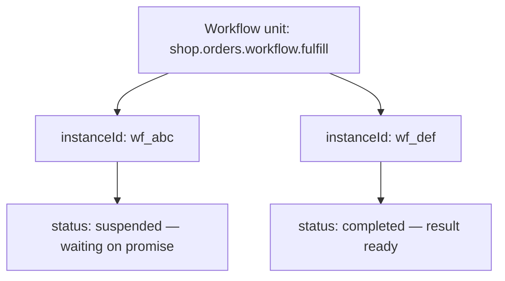
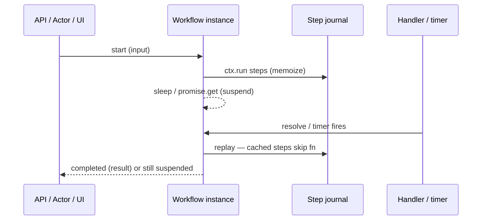
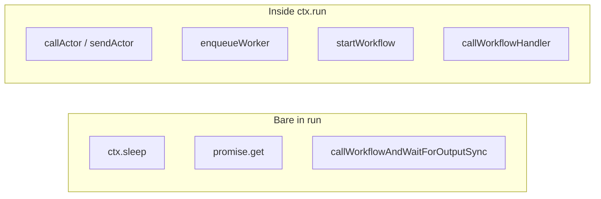

import {
  Callout,
  Cards,
  Details,
  Steps,
  Summary,
  Tabs,
} from 'nextra/components'

export const metadata = {
  title: 'Workflow Unit',
}

# Workflow Unit

A **workflow unit** is a durable, resumable multi-step process: named steps are memoized, timers and external signals suspend execution without losing progress, and the run survives crashes and redeploys. Use it for orchestrations that span minutes to days — checkouts, approvals, sagas, and anything that must finish reliably after waits or failures.

The AI authors the unit (path, `Input` / `Output`, steps, sleeps, promises, shared handlers, retries). You start instances and operate them through the dashboard **Live interaction** client (or from other units via `@sdk`) after the workflow is released.

The **unit path** of a workflow unit is:

```
{context}.{module}.workflow.{unit_name}
```

Example: `billing.payments.workflow.charge`

The AI uses this path when wiring SDK calls and `@units/…` type imports. You work with the unit through the dashboard — you do not construct the path yourself.

<Callout type="important">
A workflow is a **process that runs to completion**, not a long-lived entity. For carts, balances, or device twins keyed by id, use an **actor**. For a single background job, use a **queue worker**. For a public HTTP entry point, use an **API**.
</Callout>

## What they are for

| Use case | Why a workflow unit |
| --- | --- |
| Multi-step checkout / order | Charge → reserve inventory → ship; each step survives crash |
| Human / external approval | Suspend on a durable promise; resume when a handler resolves it |
| Delayed / scheduled work | Durable `sleep` for hours or days without holding a request open |
| Saga / compensation | Undo completed steps in reverse when a later step fails |
| Child orchestration | Call another workflow and wait, or start one fire-and-forget |
| Fan-out of durable steps | Parallel `ctx.run` via `Promise.all` with memoized results |

Workflows are **not** request-scoped. Short HTTP work belongs in an **API** unit; entity state in an **actor**; fire-and-forget jobs in a **queue worker**; shared helpers in a **common** unit.

### Example scenarios

- **Order fulfillment** — API starts `shop.orders.workflow.fulfill`. Steps charge payment, reserve stock, then sleep until the carrier webhook resolves a promise.
- **Subscription renewal** — Sleep until billing day, call an actor for the wallet, enqueue a receipt worker; on `TerminalError`, run compensation steps.
- **KYC / approval gate** — Start fire-and-forget; shared handler `approve` resolves the gate; status handler lets ops poll phase via Live interaction.
- **Cross-unit pipeline** — Workflow steps call actors for state, enqueue queue workers for email/PDF, and wait on a child workflow for fraud checks.

## Unit vs instance

| Concept | Meaning |
| --- | --- |
| **Workflow unit** | The definition (`run` + optional `handlers`) — like a process template |
| **Workflow instance** | One execution addressed by `instanceId` (`WorkflowInstanceId`) |
| **`instanceId`** | Returned when you start; required for handlers, status, cancel, result |



Same unit path can have many concurrent instances. Each instance has its own step journal, KV state (`ctx.set` / `ctx.get`), and status.

<Callout type="info">
Active instances for the same start can be **deduplicated**: if an instance for that unit is already `running` or `suspended`, a duplicate start may attach to the same execution rather than creating a new one. Prefer treating start as idempotent for a given business key when the AI designs the flow.
</Callout>

## How execution works

The runtime runs your `run` function, then **replays from the top** after every sleep, promise wait, or child-workflow wait. Completed `ctx.run` steps return their **cached** result — side effects inside those steps do not re-execute.

<Steps>
### Start

Dashboard Live interaction, SDK `startWorkflowSync` / `callWorkflowAndWaitForOutputSync`, or private HTTP trigger creates (or reuses) an instance and drives `run`.

### Durable steps

`await ctx.run(name, fn)` runs `fn` once; the result is journaled. On replay, the same name returns the cache without calling `fn` again.

### Suspend

Bare `ctx.sleep`, `ctx.promise(…).get()`, or `sdk.callWorkflowAndWaitForOutputSync` suspend the instance. Status becomes `suspended` until a timer, signal, or child completes.

### Resume and finish

Wakeup re-enters `run` from the top with memoized steps. When `run` returns, status is `completed` (or `failed` / `cancelled`).
</Steps>



## Guarantees (platform-enforced)

| Guarantee | Detail |
| --- | --- |
| Step memoization | Same step name → first result reused; `fn` does not re-run |
| Crash resilience | Sleep / promise / child wait survive pod restart |
| Deterministic helpers | `ctx.date.now()` / `ctx.rand.*` stable across replay |
| Per-step retry | Transient errors retry per `retryPolicy`; `TerminalError` does not |
| Isolation | Different projects, staging runtimes, and production never share instances |
| Private triggers | Workflow HTTP surface is private (dashboard / SDK), not a public internet API |

## Create and change workflows (Develop)

There is no code editor for units. Describe the product process; the AI chooses unit types (including workflows when durable multi-step work fits), writes the code, and wires callers.

<Steps>
### Open Develop

Select your project → sidebar **Develop** → open or start a conversation.

### Describe the behavior

Example: *“When a customer places an order, charge payment, reserve inventory, wait up to 24 hours for shipping approval, then send a confirmation email. If inventory reservation fails after the charge, undo the charge. The storefront should call an HTTP endpoint to start this.”*

### Review the draft

The AI produces the units and updates dependents. Drafts are not live until you release.

### Release to staging

In the release controller: **Release Stage** → pick a staging runtime → **Deploy**.

### Promote when ready

**Release production** → confirm → **Deploy to production**.
</Steps>

<Callout type="info">
You do not need to name unit types (workflow, actor, queue worker, …), exports, steps, or SDK helpers. Speak in product terms — steps, waits, approvals, undo rules, and who starts the flow. The AI is trained on platform rules and the technical reviewer enforces them.
</Callout>

## Live interaction (dashboard)

Workflow triggers are **private** (dashboard / SDK), not a public internet surface like API units. Prefer an **API** unit as the external gateway; use Live interaction to start, signal, and operate instances.

### Staging

<Steps>
### Open a runtime

Select your project → sidebar **Runtimes** → pick the staging runtime you deployed to.

### Open units

On the runtime card → **Open Units**.

### Find the workflow

Tab **All units** → workflow unit card → toggle **Live interaction**.

### Start

Tab **Start workflow** → fill input body → **Send**. Copy `instanceId` from the response.

### Operate the instance

Paste **Workflow instance id** (required for the other tabs). Optionally set **Shared handler name**. Then use:

- **Call shared handler** — signal / query (needs instance id + handler name)
- **Get status** — running / suspended / completed / failed / cancelled
- **Cancel workflow** — cancel a running or suspended instance
- **Get result (poll)** — `completed` + result, or `pending` while still in flight
</Steps>

### Production

<Steps>
### Open Units & Releases

Select your project → sidebar **Units & Releases**.

### Find and test

Tab **All units** → workflow card → **Live interaction** → **Start workflow** → copy `instanceId` → handler / status / cancel / result as needed.
</Steps>

| Live interaction tab | What it does |
| --- | --- |
| **Start workflow** | `POST` start — returns `{ instanceId, status: "running" }` |
| **Call shared handler** | `POST` invoke a `handlers` entry on a running instance |
| **Get status** | `GET` status (+ suspended info / result when available) |
| **Cancel workflow** | `POST` cancel → `{ status: "cancelled" }` |
| **Get result (poll)** | `GET` result — `completed` + result, or `pending` |

**Workflow instance id** max **512** characters. **Shared handler name** max **256** characters.

<Callout type="important">
Every response includes **`X-Trace-Id`**. Copy it → sidebar **Debug** → **Start Debug** → **by trace id** when something fails.
</Callout>

## Required contract (what the AI exports)

These exports power Live interaction schemas, docs, and cross-unit type imports. The technical reviewer enforces them automatically.

| Export | Rule |
| --- | --- |
| `export type Input` | Start payload — **required** (`void` if none) |
| `export type Output` | Completion result — **required** |
| `export type {Handler}Input` | Handler payload when the handler takes input |
| `export type {Handler}Output` | Handler return when the handler returns a value |
| `export default workflow(…)` | Definition — **required** |

Naming: PascalCase handler name + `Input` / `Output` (e.g. handler `approve` → `ApproveInput`).

Forbidden: value exports, `export { … }` / `export *`, unrelated type names.

```typescript copy filename="skeleton.ts"
import { workflow } from "@sdk";

export type Input = { orderId: string };
export type Output = { ok: boolean };
export type ApproveInput = { approved: boolean };
export type ApproveOutput = { accepted: boolean };

export default workflow({
  run: async (ctx, input) => {
    await ctx.run("mark-started", async () => {
      ctx.set("orderId", input.orderId);
    });
    const decision = await ctx.promise<ApproveInput>("approval").get({
      timeout: { hours: 24 },
    });
    return { ok: decision?.approved === true };
  },
  handlers: {
    approve: async (ctx, input?: ApproveInput): Promise<ApproveOutput> => {
      await ctx.promise<ApproveInput>("approval").resolve(input ?? { approved: false });
      return { accepted: true };
    },
  },
});
```

Other units can import types only:

```typescript copy
import type { Input, Output } from "@units/shop.orders.workflow.fulfill";
```

Runtime value imports from workflows are **not** allowed — use `@sdk` to start or signal them, or put shared helpers in a **common** unit.

## Patterns the AI writes

### Sequential durable steps

```typescript copy filename="shop.orders.workflow.pipeline.ts"
import { workflow } from "@sdk";

export type Input = { seed: number };
export type Output = {
  first: number;
  second: number;
  third: number;
  chain: string;
};

export default workflow<Input, Output>(async (ctx, input) => {
  const first = await ctx.run("increment-seed", async () => input.seed + 1);
  const second = await ctx.run("double-first", async () => first * 2);
  const third = await ctx.run("add-seed-to-second", async () => second + input.seed);
  const chain = await ctx.run("format-chain", async () => `${first}:${second}:${third}`);
  return { first, second, third, chain };
});
```

### Sleep (durable timers)

Duration may be a millisecond number or a `Duration` object (`milliseconds`, `seconds`, `minutes`, `hours`, `days`). Sleeps are suspension primitives — called bare in `run`, not inside `ctx.run`.

```typescript copy filename="ops.jobs.workflow.wait-window.ts"
import { workflow } from "@sdk";

export type Input = void;
export type Output = { startedAt: number; endedAt: number };

export default workflow<Input, Output>(async (ctx) => {
  const startedAt = await ctx.run("mark-start", async () => ctx.date.now());
  ctx.sleep("cool-down", { minutes: 30 });
  const endedAt = await ctx.run("mark-end", async () => ctx.date.now());
  return { startedAt, endedAt };
});
```

### Human / external signal (promise + handlers)

```typescript copy filename="compliance.kyc.workflow.approve.ts"
import { workflow } from "@sdk";

export type Input = void;
export type Output = { phase: "done"; signal: unknown };
export type GetStateOutput = { phase: string | null; counter: number | null };
export type SignalInput = unknown;
export type SignalOutput = { accepted: boolean };

export default workflow({
  run: async (ctx) => {
    ctx.set("phase", "waiting");
    ctx.set("counter", 42);
    const signal = await ctx.promise<unknown>("gate").get({ timeout: { hours: 24 } });
    return { phase: "done", signal };
  },
  handlers: {
    getState: async (ctx): Promise<GetStateOutput> => ({
      phase: await ctx.get("phase"),
      counter: await ctx.get("counter"),
    }),
    signal: async (ctx, input?: SignalInput): Promise<SignalOutput> => {
      await ctx.promise<unknown>("gate").resolve(input ?? "default");
      return { accepted: true };
    },
  },
});
```

<Tabs items={['Start + signal', 'Notes']}>
  <Tabs.Tab>
    Typical ops path in Live interaction: **Start workflow** → copy `instanceId` → set **Shared handler name** to `signal` → **Call shared handler** → **Get result (poll)**.
  </Tabs.Tab>
  <Tabs.Tab>
    - `.get({ timeout })` returns `null` on timeout.
    - `.reject(message)` makes `.get()` throw (catchable in `run`).
    - Resolve before wait is fine — `.get()` returns immediately.
    - Handlers do **not** run on start; only via `callWorkflowHandlerAndWaitForResultSync` or Live interaction.
    - Handlers can `get` / `resolve` / `reject` — they cannot `run`, `sleep`, or `set`.
  </Tabs.Tab>
</Tabs>

### Parallel durable steps

```typescript copy filename="analytics.batch.workflow.fan-out.ts"
import { workflow } from "@sdk";

export type Input = Record<string, never>;
export type Output = {
  a: { label: string; value: number };
  b: { label: string; value: number };
  sum: number;
};

export default workflow(async (ctx, _input: Input): Promise<Output> => {
  const [a, b] = await Promise.all([
    ctx.run("branch-a", async () => ({ label: "a", value: 21 })),
    ctx.run("branch-b", async () => ({ label: "b", value: 21 })),
  ]);
  return { a, b, sum: a.value + b.value };
});
```

### Per-step retry and TerminalError

```typescript copy filename="billing.payments.workflow.retry-step.ts"
import { workflow } from "@sdk";

export type Input = Record<string, never>;
export type Output = { ok: boolean; attempts: number };

export default workflow(async (ctx, _input: Input): Promise<Output> => {
  const result = await ctx.run(
    "custom-backoff-step",
    async () => {
      const prev = Number((await ctx.get("policy-attempt")) ?? 0);
      const next = prev + 1;
      ctx.set("policy-attempt", next);
      if (next < 5) throw new Error(`not yet: ${next}`);
      return { ok: true, attempts: next };
    },
    {
      retryPolicy: {
        maxAttempts: 12,
        initialInterval: { milliseconds: 50 },
        backoffFactor: 3,
        maxInterval: { minutes: 1 },
      },
    },
  );
  return result;
});
```

`throw new ctx.TerminalError(…)` inside a step skips remaining retries for that step (even if `maxAttempts` is large). Catch with `instanceof ctx.TerminalError` in `run` when you want compensation instead of failing the whole instance.

<Callout type="warning">
Unlike actors, **`ctx.set` inside a failing step is not rolled back** — values persist across retries. Design counters and flags knowing that.
</Callout>

### Compensation (saga undo)

```typescript copy filename="billing.payments.workflow.saga.ts"
import { workflow } from "@sdk";

export type Input = Record<string, never>;
export type Output = { compensationOrder: string[] };

export default workflow(async (ctx, _input: Input): Promise<Output> => {
  const compensations: Array<() => Promise<void>> = [];
  const compensationOrder: string[] = [];

  try {
    compensations.push(() =>
      ctx.run("undo-charge", async () => {
        compensationOrder.push("undo-charge");
      }),
    );
    await ctx.run("charge", async () => {
      ctx.set("charged", true);
    });

    compensations.push(() =>
      ctx.run("undo-reserve", async () => {
        compensationOrder.push("undo-reserve");
      }),
    );
    await ctx.run("reserve", async () => {
      ctx.set("reserved", true);
    });

    throw new ctx.TerminalError("abort-after-reserve");
  } catch (e) {
    if (e instanceof ctx.TerminalError) {
      for (const comp of [...compensations].reverse()) {
        await comp();
      }
      return { compensationOrder };
    }
    throw e;
  }
});
```

### Call child workflow and wait

Inside workflow `run`, waiting on a child is a **suspension** — call bare (do not wrap in `ctx.run`):

```typescript copy filename="fraud.checks.workflow.parent.ts"
import { workflow, sdk } from "@sdk";

export type Input = void;
export type Output = { called: true; doubled: number };

export default workflow<Input, Output>(async (ctx) => {
  void ctx;
  const result = sdk.callWorkflowAndWaitForOutputSync<
    { n: number },
    { doubled: number }
  >({
    unitPath: "fraud.checks.workflow.score",
    input: { n: 2 },
  });
  return { called: true, doubled: result.doubled };
});
```

Default wait timeout for this helper is **300_000** ms (5 minutes). Prefer `startWorkflowSync` for signal-driven or long-running children.

### Fire-and-forget start + handler signal

```typescript copy filename="ops.jobs.workflow.kickoff.ts"
import { workflow, sdk, type WorkflowInstanceId } from "@sdk";

export type Input = void;
export type Output = { instanceId: WorkflowInstanceId };

export default workflow<Input, Output>(async (ctx) => {
  const started = await ctx.run("start-child", () =>
    sdk.startWorkflowSync<{ n: number }>({
      unitPath: "ops.jobs.workflow.worker",
      input: { n: 9 },
    }),
  );

  await ctx.run("signal-child", () =>
    sdk.callWorkflowHandlerAndWaitForResultSync({
      unitPath: "ops.jobs.workflow.worker",
      instanceId: started.instanceId,
      handler: "finish",
      input: {},
    }),
  );

  return { instanceId: started.instanceId };
});
```

`startWorkflowSync` and handler calls are **side effects** — inside a parent workflow they go in `ctx.run`. Outside workflows (API / actor / queue worker), call them directly (no `await` on `*Sync` helpers).

### Actor / queue worker from a workflow

```typescript copy filename="shop.orders.workflow.touch-cart.ts"
import { workflow, sdk, type ActorInstanceId } from "@sdk";

export type Input = { actorId: string; value: number };
export type Output = { ok: boolean };

export default workflow<Input, Output>({
  run: async (ctx, input) => {
    const result = await ctx.run("call-actor", () =>
      sdk.callActorAndWaitForResultSync<{ value: number }, { ok: boolean }>({
        unitPath: "shop.cart.actor.session",
        actorId: input.actorId as ActorInstanceId,
        handler: "set",
        payload: { value: input.value },
      }),
    );

    await ctx.run("enqueue-receipt", () => {
      sdk.enqueueWorkerSync({
        unitPath: "ops.jobs.queue_worker.echo",
        data: { value: input.value },
      });
    });

    return result;
  },
});
```

<Callout type="warning">
**Never mix suspension and side effects.** Suspension primitives stay bare in `run`. Side effects stay inside `await ctx.run(…)`. Wrapping `sleep` / `promise.get` / child `callWorkflowAndWaitForOutputSync` in `ctx.run` breaks durability.
</Callout>

| Call in workflow `run` | How |
| --- | --- |
| `ctx.sleep(…)` | Bare (suspension) |
| `ctx.promise(…).get(…)` | Bare (suspension) |
| `sdk.callWorkflowAndWaitForOutputSync(…)` | Bare (durable child wait) |
| `sdk.startWorkflowSync(…)` | Inside `ctx.run` |
| `sdk.callWorkflowHandlerAndWaitForResultSync(…)` | Inside `ctx.run` |
| `sdk.callActorAndWaitForResultSync(…)` | Inside `ctx.run` |
| `sdk.sendActorMessageSync(…)` | Inside `ctx.run` |
| `sdk.enqueueWorkerSync(…)` | Inside `ctx.run` |

<Callout type="info">
Sync SDK helpers return plain values — unit code must not `await sdk.xxxSync(…)`.
</Callout>

## Suspension vs side effects (critical)



Anything **outside** `ctx.run` re-executes on every replay. Put I/O and SDK side effects inside named steps so they run once.

## Context APIs at a glance

### `WorkflowContext` (`run`)

| API | Role |
| --- | --- |
| `ctx.key` | This instance’s `WorkflowInstanceId` |
| `await ctx.run(name, fn, opts?)` | Durable memoized step (only ctx method that returns a real Promise) |
| `ctx.sleep(name, duration)` | Durable timer |
| `ctx.promise(name)` | Durable promise: `.get` / `.resolve` / `.reject` |
| `ctx.set` / `ctx.get` | Instance KV state |
| `ctx.rand.uuidv4()` / `.random()` | Deterministic RNG |
| `ctx.date.now()` | Deterministic timestamp |
| `ctx.TerminalError` | Non-retriable step failure |

### `WorkflowSharedContext` (`handlers`)

| API | Role |
| --- | --- |
| `ctx.key` | Instance id |
| `ctx.promise(name)` | `{ resolve, reject }` only |
| `ctx.get(key)` | Read KV state |

No `ctx.run`, `ctx.sleep`, or `ctx.set` in handlers.

## Calling workflows from other units

| Goal | SDK helper | Notes |
| --- | --- | --- |
| Start and return immediately | `sdk.startWorkflowSync` | Best for signal-driven / long runs |
| Start and wait for `Output` | `sdk.callWorkflowAndWaitForOutputSync` | Default timeout **300s**; avoid for human-wait flows |
| Signal / query a running instance | `sdk.callWorkflowHandlerAndWaitForResultSync` | Needs `instanceId`; default timeout **30s** |

From an **API** unit, prefer start + return `instanceId` (or enqueue / actor) so HTTP stays short. Blocking `callWorkflowAndWaitForOutputSync` from a public handler can stall the request until the whole process finishes.

Secrets belong in dashboard **Variables** (Select project → **Variables**). The AI discovers configured keys automatically via `sdk.getSecureEnv`.

## Persistence isolation

| Concern | Behavior |
| --- | --- |
| Same unit path on stage A vs stage B vs production | Separate instances and data — never shared |
| Same unit path, different revisions, same runtime | Same state and data — revisions share persistence on that runtime |
| SDK chains (workflow → child / actor / queue worker) | Stay in the caller’s runtime scope |
| Cross-project SDK calls | Not allowed — same `project_id` only |

Test workflows on the staging runtime you released to before promoting. Cancelling a staging instance does not affect production.

## Limits and operational notes

| Topic | Detail |
| --- | --- |
| Auth | Private trigger — not the public API surface |
| Start response | `{ instanceId, status: "running" }` |
| Statuses | `running` · `suspended` · `completed` · `failed` · `cancelled` |
| Instance id | Up to **512** characters |
| Handler name | Up to **256** characters |
| Child wait default | **300s** (`opts.timeoutMs` on `callWorkflowAndWaitForOutputSync`) |
| Handler call default | **30s** |
| Step / sleep / promise names | Must be unique per instance |
| Determinism | Use `ctx.date` / `ctx.rand`, not `Date.now()` / `Math.random()` |
| Project isolation | SDK calls stay inside the same project |
| Observability | Response **`X-Trace-Id`** → **Debug** → **by trace id** |

## Common mistakes

<Details>
  <Summary>Using a workflow as a long-lived entity store</Summary>
  Workflows finish. Per-entity durable state belongs in an **actor** keyed by `actorId`. Use the workflow to orchestrate; put the cart / balance / device in an actor.
</Details>

<Details>
  <Summary>Blocking an API on a human-wait workflow</Summary>
  Prefer `startWorkflowSync` from the API, return `instanceId`, and signal later via handlers or Live interaction. `callWorkflowAndWaitForOutputSync` waits until terminal state.
</Details>

<Details>
  <Summary>Wrapping sleep / promise.get / child wait in ctx.run</Summary>
  Those are suspension primitives. Wrapping them in `ctx.run` swallows the internal sentinel and breaks resume.
</Details>

<Details>
  <Summary>Putting side effects outside ctx.run</Summary>
  Code outside steps re-runs on every replay — duplicate charges, double emails, double starts. Actors, enqueue, and fire-and-forget starts belong inside named steps.
</Details>

<Details>
  <Summary>Expecting handlers to run automatically on start</Summary>
  Handlers only run when invoked externally (Live interaction or `callWorkflowHandlerAndWaitForResultSync`). They never auto-fire when the instance starts.
</Details>

<Details>
  <Summary>Assuming failed-step ctx.set rolls back</Summary>
  Workflow KV writes inside a throwing step persist across retries. That differs from actor handler rollback.
</Details>

<Details>
  <Summary>Reusing Date.now / Math.random in run logic</Summary>
  Replay needs stable values. Ask for business behavior; the AI uses `ctx.date.now()` and `ctx.rand.*`.
</Details>

<Details>
  <Summary>Expecting workflows to be a public REST API</Summary>
  External clients should hit an **API** unit; that unit starts or signals the workflow via `@sdk`. Workflow Live interaction is for testing and ops.
</Details>

<Details>
  <Summary>Value-importing a workflow unit</Summary>
  Only **common** units are value-importable. Call workflows with `@sdk`; import types with `import type` from `@units/…`.
</Details>

<Details>
  <Summary>Confusing staging and production instances</Summary>
  Same path on staging vs production are different executions. Always test on the staging runtime you released to.
</Details>

## Quick reference

| Item | Value |
| --- | --- |
| Role | Durable multi-step orchestration with sleep, signals, and compensation |
| Unit path | `{context}.{module}.workflow.{unit_name}` (chosen by AI) |
| Entry point | `export default workflow(…)` or `workflow({ run, handlers? })` |
| Address | `instanceId` (`WorkflowInstanceId`) from start |
| Start (fire-and-forget) | `sdk.startWorkflowSync` → `{ instanceId }` |
| Start and wait for output | `sdk.callWorkflowAndWaitForOutputSync` |
| Signal / query | `sdk.callWorkflowHandlerAndWaitForResultSync` |
| Durable step | `await ctx.run(name, fn, { retryPolicy? })` |
| Timer | `ctx.sleep(name, duration)` |
| External wait | `ctx.promise(name).get({ timeout? })` |
| Non-retriable | `throw new ctx.TerminalError(…)` |
| Auth | Private |
| Dashboard try-it | **Runtimes** → **Open Units** → workflow → **Live interaction** |
| Release | **Develop** chat → **Release Stage** / **Release production** |
| Debug | Response **X-Trace-Id** → **Debug** → **Start Debug** → **by trace id** |

<Cards>
  <Cards.Card title="Units" href="/platform/units" />
  <Cards.Card title="API Unit" href="/platform/units/api-unit" />
  <Cards.Card title="Common Unit" href="/platform/units/common-unit" />
  <Cards.Card title="Actor Unit" href="/platform/units/actor-unit" />
  <Cards.Card title="Queue Worker Unit" href="/platform/units/queue-worker-unit" />
  <Cards.Card title="SDK" href="/platform/sdk" />
  <Cards.Card title="Variables" href="/platform/variables" />
  <Cards.Card title="Glossary" href="/platform/glossary" />
</Cards>
